# Object Detection Loss Zoo
[TOC]

Focus on object detection loss function

## Problem Line Summary

loss为什么要发展呢？因为我们发现很多loss不能很好地描述我们想要的内容，比如分类和定位的统一，比如质量的估计，如何处理不确定性，以及最后我们要使用的confidence ranking

## Basic Loss

### L1 Loss

- Takeaway: 最草率reg loss

- Core Mechanism
  $$
  \ell(x, y) = L = \{l_1,\dots,l_N\}^\top, \quad
  l_n = \left| x_n - y_n \right|,
  $$

### L2 Loss MSE

- Core Mechanism
  $$
  \ell(x, y) = L = \{l_1,\dots,l_N\}^\top, \quad
  l_n = \left( x_n - y_n \right)^2,
  $$

### smooth L1 Loss

> introduces by Fast R-CNN

- Core Mechanism:

  对单一维度的回归误差
  $$
  x = y - y^{gt}
  $$
  Smooth L1 定义为
  $$
  \mathrm{SmoothL1}(x) =
  \begin{cases}
  0.5 x^2, & |x| < 1 \\
  |x| - 0.5, & \text{otherwise}
  \end{cases}
  $$
  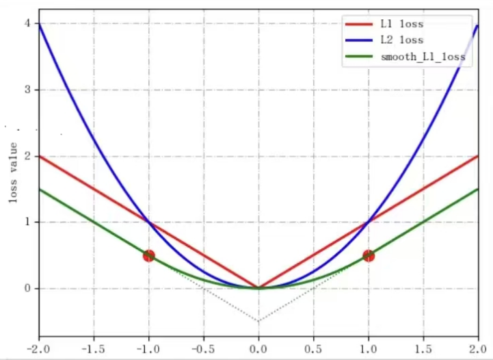

- Pros

  - 相比 L2，避免了大误差带来的梯度爆炸，对 outliers less sensitive
  - 相比 L1，在小误差区域提供连续梯度，收敛更快
  
- Cons

  - 回归目标是参数偏移，不直接反映定位质量

### CE Loss

- Takeaway: 经典分类损失cross entropy交叉熵损失

- Core Mechanism
  $$
  \ell(x, y) = L = \{l_1,\dots,l_N\}^\top, \quad
  l_n = - w_{y_n} \log \frac{\exp(x_{n,y_n})}{\sum_{c=1}^C \exp(x_{n,c})}
  \cdot \mathbb{1}\{y_n \not= \text{ignore\_index}\}
  $$
  where $x$ is the input, $y$ is the target, $w$ is the weight, $C$ is the number of classes, and $N$ spans the minibatch dimension as well as $d_1, ..., d_k$ for the K\-dimensional case. 

### BCE Loss

- Takeaway: 经典二分类损失

- Core Mechanism
  $$
  \ell(x, y) = L = \{l_1,\dots,l_N\}^\top, \quad
  l_n = - w_n \left[ y_n \cdot \log x_n + (1 - y_n) \cdot \log (1 - x_n) \right],
  $$
  BCE with logits loss: a sigmoid layer+BCE loss

## Focal Loss

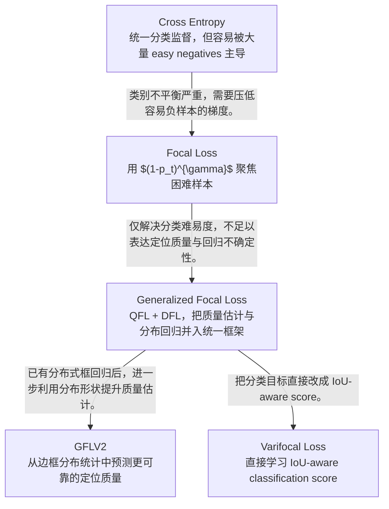

### Focal Loss

- __Focal Loss for Dense Object Detection.__ *Tsung-Yi Lin et al.* __IEEE Transactions on Pattern Analysis and Machine Intelligence, 2017__ [(Arxiv)](https://arxiv.org/abs/1708.02002) [(S2)](https://www.semanticscholar.org/paper/1a857da1a8ce47b2aa185b91b5cb215ddef24de7) (Citations __3113__)

  - Takeaway: 在CE loss上加了调制因子来解决imbalance的问题

  - Motivation:  positive vs. negative class imbalance and easy vs. hard example imbalance

  - Core Mechanism: 这里用BCE写公式

    - **Focal Loss**: addresses the **easy vs. hard example problem**
      $$
      \mathrm{FL}(p_t) = -(1-p_t)^{\gamma}\log(p_t),\quad p_t =
      \begin{cases}
      p & \text{if } y=1\\
      1-p & \text{if } y=0
      \end{cases}
      $$
      where $\gamma \ge 0$ is the focusing parameter.

      - If an example is easy, $p_t$ is near 1, then $(1-p_t)^\gamma$ is near 0, so its loss contribution is heavily reduced.
      - If an example is hard, $p_t$ is small, the modulating factor stays large, so it gets more weight.

    - **Alpha-balanced Focal Loss**: addresses the **positive vs. negative class imbalance problem**
      $$
      \mathrm{FL}(p_t) = -\alpha_t (1-p_t)^{\gamma}\log(p_t),\quad \alpha_t =
      \begin{cases}
      \alpha & \text{if } y=1\\
      1-\alpha & \text{if } y=0
      \end{cases}
      $$

  - Cons: adds hyperparameters $\gamma$ (common $\gamma$ = 2) and $\alpha$ that need tuning

### GFL

- __Generalized Focal Loss: Learning Qualified and Distributed Bounding Boxes for Dense Object Detection.__ *Xiang Li et al.* __ArXiv, 2020__ [(Arxiv)](https://arxiv.org/abs/2006.04388) [(S2)](https://www.semanticscholar.org/paper/da60e046aac895b5775ed34bde45beb86aad0fe8) [(Code)](https://github.com/implus/GFocal?tab=readme-ov-file) [大白话](https://zhuanlan.zhihu.com/p/147691786)(Citations __1544__)

  - Takeaway: combine cls and reg score + distribution reg

  - Motivation:

    Consider three fundamental elements: **quality estimation, classification and localization**

    - Con 1: cls and reg统一的问题，要么分别独立，要么使用时joint起来（not end-to-end Trained independently but compositely utilized during inference）

      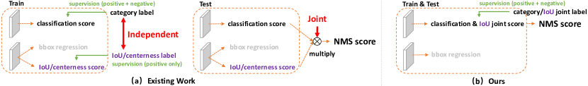

    - Con 2: reg`s supervision is only assigned for positives. 负样本的表现不可控

    - Con 3: Inflexible representation of bounding boxes:

      Deterministic box regression (Dirac delta distribution for localization) is inflexible when boundaries are uncertain (occlusion, blur, crowded scenes). 我们希望用一种general的分布去建模边界框的表示, so we want a "distribution"

      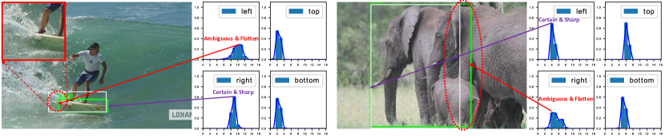
      

  - Core Mechanism:

    two loss: Quality Focal Loss (QFL), Distribution Focal Loss (DFL) and summarize them into GFL

    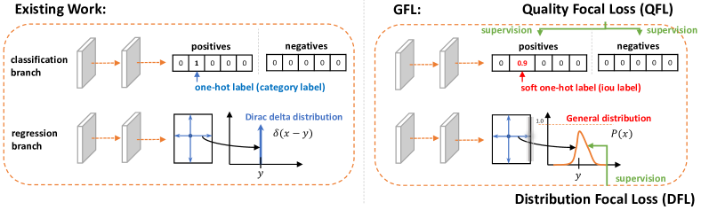

    **QFL (Quality Focal Loss):** 

    - Takeaway: 让cls score带有localization quality info

    - Core Mechanism

      用软标作为gt监督信号
      $$
      \mathrm{QFL}(p,y)
      =
      |y - p|^{\beta}
      \left(
      - y \log p - (1-y)\log(1-p)
      \right).
      $$

      $y\in[0,1]$ 是监督目标，对负样本，$y=0$，对正样本目标类别，$y=q$（通常为 IoU）

      - 正样本把分数学成质量值: 正样本时如果 $p$ 偏离 $y$ 很大，loss 被放大

      - 负样本依旧具有 focal 的“抑制容易负样本”效果

    **DFL (Distribution Focal Loss):** 

    - Takeaway: 让reg 表达positioning uncertainty

    - Core Mechanism

      For bounding box regression, each side offset is modeled as a **discrete distribution**.

      Let the continuous regression target be
      $$
      y \in [0, n],
      $$
      and the predicted distribution be
      $$
      \mathbf{p} = (p_0, p_1, \dots, p_n),
      \quad \sum_{i=0}^{n} p_i = 1.
      $$

      最终得到的预测值为
      $$
      \hat{y}
      =
      \sum_{i=0}^{n} P(i)i
      $$
      但是在监督训练的时候只用$y_{gt}$的左右两边的值进行两邻居加权 CE
      $$
      i = \lfloor y \rfloor, \quad i+1 = \lceil y \rceil.
      $$

      $$
      \mathrm{DFL}(\mathbf{p}, y)
      =
      - \big(
      (y_{i+1}-y)\log p_i
      +
      (y - y_i)\log p_{i+1}
      \big),
      $$

    GFL： QFL+DFL+IoU loss

    $$
    \mathcal{L}
    =
    \frac{1}{N_{\text{pos}}}
    \sum_i \mathcal{L}_{\text{QFL},i}
    +
    \frac{1}{N_{\text{pos}}}
    \sum_i \mathbb{1}_{\{i \in \text{pos}\}}
    \left(
    \mathcal{L}_{\text{IoU},i}
    +
    \mathcal{L}_{\text{DFL},i}
    \right).
    $$

| Component  | Hyperparameter | Typical value              |
| ---------- | -------------- | -------------------------- |
| Focal Loss | $\gamma$       | 2.0                        |
| Focal Loss | $\alpha$       | 0.25 (often omitted later) |
| QFL        | $\beta$        | 2.0                        |
| DFL        | reg_max        | 16                         |
| DFL        | weight         | 0.25                       |

### GFLv2

- __Generalized Focal Loss V2: Learning Reliable Localization Quality Estimation for Dense Object Detection.__ *Xiang Li et al.* __2021 IEEE/CVF Conference on Computer Vision and Pattern Recognition (CVPR), 2020__ [(Arxiv)](https://arxiv.org/abs/2011.12885) [(S2)](https://www.semanticscholar.org/paper/cd9a2b4578fbd812fea5d31e5b8e778f13e352c0) [(code)](https://github.com/implus/GFocalV2?tab=readme-ov-file) [大白话](https://zhuanlan.zhihu.com/p/313684358)(Citations __282__)

  - Takeaway: 从DFL的离散分布中获得更好的quality estimation.

  - Core Mechanism

    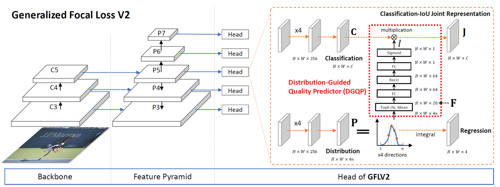

    - **DGQP predicts IoU from distribution statistics**
      For each side $w\in\{l,r,t,b\}$, the discrete distribution is
      $$
      P_w=[P_w(y_0),P_w(y_1),\dots,P_w(y_n)]
      $$
      Build a statistical feature by concatenating Top k values plus the mean from each side distribution
      $$
      F=\mathrm{Concat}\big(\mathrm{Topk}_m(P_w)\mid w\in\{l,r,t,b\}\big)
      $$
      Then DGQP maps $F$ to an IoU scalar with two FC layers
      $$
      I=\mathcal{F}(F)=\sigma\big(W_2\,\delta(W_1F)\big)
      $$
      The paper reports a typical setting $k=4$, hidden dim $p=64$.
      $$
      J=C\times I
      $$
      where $C=[C_1,\dots,C_m]$ and $I\in[0,1]$.
    
      > [!TIP]
      >
      > 如果某条边的概率高度集中在一个很窄的范围，说明模型对这条边的位置很确定；如果分布很平、很散、甚至多峰，说明模型对边界位置不确定。定位不确定通常就意味着预测框更可能和 GT 对不齐，IoU 往往更低

### Varifocal loss

- __VarifocalNet: An IoU-aware Dense Object Detector.__ *Haoyang Zhang et al.* __2021 IEEE/CVF Conference on Computer Vision and Pattern Recognition (CVPR), 2020__ [(Arxiv)](https://arxiv.org/abs/2008.13367) [(S2)](https://www.semanticscholar.org/paper/14c3510e4f4b370d5cd0420037406024533f4b6f) (Citations __854__)

  - Takeaway: 提出Varifocal Loss (VFL), 对齐cls score and iou

  - Motivation: Standard Focal Loss treats all positive samples equally, even if their IoU quality varies widely.

  - Core Mechanism

    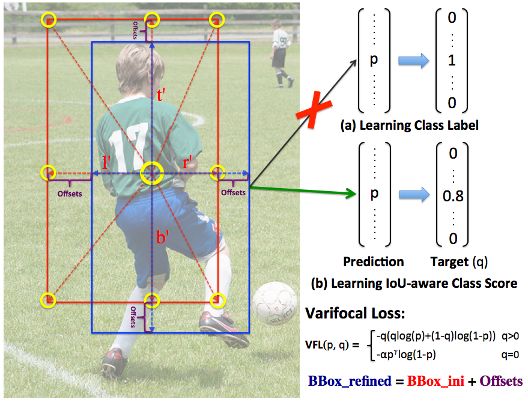

    - **Varifocal Loss (VFL)**
      软标签+强调高质量的正样本（iou高）
      $$
      \mathrm{VFL}(p,q)=
      \begin{cases}
      -q\big(q\log p + (1-q)\log(1-p)\big), & q>0 \\
      -\alpha\,p^{\gamma}\log(1-p), & q=0
      \end{cases}
      $$
      where $p$ is the predicted IoU-aware classification score and $q$ is the target (IoU).

## IoU Loss

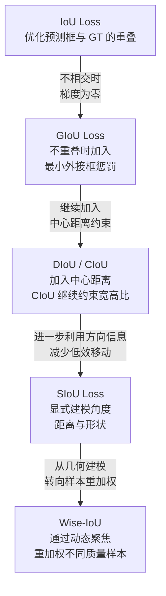

### IoU

- __UnitBox: An Advanced Object Detection Network.__ *Jiahui Yu et al.* __Proceedings of the 24th ACM international conference on Multimedia, 2016__ [(Arxiv)](https://arxiv.org/abs/1608.01471) [(S2)](https://www.semanticscholar.org/paper/22264e60f1dfbc7d0b52549d1de560993dd96e46) (Citations __1614__)

  - Core Mechanism:

    放弃了回归offset而是直接优化box overlap（虽然很多都是两者同时用）

    - Intersection over Union (IoU)
      $$
      \mathrm{IoU}(B, B^{gt}) = \frac{|B \cap B^{gt}|}{|B \cup B^{gt}|}
      $$

    - IoU Loss
      $$
      L_{\mathrm{IoU}} = 1 - \mathrm{IoU}(B, B^{gt})
      $$

  - Pros: 尺度不变性，直接反应定位质量

### GIoU

- __Generalized Intersection Over Union: A Metric and a Loss for Bounding Box Regression.__ *S. H. Rezatofighi et al.* __2019 IEEE/CVF Conference on Computer Vision and Pattern Recognition (CVPR), 2019__ [(Arxiv)](https://arxiv.org/abs/1902.09630) [(S2)](https://www.semanticscholar.org/paper/889c81b4d7b7ed43a3f69f880ea60b0572e02e27) (Citations __5066__)

  - Takeaway: Generalized IoU as both a **metric** and a **loss** for bbox reg.

  - Motivation: when two boxes **do not overlap**, IoU is zero and provides **no useful gradient**.

  - Core Mechanism: Generalized IoU

    > [!IMPORTANT]
    >
    > Idea: Add a term that measures how well the two boxes fit inside their **smallest enclosing box**.
    
    Smallest enclosing box: Let $C$ be the smallest box that encloses both $A$ and $B$.

    Generalized IoU
    $$
    \mathrm{GIoU}(A,B)=\mathrm{IoU}(A,B)-\frac{|C\setminus (A\cup B)|}{|C|}
    $$
    GIoU loss
    $$
    L_{\mathrm{GIoU}} = 1-\mathrm{GIoU}(A,B)
    $$
    - If $A$ and $B$ overlap well, the second term is small, GIoU is close to IoU.
    - If $A$ and $B$ do not overlap, IoU is 0 but the enclosing-box penalty drives the prediction toward the target.
    
  - Pros: Provides gradients even when predicted and GT boxes are disjoint.

  - Cons: slow convergence

### DIoU/CIoU

- __Distance-IoU Loss: Faster and Better Learning for Bounding Box Regression.__ *Zhaohui Zheng et al.* __ArXiv, 2019__ [(Arxiv)](https://arxiv.org/abs/1911.08287) [(S2)](https://www.semanticscholar.org/paper/63a243afcb133569a962c41e9db956c076c5c4f3) (Citations __4404__)

  - Takeaway: DIoU/CIoU add **center distance** (and **aspect ratio** for CIoU) to IoU loss for faster, better regression.

  - Motivation:

    GIou just answers how much they overlap, doesn`t answer how well they overlap.

  - Core Mechanism

    Generally, the IoU-based loss can be defined as
    $$
    \mathcal{L} = 1 - \mathrm{IoU} + \mathcal{R}(B, B^{gt})
    $$
    where $\mathcal{R}(B, B^{gt})$ is the penalty term for the predicted box $B$ and the target box $B^{gt}$. By designing proper penalty terms.

    - Distance IoU Loss

      Add a **geometric cue** into the loss -- **Center alignment**
      $$
      L_{\mathrm{DIoU}} = 1 - \mathrm{IoU}(B, B^{gt}) + \frac{\rho^2(b, b^{gt})}{c^2}
      $$
      Box centers $b$, $b^{gt}$，$\rho(\cdot,\cdot)$ is Euclidean distance，$c$ is the diagonal length of the smallest enclosing box covering both $B$ and $B^{gt}$（对角线距离）

      > [!TIP]
      >
      > 除以c是为了尺度归一化
      
      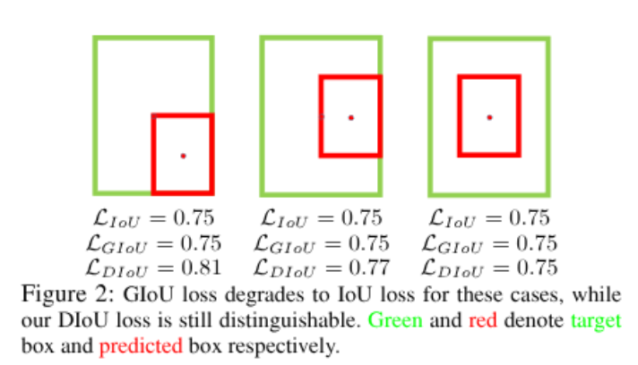
      
    - Complete IoU Loss: add an aspect ratio consistency term
    
      Idea: Align centers, overlap, and shape
      $$
      L_{\mathrm{CIoU}} = 1 - \mathrm{IoU}(B, B^{gt}) + \frac{\rho^2(b, b^{gt})}{c^2} + \alpha v
      $$
    
      $$
      v = \frac{4}{\pi^2}\left(\arctan\frac{w^{gt}}{h^{gt}} - \arctan\frac{w}{h}\right)^2
      $$
    
      $$
      \alpha = \frac{v}{(1-\mathrm{IoU}(B, B^{gt})) + v}
      $$
    
      $\alpha v$ 衡量预测框和真实框的形状是否一致
      
      - $v$ 衡量宽高比的一致性
        
      > [!NOTE]
        >
        > 为什么前面还有一个$4/\pi^2$: 为了归一化,两个角度之差不大于$\frac{\pi}{2}$
      
      - $\alpha$ 控制这个差异项的权重：动态调节形状约束的重要性
    
        - 当预测框和真实框重叠程度较低时，IoU 较小，1 - IoU 较大，此时 $\alpha$ 会比较小。模型会更关注：提高重叠程度，拉近中心点距离
    
        - 当预测框和真实框已经比较接近时，$\alpha$ 会变大。
    
    - DIoU-NMS: suggest that DIoU is a better criterion for NMS
    
  - Pros: 更快收敛

### SIoU

- __SIoU Loss: More Powerful Learning for Bounding Box Regression.__ *Zhora Gevorgyan.* __ArXiv, 2022__ [(Arxiv)](https://arxiv.org/abs/2205.12740) [(S2)](https://www.semanticscholar.org/paper/406b457cf2dc9a62417b05b755ef5434df0a4d33) (Citations __827__)

  - Takeaway: 增加**angle-aware distance** and **shape** costs

  - Core Mechanism

    SIoU = Angle cost + Distance cost + Shape cost + IoU cost

    **Overall loss**
    $$
    \Lambda=\sin\!\left(2\sin^{-1}\!\frac{\min(|x-x^{gt}|,\;|y-y^{gt}|)}{\sqrt{(x-x^{gt})^2+(y-y^{gt})^2+\epsilon}}\right)
    $$
    $$
    \Delta=\frac{1}{2}\sum_{t\in\{x,y\}}\left(1-e^{-\gamma\rho_t}\right),\quad \gamma=2-\Lambda
    $$
    $$
    \rho_x=\frac{(x-x^{gt})^2}{W_g^2},\quad \rho_y=\frac{(y-y^{gt})^2}{H_g^2}
    $$
    $$
    \Omega=\frac{1}{2}\sum_{t\in\{w,h\}}\left(1-e^{-\omega_t}\right)^{\theta},\quad \theta=4
    $$
    $$
    \omega_w=\frac{|w-w^{gt}|}{\max(w,w^{gt})},\quad \omega_h=\frac{|h-h^{gt}|}{\max(h,h^{gt})}
    $$
    $$
    L_{\mathrm{SIoU}} = 1 - \mathrm{IoU} + \frac{\Delta+\Omega}{2}
    $$
    
    - $\Lambda$ 衡量angle offset
    - $\Delta$ penalizes center distance,
    - $\Omega$ penalizes size mismatch (shape).
    
  - Pros: Faster convergence, stable

- https://arxiv.org/pdf/2101.08158

  > [!NOTE]

>
  > - FM（focus mechanism聚焦机制）：给每个样本的损失乘一个权重，权重由样本“难度/质量”决定（比如 IoU、loss 大小）。目标是抑制容易样本或噪声样本，把学习资源集中到更关键的样本上
>
  > - Non‑monotonic FM（非单调聚焦）：权重不是随着样本质量单调增加或减少，而是对“中等质量”样本给最大权重，同时压低“太差”和“太好”的样本。
  >
>   Intuition：
  >
>      - 太好（高 IoU）→ 已经学会了，少给梯度
  >      - 太差（很低 IoU / 可能是噪声）→ 少给梯度
  >      - 中等质量 → 最有学习价值，给最大权重

### Wise-IoU

- __Wise-IoU: Bounding Box Regression Loss with Dynamic Focusing Mechanism.__ *Zanjia Tong et al.* __ArXiv, 2023__ [(Arxiv)](https://arxiv.org/abs/2301.10051) [(S2)](https://www.semanticscholar.org/paper/f2a42960b362bc673638643257d65c309b7324dd) (Citations __744__)

  - Takeaway: **dynamic focusing mechanism** 减小低质量的影响，增加高质量的影响

  - Motivation

    - Standard IoU losses treat all positives similarly, so extreme outliers or very easy samples can dominate gradients.
    - Static reweighting (e.g., fixed focal terms) cannot adapt to training dynamics.

  - Core Mechanism: DIoU + dynamic focusing

    - **WIoU v1 (distance attention)**
      $$
      L_{\mathrm{WIoU}\,v1} = R_{\mathrm{WIoU}}\,L_{\mathrm{IoU}}
      $$
      $$
      R_{\mathrm{WIoU}}=\exp\!\left(\frac{(x-x^{gt})^2+(y-y^{gt})^2}{W_g^2+H_g^2}\right)
      $$
      where $W_g,H_g$ are the size of the smallest enclosing box (detached).

      - $R_{\mathrm{WIoU}}$ increases penalty when centers are far apart.
      - Detaching $W_g,H_g$ avoids unstable gradients from the enclosing box size.
    
    - **WIoU v2 (monotonic focusing)**
      $$
      L_{\mathrm{WIoU}\,v2}=r\,L_{\mathrm{WIoU}\,v1},\quad r=\left(\frac{L^*_{\mathrm{IoU}}}{L_{\mathrm{IoU}}}\right)^{\gamma}
      $$
      where $L^*_{\mathrm{IoU}}$ is the EMA of $L_{\mathrm{IoU}}$.

      - Monotonic focus: smaller IoU loss (easier samples) get lower gradient gain.
      - EMA normalization keeps gradients stable over training.

    - **WIoU v3 (dynamic non-monotonic focusing)**
      $$
      \beta=\frac{L^*_{\mathrm{IoU}}}{L_{\mathrm{IoU}}},\quad r=\frac{\beta}{\delta\alpha\beta-\delta}
      $$
      $$
      L_{\mathrm{WIoU}\,v3}=r\,L_{\mathrm{WIoU}\,v1}
      $$
    
      - Non-monotonic focus: highest gain for mid-quality samples, suppresses outliers.
      - $\beta$ adapts the focus to current batch statistics.
    
  - Pros: robust

## mIoU

- mIoU（mean Intersection over Union）

  - Takeaway

    语义分割 / 实例分割中最常见的评价指标。用于衡量预测区域和真实区域的重叠程度

  - Core Mechanism
    $$
    IoU = \frac{|A \cap B|}{|A \cup B|} \\
    假设有K个类别: mIoU = \frac{1}{K}\sum_{i=1}^{K} IoU_i
    $$

## Dice Loss

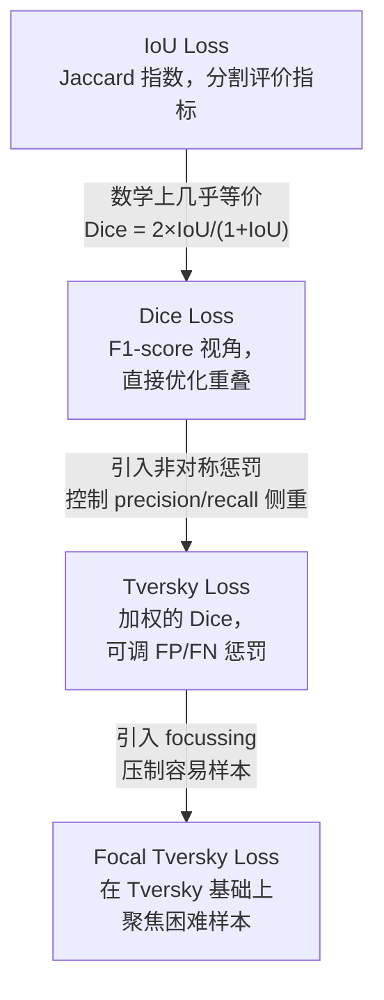

- Takeaway: F1-score like

- Core Mechanism

  - **Dice Coefficient**

    预测 mask $P$ 与 GT mask $G$ 之间的 Dice 系数（Sørensen–Dice coefficient）：

    $$
    \mathrm{Dice}(P, G) = \frac{2|P \cap G|}{|P| + |G|}
    $$

    直觉：Dice 系数是两倍的交集面积除以两者面积之和，等价于集合层面的 **F1-score**（precision 和 recall 的调和平均）。

  - **Dice Loss**

    直接最大化 Dice 系数，等价于最小化：

    $$
    L_{\mathrm{Dice}} = 1 - \mathrm{Dice}(P, G) = 1 - \frac{2\sum_i p_i g_i}{\sum_i p_i + \sum_i g_i}
    $$

    其中 $p_i \in [0,1]$ 是像素 $i$ 的预测概率，$g_i \in \{0,1\}$ 是 GT。实际使用时通常在分子分母加 smooth 项 $\epsilon$（如 $\epsilon=1$）防止除零：

    $$
    L_{\mathrm{Dice}} = 1 - \frac{2\sum_i p_i g_i + \epsilon}{\sum_i p_i + \sum_i g_i + \epsilon}
    $$

  - **与 IoU Loss 的关系**
    $$
    \mathrm{Dice} = \frac{2 \cdot \mathrm{IoU}}{1 + \mathrm{IoU}}, \qquad
    \mathrm{IoU} = \frac{\mathrm{Dice}}{2 - \mathrm{Dice}}
    $$

    两者在数学上几乎等价，梯度方向一致但形状不同：Dice Loss 在 IoU 较低时梯度更大（优化更激进），IoU Loss 在 IoU 较高时梯度更大（精细调优更有效）。实际中两者常组合使用（如 SAM 中的 $\lambda_{\text{focal}} L_{\text{focal}} + \lambda_{\text{dice}} L_{\text{dice}}$）。

### Tversky Loss

- Takeaway: 引入非对称惩罚

- Core Mechanism

  引入两个超参数 $\alpha, \beta$ 控制对 False Positive 和 False Negative 的惩罚力度：

  $$
  L_{\mathrm{Tversky}} = 1 - \frac{\sum_i p_i g_i + \epsilon}{\sum_i p_i g_i + \alpha \sum_i p_i(1-g_i) + \beta \sum_i (1-p_i)g_i + \epsilon}
  $$

  - $\alpha > \beta$：更重惩罚 FP → 提高 precision（适合病灶不能 Oversegment 的场景）
  - $\beta > \alpha$：更重惩罚 FN → 提高 recall（适合不能漏检的场景）
  - $\alpha=\beta=0.5$ 退化为 Dice Loss

### Focal Tversky Loss

- **Focal Tversky Loss**

  在 Tversky Loss 上引入 focal 机制（$\gamma$ 控制聚焦强度），压制 easy examples：

  $$
  L_{\mathrm{FTL}} = \big(L_{\mathrm{Tversky}}\big)^{\gamma}
  $$

## Relation

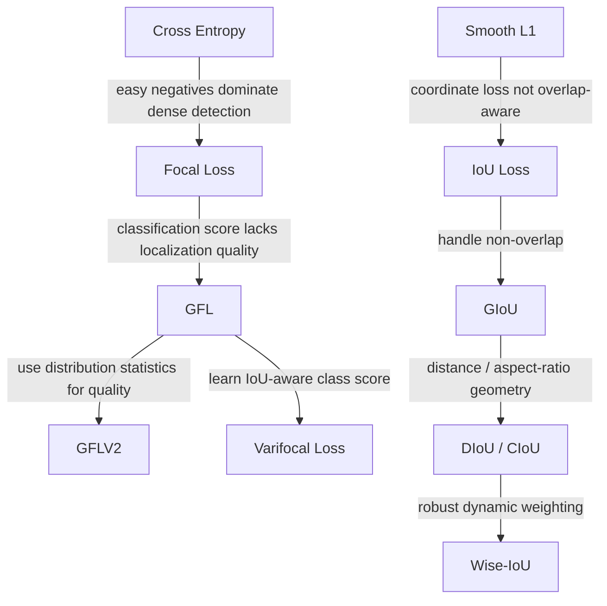

## References

- Just check the [Loss function document](https://docs.pytorch.org/docs/stable/generated/torch.nn.modules.loss.L1Loss.html) which includes the math formula and how to use it in pytorch.
