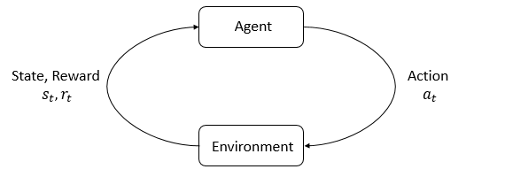

# Concepts

[TOC]

## RL interface

## MDP

- **Markov Decision Process**.

  - Takeaway: MDP 是 RL 的数学建模语言，用 state、action、reward、transition 和 initial distribution 描述 sequential decision problem。Markov property 让长期最优决策可以通过当前 state 的 value 递推。

  - Core Mechanism:

    $$
    \mathcal{M}=\langle S,A,R,P,\rho_0\rangle
    $$

    $S$ 是 valid states，$A$ 是 valid actions，$R:S\times A\times S\to\mathbb{R}$ 是 reward function，$P(s'|s,a)$ 是 transition probability，$\rho_0$ 是 start-state distribution。

    $$
    P(s_{t+1}|s_t,a_t,s_{0:t-1},a_{0:t-1})=P(s_{t+1}|s_t,a_t)
    $$

    Markov property(无后效性) 要求当前 state 已经包含预测未来所需的信息。

  - Cons:

    - 真实任务中 agent 常只能看到 observation $o_t$，不一定能看到完整 state $s_t$。

---

## Concepts

- Policy: RL真正的学习对象，是agent的行为规则$\pi(a|s)$

  - deterministic policy: $a_t=\mu(s_t)$
  - stochastic policy 输出 action distribution: $a_t\sim\pi(\cdot|s_t)$

  Deep RL 里 policy 通常由 neural network 参数化：

  $$
  \pi_\theta(a|s)
  $$

  - discrete action：$\pi_\theta(a|s)=\text{Softmax}(f_\theta(s))$

  - continuous action，常见 Gaussian policy: $\pi_\theta(a|s)=\mathcal{N}(\mu_\theta(s), \Sigma_\theta(s))$

- Trajectory probability:
  $$
  P(\tau|\pi)=\rho_0(s_0)\prod_{t=0}^{T-1}P(s_{t+1}|s_t,a_t)\pi(a_t|s_t)
  $$

- Return:

  - finite-horizon undiscounted return: $R(\tau)=\sum_{t=0}^{T}r_t$
  - infinite-horizon discounted return: $R(\tau)=\sum_{t=0}^{\infty}\gamma^t r_t$

- Optimization objective:
  $$
  \pi^*=\arg\max_\pi J(\pi),\qquad
  J(\pi)=\mathbb{E}_{\tau\sim\pi}[R(\tau)]
  $$

---

### Value Functions

- Takeaway: Value function 估计从 state 出发的长期回报，Q function 估计在 state 先做 action 后的长期回报，advantage 衡量 action 相对当前 policy 平均行为的增益。

- Core Mechanism:

  state value function:
  $$
  V^\pi(s)=\mathbb{E}_\pi[G_t|s_t=s]
  $$
  
  Action value function / Q-function:
  $$
  Q^\pi(s,a)=\mathbb{E}_\pi[G_t|s_t=s,a_t=a]
  $$
  
  advantage function:
  $$
  A^\pi(s,a)=Q^\pi(s,a)-V^\pi(s)
  $$
  
  $$
  V^\pi(s)=\mathbb{E}_{a\sim\pi}[Q^\pi(s,a)],\qquad
  V^*(s)=\max_a Q^*(s,a)
  $$
  
  如果已知 $Q^*$，可以直接得到 optimal action：
  
  $$
  a^*(s)=\arg\max_a Q^*(s,a)
  $$
  

---

### Bellman Equations

- **Bellman Equations**.

  - Takeaway: 当前价值 = 当前 reward + 下一状态价值的期望

  - Core Mechanism:

    - **Bellman expectation equation**:
      $$
      V^\pi(s)=\mathbb{E}_{a\sim\pi,s'\sim P}
      \left[r(s,a)+\gamma V^\pi(s')\right]
      $$
      
      $$
      Q^\pi(s,a)=\mathbb{E}_{s'\sim P}
      \left[r(s,a)+\gamma\mathbb{E}_{a'\sim\pi}Q^\pi(s',a')\right]
      $$
      
    - **Bellman optimality equation**:
    
      $$
      V^*(s)=\max_a\mathbb{E}_{s'\sim P}
      \left[r(s,a)+\gamma V^*(s')\right]
      $$
    
      $$
      Q^*(s,a)=\mathbb{E}_{s'\sim P}
      \left[r(s,a)+\gamma\max_{a'}Q^*(s',a')\right]
      $$

RL algorithm的本质就是在近似求解Bellman equation

## References

- [OpenAI Spinning Up: Key Concepts and Terminology](https://spinningup.openai.com/en/latest/spinningup/rl_intro.html#key-concepts-and-terminology)
- [Sutton and Barto: Reinforcement Learning: An Introduction](https://web.stanford.edu/class/psych209/Readings/SuttonBartoIPRLBook2ndEd.pdf)
