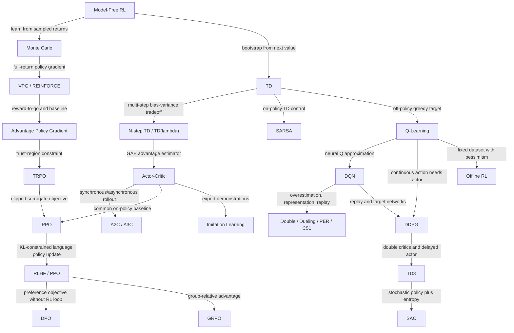

# Model-Free Reinforcement Learning

[TOC]

## Intro

- **Model-Free Reinforcement Learning**.

  - Takeaway: 不显式学习 environment dynamics，而是直接从 interaction samples 中学习 value function、Q-function 或 policy。

  - Core Mechanism:

    $$
    (s_t,a_t,r_t,s_{t+1})\sim\text{environment interaction}
    $$

    algorithm 只使用采样到的 transition 或 rollout 来构造 return、TD target、advantage 或 policy gradient，不需要显式估计 $P(s'|s,a)$。

  - Pros: easy to implement and tune

  - Cons:
  
    - sample inefficient
    - hyperparameters敏感。
    - 缺少显式 model，难以做 lookahead planning、constraint reasoning 或 counterfactual analysis。

在model-free中，主要有两种表示和训练agents方法：

1. policy optimization
2. Q-learning

---

## Prediction and Control Basics

这部分只保留一条主线：先估计 value，再用 value 改进 policy。核心区别是 target 从哪里来。

### DP

- **Dynamic Programming**.

  - Takeaway: DP 用已知 environment model 做 Bellman backup，适合理论理解和小规模已知 MDP。

  - Core Mechanism:

    Policy evaluation 估计固定策略的 value：

    $$
    V^\pi(s)
    =
    \sum_a\pi(a\mid s)
    \sum_{s',r}P(s',r\mid s,a)
    \left[r+\gamma V^\pi(s')\right]
    $$

    Policy improvement 根据 action value 变 greedy：

    $$
    \pi'(s)=\arg\max_a Q^\pi(s,a)
    $$

  - Key Point: DP 不需要采样，但必须知道 $P(s',r\mid s,a)$。

### MC

- **Monte-Carlo Methods**.

  - Takeaway: MC 用完整 episode return 直接估计 value，不需要 model，也不 bootstrap。

  - Core Mechanism:

    $$
    G_t=\sum_{k=0}^{T-t-1}\gamma^kR_{t+k+1}
    $$

    $$
    V(S_t)\leftarrow V(S_t)+\alpha\left[G_t-V(S_t)\right]
    $$

  - Key Point: target 来自真实完整回报，bias 低；但必须等 episode 结束，long horizon 下 variance 高。

### TD

- **Temporal-Difference Learning**.

  - Takeaway: TD 用一步真实 reward 加下一状态当前估计构造 target，可以在线更新。

  - Core Mechanism:

    $$
    y_t^{TD}=R_{t+1}+\gamma V(S_{t+1})
    $$

    $$
    \delta_t=y_t^{TD}-V(S_t)
    $$

    $$
    V(S_t)\leftarrow V(S_t)+\alpha\delta_t
    $$

  - Key Point: TD 介于 MC 和 DP 之间：像 MC 一样从 sample 学习，像 DP 一样 bootstrap。它 variance 较低，但会引入 bootstrap bias。

### N-step TD / TD(lambda)

- **N-step TD and TD(lambda)**.

  - Takeaway: N-step TD 和 TD($\lambda$) 在 one-step TD 与 MC 之间折中，用 $n$ 或 $\lambda$ 控制 bias-variance tradeoff。

  - Core Mechanism:

    $$
    G_t^{(n)}
    =
    R_{t+1}
    +\gamma R_{t+2}
    +\cdots
    +\gamma^{n-1}R_{t+n}
    +\gamma^nV(S_{t+n})
    $$

    $$
    G_t^\lambda
    =
    (1-\lambda)
    \sum_{n=1}^{\infty}\lambda^{n-1}G_t^{(n)}
    $$

  - Key Point: $n=1$ 或 $\lambda=0$ 接近 one-step TD；$n$ 很大或 $\lambda\to1$ 接近 MC。

### TD Control

- **TD Control**.

  - Takeaway: TD control 指用 TD target 学习可用于决策的 action-value function，并在学习过程中不断改进 policy。它不只是预测“当前 policy 有多好”，而是要学出“每个 state 该选哪个 action”。

  - Core Mechanism:

    TD prediction 通常估计 $V^\pi(s)$：给定 policy $\pi$，回答这个 state 的长期回报是多少。

    TD control 通常估计 $Q(s,a)$：回答在 state $s$ 执行动作 $a$ 后，长期回报是多少。只要有 $Q(s,a)$，policy improvement 就可以直接选高价值动作：

    $$
    \pi(s)=\arg\max_a Q(s,a)
    $$

    因此 TD control 本质上是把 **TD learning** 和 **policy improvement** 放进同一个循环：

    $$
    Q \xrightarrow{\text{TD update}} Q'
    \xrightarrow{\text{greedy or epsilon-greedy}} \pi'
    $$

  - Key Point: SARSA 和 Q-Learning 都是 TD control。SARSA 的 target 跟随实际 behavior policy；Q-Learning 的 target 直接朝 greedy policy 学。

- **SARSA vs Q-Learning**.

  - Takeaway: SARSA 和 Q-Learning 都是 TD control，区别在于下一步 target action 怎么选。

  - Core Mechanism:

    SARSA 是 on-policy，使用实际下一动作：

    $$
    y_t^{SARSA}=R_{t+1}+\gamma Q(S_{t+1},A_{t+1})
    $$

    Q-Learning 是 off-policy，使用 greedy 下一动作：

    $$
    y_t^Q=R_{t+1}+\gamma\max_{a'}Q(S_{t+1},a')
    $$

  - Key Point:

    - SARSA 学的是当前 behavior policy 的价值，探索风险会进入 target，因此更保守。
    - Q-Learning 学的是 greedy target，样本利用更灵活，但更容易 overestimate 和不稳定。

## Policy Optimization

- Takeaway: 将策略表示为$\pi_{\theta}(a|s)$，然后优化参数$\theta$

- Core Mechanism

  有几种不同的方法来优化参数

  1. 直接基于性能目标 $J(\pi_{\theta})$ 梯度上升
  2. 间接通过最大化 $J(\pi_{\theta})$ 的局部近似值来进行优化

  优化是on-policy的

  策略优化通常还涉及学习一个用于近似表示“按策略”价值函数 $V^{\pi}(s)$ 的函数 $V_{\phi}(s)$ ，该函数被用来确定如何更新策略

- Pros: 直接优化目标，稳定

- Cons: 利用样本不高效

### VPG

Vanilla Policy Gradient

- Takeaway: 直接优化 policy 参数 $\theta$，使得 expected return 最大：
  $$
  J(\theta)=\mathbb{E}_{\tau\sim \pi_\theta}[R(\tau)] \\
  \theta^*
  =
  \arg\max_\theta J(\theta)
  $$

- Core Mechanism:

  > [!NOTE]
  >
  > 推导详情自行查看spinning up，其中主要使用了一个关键的trick:
  >
  > log-derivative trick，也叫 score function trick:
  > $$
  > \nabla_\theta P(\tau|\theta) = P(\tau|\theta)\nabla_\theta \log P(\tau|\theta)
  > $$
  > 因为：
  >
  > $$
  > \nabla_\theta \log P(\tau|\theta) = \frac{\nabla_\theta P(\tau|\theta)}{P(\tau|\theta)}
  > $$

  Policy Gradient 的结论是：

  $$
  \nabla_\theta J(\theta) = \mathbb{E}_{\tau\sim \pi_\theta} \left[ \nabla_\theta \log P(\tau|\theta) R(\tau) \right]
  $$
  进一步展开 trajectory probability 后：

  $$
  \nabla_\theta J(\theta) = \mathbb{E}_{\tau\sim \pi_\theta} \left[ \sum_{t=0}^{T} \nabla_\theta \log \pi_\theta(a_t|s_t) R(\tau) \right]
  $$
  优化时做 gradient ascent：

  $$
  \theta \leftarrow \theta + \alpha \nabla_\theta J(\theta)
  $$
  增加高return的trajectory的所有action的log-probability

  实际中无法精确计算梯度，常用Monte Carlo采样进行估计计算。假设采样N条轨迹
  $$
  \hat{g}
  =
  \frac{1}{N}
  \sum_{i=1}^{N}
  \sum_{t=0}^{T}
  \nabla_\theta
  \log \pi_\theta(a_{i,t}|s_{i,t})
  R(\tau_i)
  $$

- Pros:

  - 直接优化 policy performance，stable

- Cons:

  - high variance and sample inefficient
  - 只告诉了更新方向，没告诉应该走多远


推导如下：

Step 1：定义目标函数

我们从 objective 开始：

$$J(\theta) = \mathbb{E}_{\tau\sim \pi_\theta}[R(\tau)]$$

写成积分形式：

$$J(\theta) = \int_{\tau} P(\tau|\theta)R(\tau)d\tau$$

如果是离散 trajectory space，也可以写成：

$$J(\theta) = \sum_{\tau} P(\tau|\theta)R(\tau)$$

这里：

*   $P(\tau|\theta)$：在 policy $\pi_\theta$ 下采样到 trajectory $\tau$ 的概率；

*   $R(\tau)$：这条 trajectory 的 total return；

*   $J(\theta)$：当前 policy 的平均表现。

我们希望：

$$\theta^* = \arg\max_\theta J(\theta)$$

* * *

Step 2：对目标函数求梯度

对 $J(\theta)$ 求导：

$$\nabla_\theta J(\theta) = \nabla_\theta \int_\tau P(\tau|\theta)R(\tau)d\tau$$

把梯度放进积分：

$$\nabla_\theta J(\theta) = \int_\tau \nabla_\theta P(\tau|\theta)R(\tau)d\tau$$

问题是：

$$\nabla_\theta P(\tau|\theta)$$

不好直接处理，因为 trajectory probability 是一连串 transition 和 action probability 的乘积。

所以这里使用一个非常关键的 trick：

$$\nabla_\theta P(\tau|\theta) = P(\tau|\theta)\nabla_\theta \log P(\tau|\theta)$$

因为：

$$\nabla_\theta \log P(\tau|\theta) = \frac{\nabla_\theta P(\tau|\theta)}{P(\tau|\theta)}$$

所以：

$$\nabla_\theta P(\tau|\theta) = P(\tau|\theta)\nabla_\theta \log P(\tau|\theta)$$

这个技巧叫 **log-derivative trick**，也叫 **score function trick**。

代回去：

$$\nabla_\theta J(\theta) = \int_\tau P(\tau|\theta) \nabla_\theta \log P(\tau|\theta) R(\tau)d\tau$$

写成 expectation：

$$\nabla_\theta J(\theta) = \mathbb{E}_{\tau\sim \pi_\theta} \left[ \nabla_\theta \log P(\tau|\theta)R(\tau) \right]$$

这一步非常重要：  
我们把原来难处理的 $\nabla_\theta P(\tau|\theta)$，变成了可以通过 sample trajectory 估计的形式。

* * *

Step 3：展开 trajectory probability

现在要处理：

$$P(\tau|\theta)$$

对于 trajectory：

$$\tau=(s_0,a_0,s_1,a_1,\dots,s_T,a_T)$$

它的概率是：

$$P(\tau|\theta) = \rho_0(s_0) \prod_{t=0}^{T} \pi_\theta(a_t|s_t) P(s_{t+1}|s_t,a_t)$$

其中：

*   $\rho_0(s_0)$：initial state distribution；

*   $\pi_\theta(a_t|s_t)$：policy；

*   $P(s_{t+1}|s_t,a_t)$：environment dynamics。

取 log：

$$\log P(\tau|\theta) = \log \rho_0(s_0) + \sum_{t=0}^{T} \log \pi_\theta(a_t|s_t) + \sum_{t=0}^{T} \log P(s_{t+1}|s_t,a_t)$$

对 $\theta$ 求导：

$$\nabla_\theta \log P(\tau|\theta) = \nabla_\theta \log \rho_0(s_0) + \sum_{t=0}^{T} \nabla_\theta \log \pi_\theta(a_t|s_t) + \sum_{t=0}^{T} \nabla_\theta \log P(s_{t+1}|s_t,a_t)$$

但是注意：

$$\rho_0(s_0)$$

和

$$P(s_{t+1}|s_t,a_t)$$

通常不依赖 policy 参数 $\theta$。所以：

$$\nabla_\theta \log \rho_0(s_0)=0$$

$$\nabla_\theta \log P(s_{t+1}|s_t,a_t)=0$$

因此：

$$\nabla_\theta \log P(\tau|\theta) = \sum_{t=0}^{T} \nabla_\theta \log \pi_\theta(a_t|s_t)$$

代回 policy gradient：

$$\nabla_\theta J(\theta) = \mathbb{E}_{\tau\sim \pi_\theta} \left[ \left( \sum_{t=0}^{T} \nabla_\theta \log \pi_\theta(a_t|s_t) \right) R(\tau) \right]$$

这就是最基础的 policy gradient。

#### EGLP Lemma

Expected Grad-Log-Prob (EGLP) lemma一个引理
$$
\mathbb{E}_{a\sim\pi_\theta}
\left[
\nabla_\theta \log \pi_\theta(a|s)
\right]
=
\sum_a
\pi_\theta(a|s)
\nabla_\theta \log \pi_\theta(a|s)\\
\sum_a
\pi_\theta(a|s)
\frac{\nabla_\theta \pi_\theta(a|s)}
{\pi_\theta(a|s)}
=
\sum_a
\nabla_\theta \pi_\theta(a|s)
=
\nabla_\theta
\sum_a
\pi_\theta(a|s)
=
\nabla_\theta 1
=
0
$$
也就是说
$$
\mathbb{E}_{a\sim\pi_\theta}
\left[
\nabla_\theta \log \pi_\theta(a|s) b(s_t)
\right]==0
$$
我们就可以在计算策略梯度的过程中，随意添加或删除任意数量的此类项，而不会影响其预期值

#### Reward-to-go

- Takeaway: $R(t)$不负责之前的reward

- Motivation:

  最简单公式用的是 full trajectory return：

  $$
  R(\tau)=\sum_{t=0}^{T}r_t
  $$
  但是对于时间 $t$ 的 action $a_t$，过去的 reward：

  $$
  r_0,\dots,r_{t-1}
  $$
  不应该由它负责。 Don’t Let the Past Distract You

- Core Mechanism

  把 $R(\tau)$ 换成 reward-to-go即时奖励：

  $$
  \hat{R}_t = \sum_{k=t}^{T}r_k
  $$
  或 discounted reward-to-go：

  $$
  \hat{R}_t = \sum_{k=t}^{T}\gamma^{k-t}r_k
  $$
  于是 gradient estimator 变成：

  $$
  \hat{g} = \frac{1}{N} \sum_{i=1}^{N} \sum_{t=0}^{T} \nabla_\theta \log \pi_\theta(a_{i,t}|s_{i,t}) \hat{R}_{i,t}
  $$
  这仍然是 unbiased，但 variance 更低

#### Remove baseline

- Takeaway: 减去一个baseline

- Core Mechanisms
  $$
  \nabla_\theta J(\theta)
  =
  \mathbb{E}
  \left[
  \sum_{t=0}^{T}
  \nabla_\theta \log \pi_\theta(a_t|s_t)
  \left(
  \hat{R}_t - b(s_t)
  \right)
  \right]
  $$
  只要 baseline 不依赖 action $a_t$，它不会引入 bias，进一步降低variance。

  常见 baseline 是 on-policy value function：

  $$
  b(s_t)=V^\pi(s_t)
  $$
  于是：

  $$
  \hat{R}_t - V^\pi(s_t) \approx A^\pi(s_t,a_t)
  $$
  这就得到 advantage-based policy gradient：

  $$
  \nabla_\theta J(\theta) = \mathbb{E} \left[ \sum_{t=0}^{T} \nabla_\theta \log \pi_\theta(a_t|s_t) A^\pi(s_t,a_t) \right]
  $$

  > [!NOTE]
  >
  > Intuition: 如果智能体得到了自己所期望的结果，那么它应该对此保持中立态度

  这就是后面 Actor-Critic、A2C、PPO 的核心形式

  但是实际上 $V^\pi(s_t)$ 不能被精确计算出来，需要进行近似处理：

  通过神经网络 $V_{\phi}(s_t)$ 来实现的。该神经网络会与策略同步更新，从而确保价值网络始终能够近似反映最新策略所对应的价值函数。而学习这个 $V_{\phi}$ 的最简单方法就是最小化均方误差
  $$
  \phi_k = \arg \min_{\phi} \underset{s_t, \hat{R}_t \sim \pi_k}E{\left( V_{\phi}(s_t) - \hat{R}_t \right)^2},
  $$


### TRPO

TRPO (Trust Region Policy Optimization)

- Takeaway: 在VPG上加了policy更新幅度的约束

  on-policy, 连续or离散动作空间

  > [!NOTE]
  >
  > Trust Region（信赖域）: 仅在安全区域更新（优化中的常见方法），不让学习率直接决定更新幅度，不让可能每次决策差异很大

- Core Mechanism

  对Policy Distribution使用KL Divergence进行衡量约束
  $$
  \begin{aligned}
  \max_\theta\quad&
  L(\theta)
  \\
  \text{s.t.}\quad&
  D_{KL}
  (
  \pi_{old}
  ||
  \pi_\theta
  )
  \le
  \delta
  \end{aligned}
  $$
  将目标函数换为了Surrogate Objective：

  $$
  L(\theta) = E \left[ r(\theta) A \right]
  $$
  其中$$r(\theta) = \frac{\pi_\theta} {\pi_{old}}$$，Importance Sampling Ratio

  > [!NOTE]
  >
  > Q: 为什么可以换用surrogate objective，推导如下：
  >
  > 先推导得到Performance Difference Lemma
  >
  > $$
  > J(\pi')-J(\pi) = \mathbb E_{\tau\sim\pi'} \left[ \sum_{t=0}^{\infty}\gamma^t A^\pi(s_t,a_t) \right]
  > $$
  >
  > > [!NOTE]
  > >
  > > Q: 这里我们为什么需要care这个$E_{\tau\sim\pi'} \left[ \sum_{t=0}^{\infty}\gamma^t A^\pi(s_t,a_t) \right]$呢
  > >
  > > A: 外面是$\pi\prime$，里面是$\pi$，也就是我们在新策略下走出来的trajectory，用旧策略$\pi$作为评价基准，判断action好不好。这样我们就可以衡量新的策略相比旧策略究竟好多少
  >
  > 然后近似
  > $$
  > \begin{aligned}
  > J(\pi')-J(\pi)
  > &=
  > \mathbb E_{\tau\sim\pi'}
  > \left[
  > \sum_t\gamma^tA^\pi(s_t,a_t)
  > \right]
  > &&\text{exact}
  > \\[2mm]
  > &=
  > \sum_s\rho_{\pi'}(s)
  > \sum_a\pi'(a|s)A^\pi(s,a)
  > &&\text{exact}
  > \\[2mm]
  > &\approx
  > \sum_s\rho_\pi(s)
  > \sum_a\pi'(a|s)A^\pi(s,a)
  > &&\rho_{\pi'}\approx\rho_\pi
  > \\[2mm]
  > &=
  > \sum_s\rho_\pi(s)
  > \sum_a\pi(a|s)
  > \frac{\pi'(a|s)}{\pi(a|s)}
  > A^\pi(s,a)
  > &&\text{exact IS}
  > \\[2mm]
  > &\propto
  > \mathbb E_{s,a\sim\pi}
  > \left[
  > \frac{\pi'(a|s)}
  > {\pi(a|s)}
  > A^\pi(s,a)
  > \right].
  > \end{aligned}
  > $$
  > 在旧策略附近是 first-order accurate，误差从二阶开始出现

  这里我们有几个问题需要搞清楚：

  > [!NOTE]
  >
  > Q: 为什么需要重要性采样？
  >
  > A: 因为采样数据来自$$\pi_{old}$$，不是$$\pi_\theta$$，但是我们想要评价$\pi_\theta$，因此需要换测度
  > $$
  > \begin{aligned}
  > \int p(x)f(x)\,dx
  > &=
  > \int q(x)
  > \frac{p(x)}{q(x)}
  > f(x)\,dx
  > \\
  > &=
  > \mathbb E_{x\sim q}
  > \left[
  > \frac{p(x)}{q(x)}f(x)
  > \right].
  > \end{aligned}
  > $$

  > [!NOTE]
  >
  > Q: 为什么加 KL 就稳定？-- Monotonic Improvement Guarantee单调渐进保证
  >
  > A: (见论文证明)存在一个 Lower Bound：
  >
  > $$
  > J(\theta) \ge L(\theta) - C D_{KL}^{max}
  > $$
  > 真实 Performance 至少不会比：Surrogate Objective减去KL Penalty更差。
  >
  > 所以如果KL 很小，那么Surrogate Objective 增加，真实 Reward 也几乎一定增加
  >
  > > [!TIP]
  > >
  > > 但是实际上理论推导用的max KL，真实使用中用average KL

- Pipeline

  求解（optimization），因为多了一个约束，不能直接SGD，而是采用二阶优化

  ```
  Gradient
  ↓
  Natural Gradient: 一阶泰勒展开的近似求解（拉格朗日）
  ↓
  Conjugate Gradient: H矩阵的共轭求解
  ↓
  Backtracking Line Search: 线性回溯，保证约束满足（因为泰勒展开引起误差）
  ↓
  Update
  ```

- Pros: 稳定，比VPG效率高
- Cons: 二阶太复杂，慢，难并行


### PPO

实践中常用的 on-policy actor-critic baseline

- **PPO**.

  - Takeaway: 用 clipped surrogate objective 近似 trust region

    On-policy，离散or连续动作空间

  - Motivation
  
    - TRPO：显式求解带 KL 约束的二阶优化问题；
  
    - PPO：使用一阶梯度下降，通过 **clipping** 或 **KL penalty** 近似限制策略更新
  
  - Core Mechanism:
  
    有两种变体
  
    1. PPO-Penalty 不是将 KL 散度作为硬性约束来处理，而是对目标函数中的 KL 散度部分施加惩罚
    2. PPO-Clip 在目标函数中不包含 KL 散度项，也完全没有任何约束条件。它依靠目标函数中的特殊处理机制来确保新策略不会偏离旧策略太远
  
    这里我们主要介绍PPO-Clip
  
    替代目标函数能够较为保守地估计出由于此次更新而导致的 $J(\pi_{\theta})$ 的变化幅度。
    $$
    r_t(\theta)=
    \frac{\pi_\theta(a_t|s_t)}
    {\pi_{\theta_{old}}(a_t|s_t)}
    $$
  
    $$
    L^{CLIP}(\theta)=
    \mathbb{E}_t
    \left[
    \min
    \left(
    r_t(\theta)\hat{A}_t,
    \text{clip}(r_t(\theta),1-\epsilon,1+\epsilon)\hat{A}_t
    \right)
    \right]
    $$
  
  - Pros:
  
    - 简单稳定，常用
  
  - Cons:
  
    - 仍是 on-policy，样本效率低于 SAC / TD3。
    - old log-prob 必须冻结，否则 ratio 失去意义。

### Actor-Critic


- **Actor-Critic**.

  - Takeaway: Actor-critic 用 actor 表示 policy，用 critic 估计 value 或 advantage。

    是一个整体架构

  - Core Mechanism:
    $$
    \boxed{ \text{Actor-Critic} = \underbrace{\text{Actor: }\pi_\theta(a|s)}_{\text{决策/动作}} + \underbrace{\text{Critic: }V_\phi(s)\text{ 或 }Q_\phi(s,a)}_{\text{评价/打分}} }
    $$
    
    $$
    L_\pi(\theta)=-
    \mathbb{E}_t
    \left[
    \log\pi_\theta(a_t|s_t)\hat{A}_t
    \right]
    $$

    $$
    \delta_t=r_t+\gamma V_\phi(s_{t+1})-V_\phi(s_t)
    $$

    $$
    \hat{A}_t^{GAE(\gamma,\lambda)}
    =
    \sum_{l=0}^{\infty}(\gamma\lambda)^l\delta_{t+l}
    $$

    这里的GAE很重要

    > [!NOTE]
    >
    > Q: 什么是GAE
    >
    > A: TRPO 和 PPO 中最常用的 advantage estimator 是 **Generalized Advantage Estimation, GAE(广义优势估计)**
    >
    > 先计算 TD(Temporal Difference，时序差分) residual：
    >
    > $$
    > \delta_t^V = r_t + \gamma V_\phi(s_{t+1}) - V_\phi(s_t)
    > $$
    > 无偏估计
    >
    > 然后：
    >
    > $$
    > \hat A_t^{\text{GAE}(\gamma,\lambda)} = \sum_{l=0}^{T-t-1} (\gamma\lambda)^l \delta_{t+l}^V
    > $$
    > GAE就是对n-step advantage estimator做几何加权平均
    >
    > 这里：
    >
    > *   $\lambda=0$：
    >
    > $$\hat A_t=\delta_t$$
    >
    > 接近 one-step Actor-Critic，bias 较大、variance 较小。
    >
    > *   $\lambda\to1$：
    >
    > 接近 Monte Carlo advantage，bias 较小、variance 较大。
    >
    > 因此 GAE 控制 bias-variance tradeoff

    > [!NOTE]
    >
    > 这里需要介绍一下TD target和真实$Q^\mu$的区别：
    >
    > Critic 要学习：
    >
    > $$
    > Q^{\mu}(s,a).
    > $$
    > 但真实 $Q^\mu$ 是：
    >
    > $$
    > Q^\mu(s,a) = \mathbb E \left[ \sum_{k=0}^{\infty} \gamma^kr_{t+k} \right].
    > $$
    > 直接等待 episode 结束再计算 Monte Carlo return，方差较大，而且长轨迹代价高。
    >
    > Bellman equation 提供递归关系：
    >
    > $$
    > Q^\mu(s,a) = r(s,a) + \gamma \mathbb E_{s'} \left[ Q^\mu(s',\mu(s')) \right].
    > $$
    > 因此可以使用 one-step bootstrap：
    >
    > $$
    > y = r+ \gamma Q(s',\mu(s')).
    > $$
    > 这表示：
    >
    > $$\boxed{ \text{当前动作的价值} = \text{即时奖励} + \text{下一状态之后的价值} }$$
    >
    > 实际中加入 terminal mask：
    >
    > $$
    > y = r+ \gamma(1-d) Q_{\phi^-} \left( s',\mu_{\theta^-}(s') \right).
    > $$
    
  - Pros:
  
    - Critic 降低 actor 更新的 variance。
    - GAE 提供可调的 bias-variance tradeoff。
    - 能扩展到 PPO、A2C、SAC 等现代算法。
  
  - Cons:
  
    - Critic bias 会系统性误导 actor。
    - Actor 和 critic 学习速度不匹配会导致震荡。


- A2C/A3C
  - Takeaway: 梯度上升


## Value-Based Control

- **SARSA and Q-learning**.

  - Takeaway: SARSA 和 Q-learning 都学习 action-value function；SARSA 是 on-policy，Q-learning 是 off-policy。二者差异在于 target 使用实际下一动作还是 greedy 下一动作。

  - Core Mechanism:

    - **SARSA**:

      $$
      Q(s_t,a_t)\leftarrow Q(s_t,a_t)+\alpha
      \left[r_t+\gamma Q(s_{t+1},a_{t+1})-Q(s_t,a_t)\right]
      $$

    - **Q-learning**:

      $$
      Q(s_t,a_t)\leftarrow Q(s_t,a_t)+\alpha
      \left[r_t+\gamma\max_{a'}Q(s_{t+1},a')-Q(s_t,a_t)\right]
      $$

  - Pros:

    - 离散动作下简单直接。
    - Q-learning 可复用 exploratory behavior 产生的数据。

  - Cons:

    - 连续 action 中 $\max_a Q(s,a)$ 难以直接求。

---

### Q-Learning

check 03-Algorithm


#### DQN

- **DQN**.

  - Takeaway: DQN 用 neural network 近似 $Q^*(s,a)$，并用 replay buffer 和 target network 缓解 correlated samples 与 moving target 问题，是 deep value-based RL 的经典算法。

    离散动作空间

  - Core Mechanism:

    DQN 不单独训练 Actor，而是直接训练一个 Q-network，来近似最优动作价值函数
    $$
    Q_\theta(s,a)\approx Q^*(s,a)
    $$

    > [!NOTE]
    >
    > Q: 为什么直接使用神经网络做 Q-learning 不稳定
    >
    > A: 有两个问题
    >
    > 1. Agent 依次产生：$$(s_t,a_t,r_t,s_{t+1}), (s_{t+1},a_{t+1},r_{t+1},s_{t+2}), \ldots$$
    >
    >    相邻 transition 高度相关，不满足iid
    >
    > 2. Moving target
    >
    >    网络拟合$Q_\theta(s,a)
    >    \approx
    >    r+\gamma\max_{a'}Q_\theta(s',a')$，左右同时变
    >

    因此DQN有两个重要的稳定化机制

    1. Experience Replay

       DQN 将每次交互得到的 transition 存入 replay buffer：

       $$
       \mathcal D= \{(s_t,a_t,r_t,s_{t+1},d_t)\}
       $$
       训练时不直接使用最新 transition，而是从 $\mathcal D$ 中随机采样 mini-batch：

       $$
       (s_i,a_i,r_i,s'_i,d_i)\sim\mathcal D
       $$

    2. two network:

       DQN同时有两个网络，online network($Q_\theta(s,a)$) + target network($Q_{\theta^-}(s,a)$，负责构造TD target，Target network 的参数不会在每个 gradient step 中更新，而是每隔 $C$ 步重online network中复制)

    下面给出DQN的完整介绍

    DQN直接训练一个Q-network $Q_\theta(s,a)$

    Q-network 输入状态 $s$，输出所有离散动作对应的 Q-value：

    $$
    Q_\theta(s,\cdot) = \left[ Q_\theta(s,a_1), Q_\theta(s,a_2), \ldots, Q_\theta(s,a_{|\mathcal A|}) \right].
    $$
    策略由 Q-network 隐式给出：

    $$
    a=\arg\max_{a'}Q_\theta(s,a').
    $$
    训练阶段通常使用 $\epsilon$-greedy 进行探索：
    $$
    a= \begin{cases} \text{random action}, & \text{with probability }\epsilon,\\ \arg\max_{a'}Q_\theta(s,a'), & \text{with probability }1-\epsilon. \end{cases}
    $$
    Q-network 近似预测：

    $$
    Q^*(s,a) = \max_\pi \mathbb E_\pi \left[ r_t+\gamma r_{t+1}+\gamma^2r_{t+2}+\cdots \mid s_t=s,a_t=a \right].
    $$
    DQN 使用 Target Network：
    $$
    Q_{\theta^-}(s,a)
    $$
    构造 TD target：

    $$
    y = r+\gamma(1-d)\max_{a'}Q_{\theta^-}(s',a'),
    $$
    其中 $d\in{0,1}$ 表示是否到达 terminal state。若 $d=1$，则：$$y=r.$$

    Online Q-network 最小化 TD error：

    $$
    L(\theta) = \mathbb E_{(s,a,r,s',d)\sim\mathcal D} \left[ \left( Q_\theta(s,a)-y \right)^2 \right].
    $$
    即：

    $$
    L(\theta) = \mathbb E_{(s,a,r,s',d)\sim\mathcal D} \left[ \left( Q_\theta(s,a) - \left[ r+\gamma(1-d)\max_{a'}Q_{\theta^-}(s',a') \right] \right)^2 \right].
    $$
    根据梯度下降更新 Online Q-network

  - Cons:

    - 对 reward scale、exploration schedule、target update frequency 敏感。
    - Q overestimation 可能导致错误 action 被持续放大。

- **DQN Improvements**.

  - Takeaway: 主要解决 overestimation、representation efficiency、sample prioritization 和 return uncertainty。

  - Core Mechanism:

    - **Double DQN**:

      $$
      y_t=r_t+\gamma Q_{\theta^-}
      \left(s_{t+1},\arg\max_{a'}Q_\theta(s_{t+1},a')\right)
      $$

    - **Dueling DQN**:

      $$
      Q(s,a)=V(s)+A(s,a)-\frac{1}{|\mathcal{A}|}\sum_{a'}A(s,a')
      $$

    - **Prioritized Replay**: TD error 大的 transition 被更高概率采样。
    - **Distributional RL**: 学 return distribution，而不只学期望。

  - Pros:

    - Double DQN 缓解 overestimation。
    - Dueling DQN 提高 state value 与 action advantage 的表达效率。
    - Prioritized Replay 能更快利用高 TD error transition。

  - Cons:

    - 改进组件越多，implementation complexity 和调参成本越高。
    - Prioritized Replay 会改变采样分布，需要 importance correction。

---

#### C51


## Interpolating Between Policy Optimization and Q-Learning

### DDPG

- **DDPG Deep Deterministic Policy Gradient** .

  - Takeaway: DDPG 是用 deterministic actor 和 Q critic 处理连续动作空间的 off-policy Actor–Critic
    $$
    \text{DDPG}
    =
    \text{Deterministic Policy Gradient}
    +
    \text{Deep Actor–Critic}
    +
    \text{DQN stabilization techniques}
    $$
  
  - Motivation: DQN不适合高维连续动作，难以得到动作a

    在 continuous control 中，理想目标是：
  
    $$
    \mu^*(s) = \arg\max_a Q^*(s,a).
    $$
    如果只有$Q(s,a)$，那么每次都要求解一个max，而其一般是一个神经网络，跑一次优化很贵，因此我们希望得到一个直接就是 $\arg\max_a Q^*(s,a)$的网络
  
  - Core Mechanism:
  
    训练一个Actor: $\mu_\theta(s)\approx
    \arg\max_a Q_\phi(s,a)$，作为确定性策略
  
    Actor：
  
    $$
    a=\mu_\theta(s)
    $$
    Critic：
  
    $$
    Q_\phi(s,a)
    $$
    近似预测：
  
    $$
    Q^\mu(s,a) = \mathbb E \left[ r_t+\gamma r_{t+1}+\gamma^2r_{t+2}+\cdots \right].
    $$
    Critic 使用 TD target：
  
    $$
    y = r+\gamma Q_{\phi^-} \left( s',\mu_{\theta^-}(s') \right)
    $$
    并最小化：
  
    $$
    L(\phi) = \mathbb E_{(s,a,r,s')\sim \mathcal D} \left[ \left( Q_\phi(s,a)-y \right)^2 \right].
    $$
    Actor 最大化 Critic 给出的价值：
  
    $$
    J(\theta) = \mathbb E_{s\sim\mathcal D} \left[ Q_\phi(s,\mu_\theta(s)) \right].
    $$
    根据 Deterministic Policy Gradient：
  
    $$
    \nabla_\theta J(\theta) = \mathbb E_{s\sim\mathcal D} \left[ \nabla_\theta \mu_\theta(s) \nabla_a Q_\phi(s,a) \bigg|_{a=\mu_\theta(s)} \right].
    $$
  
  - Pipeline
  
    1. 与环境交互
    
       环境给出状态：$$s_t.$$
    
       Actor 产生动作：$$\mu_\theta(s_t).$$
    
       但是训练阶段不能直接执行它，因为它是 deterministic。
    
       > [!NOTE]
       >
       > Q: 为什么不能直接执行actor的动作
       >
       > A: 因为如果同一状态采取相同动作就无法进行explore
    
       于是添加 exploration noise：$$a_t = \mu_\theta(s_t)+\epsilon_t.$$
    
       > [!NOTE]
       >
       > 因此：
       >
       > $$
       > \text{target policy} = \mu_\theta(s)
       > $$
       > 而：
       >
       > $$
       > \text{behavior policy} = \mu_\theta(s)+\epsilon.
       > $$
       > 两者不同，因此 DDPG 是 off-policy。
    
       再裁剪到合法动作范围：$$a_t = \operatorname{clip} \left( \mu_\theta(s_t)+\epsilon_t, a_{\min},a_{\max} \right).$$
    
       环境执行 $a_t$，返回：$$r_t,\quad s_{t+1},\quad d_t.$$
    
       形成 transition：$$(s_t,a_t,r_t,s_{t+1},d_t).$$
    
       并存入 replay buffer：$$\mathcal D.$$
    
    2. 计算critic target
       $$
       a_i' = \mu_{\theta^-}(s_i'),
       $$
    
       $$
       y_i = r_i + \gamma(1-d_i) Q_{\phi^-}(s_i',a_i').
       $$
    
       这里整个 target 分支不计算 gradient。
    
    3. 更新 Critic
       $$
       L_Q = \frac1B\sum_i \left( Q_\phi(s_i,a_i)-y_i \right)^2.
       $$
       执行：
    
       $$
       \phi \leftarrow \phi-\alpha_Q\nabla_\phi L_Q.
       $$
    
    4. 更新 Actor
    
       重新计算：
    
       $$
       \tilde a_i = \mu_\theta(s_i).
       $$
       注意这里不能使用 replay buffer 中的旧动作 $a_i$。
    
       Actor loss：
    
       $$
       L_\mu = -\frac1B \sum_i Q_\phi(s_i,\tilde a_i).
       $$
       执行：
    
       $$
       \theta \leftarrow \theta-\alpha_\mu\nabla_\theta L_\mu.
       $$
    
    5. soft update target networks
    
  - Cons:
  
    - 对 exploration noise、Q estimate 和 target update 很敏感。
  
    - Deterministic policy 容易探索不足。
  
    - Q 函数会过高估计 Q 值，从而导致策略失效
  
      > [!NOTE]
      >
      > Q: why overestimate
      >
      > A:
      >
      > Critic 并不是真实的 $Q^\mu$，而是一个近似函数：
      >
      > $$
      > Q_\phi(s,a) = Q^\mu(s,a)+\epsilon_\phi(s,a),
      > $$
      > 其中 $\epsilon_\phi$ 是 approximation error。
      >
      > Actor 实际优化的是：
      >
      > $$
      > \max_\theta Q^\mu(s,\mu_\theta(s)) + \epsilon_\phi(s,\mu_\theta(s)).
      > $$
      > 因此 Actor 不仅会寻找真实高价值动作，还会主动寻找 Critic 误差最大的动作：
      >
      > $$
      > \mu_\theta(s) \approx \arg\max_a \left[ Q^\mu(s,a)+\epsilon_\phi(s,a) \right].
      > $$
      > 如果某个动作的真实价值一般，但 Critic 恰好高估了它，Actor 就可能快速朝这个错误动作移动

### TD3

- Twin Delayed DDPG（TD3）

  - Takeaway: TD3 通过三个tricks来改善 DDPG 的 overestimation 和不稳定。

    model-free, off-policy, 连续动作空间, actor-critic, deterministic policy

  - Motivation: DDPG Q 函数会过高估计 Q 值，从而导致策略失效

  - Core Mechanism

    用了三个tricks来解决DDPG的Cons

    1. clipped double-Q learning

       同时学习两个Q函数，计算贝尔曼误差时，该算法会使用这两个 Q 值中较小的那个作为目标值

       > [!NOTE]
       >
       > Q: 为什么要选小的那个
       >
       > A: 我们要理解overestimate的本质，因为选动作时常常会选择具有正误差的动作
       > $$
       > \mathbb E \left[ \max_a \left( Q(s,a)+\epsilon_a \right) \right] \geq \max_a Q(s,a).
       > $$

       因此我们比较两者中小的那个

       设：

       $$
       Q_{\phi_1^-}(s',a') = Q^\mu(s',a')+\epsilon_1, \\
       Q_{\phi_2^-}(s',a') = Q^\mu(s',a')+\epsilon_2.
       $$
       那么：

       $$
       \min(Q_1,Q_2) = Q^\mu+\min(\epsilon_1,\epsilon_2).
       $$
       如果 $\epsilon_1,\epsilon_2$ 是近似对称的零均值误差，则：

       $$
       \mathbb E[\min(\epsilon_1,\epsilon_2)]<0.
       $$
       也就是说，min 会引入一定程度的 underestimation bias。

       但 TD3 的观点是：适度低估通常比持续高估安全，因为 Actor 不容易利用低估误差形成失控的正反馈。

    2. delayed policy update
       $$
       \text{Critic update frequency}
       >
       \text{Actor update frequency}.
       $$

       > [!TIP]
       >
       > actor通常只使用第一个critic，为了平滑，防止切换

    3. target policy smoothing

       计算 TD target 时，对目标动作加入截断噪声，避免策略利用 Q-function 的尖锐误差

       > [!TIP]
       >
       > 近似一种local robustness

       TD3 在计算目标动作时，不直接使用：

       $$
       a'=\mu_{\theta^-}(s').
       $$
       而是加入噪声：

       $$
       a' = \mu_{\theta^-}(s')+\epsilon,
       $$
       其中：

       $$
       \epsilon \sim \operatorname{clip} \left( \mathcal N(0,\sigma_{\text{target}}^2 I), -c,c \right).
       $$
       同时需要把动作裁剪到合法动作范围：

       $$
       a' \leftarrow \operatorname{clip} \left( a', a_{\min}, a_{\max} \right).
       $$
       因此完整 target 是：

       $$
       y = r+\gamma(1-d) \min_{i=1,2} Q_{\phi_i^-} \left( s', \operatorname{clip} \left[ \mu_{\theta^-}(s')+\epsilon \right] \right).
       $$

  - Pipeline

    1. 初始化，环境交互获得$(s_t,a_t,r_t,s_{t+1},d_t)
       \rightarrow\mathcal D.$

    2. 从replay buffer中采样mini-batch

    3. 更新critic阶段

       1. Target Actor 生成平滑目标动作

          $$\epsilon_j \sim \operatorname{clip} \left( \mathcal N(0,\sigma_{\text{target}}^2I), -c,c \right),$$

          $$\tilde a_j' = \operatorname{clip} \left( \mu_{\theta^-}(s_j')+\epsilon_j, a_{\min}, a_{\max} \right).$$

       2. Target Critic构造clipped double-Q target
          $$
          y_j
          =
          r_j+
          \gamma(1-d_j)
          \min_{i=1,2}
          Q_{\phi_i^-}(s_j',\tilde a_j').
          $$

       3. 更新两个online critic
          $$
          L_i
          =
          \frac1B
          \sum_j
          \left(
          Q_{\phi_i}(s_j,a_j)-y_j
          \right)^2,
          \qquad i=1,2.
          $$

    4. 延迟更新actor

       如果当前训练步满足：

       $$
       t \bmod d_{\text{policy}}=0,
       $$
       则更新：

       $$
       L_\mu = - \frac1B \sum_j Q_{\phi_1} \left( s_j,\mu_\theta(s_j) \right).
       $$

    5. 更新target networks

       $$\theta^- \leftarrow \tau\theta+(1-\tau)\theta^-,$$

       $$\phi_i^- \leftarrow \tau\phi_i+(1-\tau)\phi_i^-.$$

       * * *

  - Pros
    - double critic 和 target smoothing 缓解 DDPG 的过估计问题


### SAC

- **SAC Soft Actor-Critic**.

  - Takeaway: 在 TD3 框架上加入了 stochastic policy 和 maximum entropy objective。通常是 continuous control 的强 baseline。

    off-policy, 连续动作空间

  - Motivation
  
    希望策略保持较高随机性，DDPG/TD3的策略是确定性的，因此为了探索action需要额外添加噪声，有两个问题
  
    1. noise外加，与策略优化目标不一致
    2. 策略容易过早收敛到局部最优动作
  
    还有就是只最大化 reward 容易导致策略过早变得确定
  
  - Core Mechanism:
  
    主要有两点区别
  
    1. SAC 直接学习 stochastic policy：$$a\sim\pi_\theta(\cdot|s),$$
  
    2. Maximum Entropy Objective
  
       SAC 优化：

       $$
       J(\pi) = \mathbb E_{\tau\sim\pi} \left[ \sum_{t=0}^\infty \gamma^t \left( r_t+\alpha \mathcal H(\pi(\cdot|s_t)) \right) \right].
       $$
       离散熵定义为：
  
       $$
       \mathcal H(\pi(\cdot|s)) = -\mathbb E_{a\sim\pi} [\log\pi(a|s)].
       $$
       因此：
  
       $$
       r_t+\alpha\mathcal H(\pi(\cdot|s_t)) = r_t - \alpha \mathbb E_{a_t\sim\pi} [\log\pi(a_t|s_t)].
       $$
       所以单步 soft reward 可以理解为：
  
       $$
       r_t-\alpha\log\pi(a_t|s_t).
       $$
       如果某个动作概率过高，则：$\log\pi(a_t|s_t)$较大，entropy bonus 相对较小；如果策略更加分散，则 entropy 更高
  
       > [!TIP]
       >
       > 现在系数$\alpha$常常不手动固定，而是用一个temperature loss来自动学习使得策略entropy接近某个target entropy $\bar{\mathcal H}$
  
       并且让value function被重新定义
  
       - Soft Q-function
         $$
         Q^\pi(s_t,a_t) = \mathbb E_\pi \left[ \sum_{k=0}^{\infty} \gamma^k \left( r_{t+k} - \alpha\log\pi(a_{t+k}|s_{t+k}) \right) \right].
         $$
         更严格地说，当前动作 $a_t$ 通常不包含当前 entropy 项，常见递归写为：
  
         $$
         Q^\pi(s_t,a_t) = r(s_t,a_t) + \gamma \mathbb E_{s_{t+1}} [V^\pi(s_{t+1})].
         $$
  
       - Soft Value Function
         $$
         V^\pi(s) = \mathbb E_{a\sim\pi} \left[ Q^\pi(s,a) - \alpha\log\pi(a|s) \right].
         $$
         让动作好坏还与该动作在当前策略下的概率有关
  
    有一个关键的结论，给定 $Q(s,a)$，maximum entropy objective 下的最优策略满足：
    $$
    \pi^*(a|s) \propto \exp \left( \frac{1}{\alpha}Q^*(s,a) \right).
    $$
    更完整地：
  
    $$
    \pi^*(a|s) = \frac{ \exp\left(Q^*(s,a)/\alpha\right) }{ \int \exp\left(Q^*(s,a')/\alpha\right)da' }.
    $$
    这是一个 Boltzmann distribution 或 Gibbs distribution（推理上网查）
  
    因此 SAC 的 Actor 本质是在逼近由 Critic 定义的 Boltzmann policy
  
  - Pipeline
  
    Actor
    $$
    a = \tanh \left( \mu_\theta(s) + \sigma_\theta(s)\odot\epsilon \right), \qquad \epsilon\sim\mathcal N(0,I).
    $$
  
    > [!NOTE]
    >
    > Q: 为什么gussian分布要提取出来
    >
    > A: 和VAE的的reparameterization trick是一样的，为了让操作可微分
    >
    > 直接写：
    >
    > $$
    > u\sim\mathcal N(\mu_\theta(s),\sigma_\theta^2(s))
    > $$
    > 时，采样操作看起来不可微。
    >
    > SAC 使用 reparameterization：
    >
    > $$\epsilon\sim\mathcal N(0,I),$$
    >
    > $$u = \mu_\theta(s) + \sigma_\theta(s)\odot\epsilon.$$
    >
    > 然后：$$a = \tanh \left( \mu_\theta(s) + \sigma_\theta(s)\odot\epsilon \right).$$
    >
    > 这样随机性全部被转移到与参数无关的 $\epsilon$ 上，因此：$$\nabla_\theta Q_\phi(s,a_\theta)$$
    >
    > 可以通过动作 $a_\theta$ 反向传播到 Actor 参数
    >
    > > [!TIP]
    > >
    > > $\epsilon$是被采样出来的，固定的一个数
  
    Critic target
    $$
    y = r+\gamma(1-d) \left[ \min_{i=1,2}Q_{\phi_i^-}(s',a') - \alpha\log\pi_\theta(a'|s') \right].
    $$
    Critic loss
    $$
    L_Q(\phi_i) = \mathbb E \left[ \left( Q_{\phi_i}(s,a)-y \right)^2 \right].
    $$
    Actor loss
    $$
    L_\pi(\theta) = \mathbb E \left[ \alpha\log\pi_\theta(a|s) - \min_{i=1,2}Q_{\phi_i}(s,a) \right].
    $$
    Temperature loss
    $$
    L(\alpha) = \mathbb E \left[ -\alpha \left( \log\pi_\theta(a|s) + \bar{\mathcal H} \right) \right].
    $$
    Target update
    $$
    \phi_i^- \leftarrow \tau\phi_i+(1-\tau)\phi_i^-.
    $$
  
  - Pros:
  
    - Entropy regularization 改善 exploration 和训练稳定性。
  
  - Cons:
  
    - 组件较多：double Q、stochastic actor、target network、temperature tuning。
    - Reward scale 和 entropy temperature 会显著影响表现。

---

## Offline, Imitation, and RLHF

- **Offline RL and Imitation Learning**.

  - Takeaway: Offline RL 只用固定 dataset 训练 policy；imitation learning 从专家示范学习行为。核心问题是 dataset coverage 和 learned policy 的 distribution shift。

  - Core Mechanism:

    $$
    \max_\theta
    \mathbb{E}_{(s,a)\sim\mathcal{D}_E}
    \left[
    \log\pi_\theta(a|s)
    \right]
    $$

    Behavior cloning 简单但容易 covariate shift；DAgger 通过聚合 learner 访问到的 states 缓解这个问题；conservative offline RL 对 dataset 外 action 做 pessimistic value estimation。

  - Pros:

    - Offline RL 可复用已有日志数据，避免在线探索风险。
    - Imitation learning 不需要手写 reward，适合 expert demonstration 可得的任务。

  - Cons:

    - Dataset coverage 决定 policy 上限。
    - Learned policy 选择 dataset 外 action 时，Q estimate 容易不可靠。
    - Behavior cloning 容易受 covariate shift 影响。

- **RLHF / RFT / GRPO**.

  - Takeaway: LLM RL 把 language model 视作 policy，用 preference、reward model 或 verifier reward 优化 response distribution。PPO、DPO、GRPO 分别代表 RL loop、preference optimization 和 group-relative advantage 路线。

  - Core Mechanism:

    $$
    \max_\theta
    \mathbb{E}_{y\sim\pi_\theta(\cdot|x)}
    \left[
    r_\phi(x,y)
    -\beta D_{KL}(\pi_\theta(\cdot|x)\|\pi_{ref}(\cdot|x))
    \right]
    $$

    $$
    \hat{A}_{i}=
    \frac{r_i-\text{mean}(r_{1:G})}
    {\text{std}(r_{1:G})+\epsilon}
    $$

  - Pros:

    - 能把 preference、reward model 或 verifier signal 转成可优化目标。
    - DPO 类方法可以绕开显式 online RL loop。
    - GRPO 类方法减少对 value critic 的依赖，适合可批量采样 response 的 reasoning task。

  - Cons:

    - reward model 或 verifier 会决定优化方向。
    - 长文本 action space 的 credit assignment 更困难。

## Relation



## References

- [OpenAI Spinning Up: Kinds of RL Algorithms](https://spinningup.openai.com/en/latest/spinningup/rl_intro2.html)
- [OpenAI Spinning Up: Policy Optimization](https://spinningup.openai.com/en/latest/spinningup/rl_intro3.html)
- [DQN Paper](https://www.cs.toronto.edu/~vmnih/docs/dqn.pdf)
- [PPO Paper](https://arxiv.org/abs/1707.06347)
- [SAC](https://arxiv.org/abs/1801.01290)
- [DPO](https://arxiv.org/abs/2305.18290)
