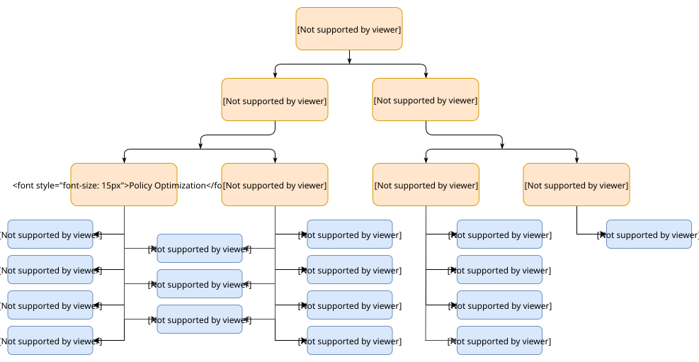

# RL Algotithms

[TOC]

> [!TIP]
>
> 不能用简单的树状图表达，

## Algorithm Taxonomy

- **RL Algorithm Families**.

  - Takeaway: RL 算法可以先按是否使用 environment model 分成 model-free 与 model-based，再按学习对象分成 value-based、policy optimization、actor-critic、planning、offline/imitation 等路线。实际选型要看 action space、是否可交互、样本成本和稳定性要求。

  - Core Mechanism:

    - **Model-free RL**: 不显式学习 $P(s'|s,a)$，直接从 samples 学 $V$、$Q$ 或 $\pi$。
    - **Model-based RL**: 学习或使用 environment model，再通过 planning、imagined rollout 或 model-augmented update 提高 sample efficiency。
  
      > [!NOTE]
      >
      > Q: 这里的environment model指什么：
      >
      > A: 也就是预测状态转换和奖励的函数
  
    - **On-policy**: 只用当前 policy 采集的数据更新，稳定但样本效率低。
    - **Off-policy**: 可复用旧数据或 replay buffer，样本效率高但更容易不稳定。
  
      可以使用在训练过程中收集到的任何数据，而无需考虑获取这些数据时智能体是如何探索环境的
  
  - Pipeline:
  
    1. Discrete action + low interaction cost: 优先 value-based / DQN。
    2. Continuous action + stable baseline: 优先 PPO。
    3. Continuous action + sample efficiency: 优先 SAC / TD3。
    4. Interaction expensive + model learnable: 考虑 model-based RL / MPC。
    5. Only logged data: 考虑 offline RL / imitation learning。
    6. LLM preference or verifier reward: 考虑 RLHF / DPO / GRPO-style optimization。

- - - 

## Notes

1. [Model-Free RL](./03-1-Model-Free.md): DP、MC、TD、Q-learning、DQN、policy gradient、PPO、DDPG、TD3、SAC、offline/imitation、RLHF/RFT。
2. [Model-Base RL](./03-2-Model-Base.md): dynamics model、planning、MPC、Dyna、model bias。

## References

- [OpenAI Spinning Up: Kinds of RL Algorithms](https://spinningup.openai.com/en/latest/spinningup/rl_intro2.html)
- [Sutton and Barto: Reinforcement Learning: An Introduction](https://web.stanford.edu/class/psych209/Readings/SuttonBartoIPRLBook2ndEd.pdf)
- [深入了解一下强化学习 | Lil’Log --- A (Long) Peek into Reinforcement Learning | Lil'Log](https://lilianweng.github.io/posts/2018-02-19-rl-overview/#monte-carlo-methods)
