# Main Takeaway
[TOC]

计算机网络的主线是：应用进程产生 message，经由传输层、网络层、链路层和物理层逐层封装，跨越多个网络后再逐层解封装。理解每一层的服务、状态和控制闭环，就能把 HTTP、TCP、IP、路由、ARP、以太网等知识放回同一张图中。

~~~mermaid
flowchart LR
  A["应用进程 HTTP / DNS / SMTP"] -->|"message"| B["传输层 TCP segment / UDP datagram"]
  B -->|"packet"| C["网络层 IP datagram"]
  C -->|"frame"| D["链路层 Ethernet / Wi-Fi"]
  D -->|"bits"| E["物理层 信号"]
  E --> F["网络中的多个交换节点"]
  F --> E
~~~

计算机网络原理

<!--more-->

# 1. 网络总览：Internet 如何提供通信

## 1.1 Internet、端系统与网络核心

- **Internet：network of networks**。

  - Takeaway：Internet 不是一台中心化计算机，而是由端系统、通信链路、分组交换设备和协议共同组成的互联网络；它既是分布式应用的基础设施，也是运行在其上的分布式系统。

  - Motivation：不同厂商、不同组织的网络需要互相通信，必须用统一的寻址、转发和协议规则把局部网络连接起来。

  - Core Mechanism：

    - **What**：端系统（end system/host）运行应用进程；路由器和交换机负责转发分组；链路提供传输速率（bandwidth，单位 bps）；协议（protocol）约束消息的格式、顺序和动作。
    - **Why**：把“应用要发送数据”转换为“网络节点可以逐跳处理的分组”，并通过标准化协议实现异构网络互通。
    - **How**：RFC（Request for Comments）记录 Internet 的技术规范和组织说明，IETF（Internet Engineering Task Force）负责制定和发布大量 Internet 标准。

    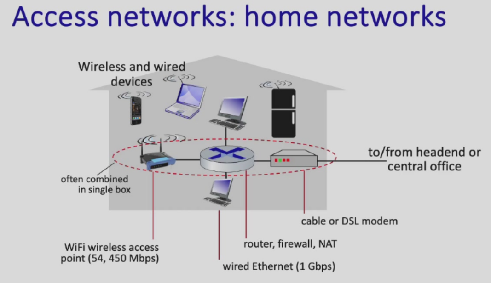

    - 常见参与者：
      - ISP（Internet Service Provider）：为端系统提供 Internet 接入。
      - ICP（Internet Content Provider）：部署内容和服务，例如 Google。
      - IXP（Internet Exchange Point）：多个对等 ISP 交换流量的互联点，通常不涉及传统的结算关系。
      - POP（Point of Presence）：高层 ISP 面向客户网络的接入点；一个低层 ISP 接入多个上游 ISP 称为多宿（multi-home）。

  - Pipeline：

    1. 应用进程把数据交给本机传输层。
    2. 传输层建立进程到进程的通信，并把数据交给 IP。
    3. IP 数据报在每个路由器上查表、转发，逐跳穿过网络。
    4. 目的主机逐层解封装，把数据交给目标进程。

---

- **Network edge 与 Network core**。

  - Takeaway：Network edge 由端系统和应用构成，关注“谁与谁通信”；Network core 由互连路由器构成，关注“分组走哪条路径以及如何共享链路”。

  - Core Mechanism：

    - **Network edge**：
      - C/S（client/server）中，server 通常具有长期稳定的地址，client 主动发起请求。
      - P2P（peer to peer）中，节点既可以请求资源，也可以向其他节点提供资源；实际应用也常采用 hybrid 结构。
      - 面向连接的交互会先握手并建立状态；无连接交互则直接发送数据。
    - **Network core**：
      - routing：决定源到目的地的路径。
      - forwarding：路由器根据转发表，把分组从输入端口送到合适的输出端口。
      - packet switching：数据被切成分组，各分组在节点处采用 store-and-forward。

    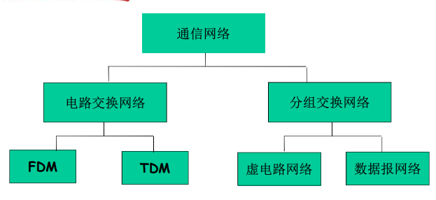

  - Pros：
    - 分组交换按需共享链路，提高链路利用率。
    - 路由提供一定的容错和分流能力，单条路径或部分设备失效时仍可能找到替代路径。

  - Cons：
    - 共享资源会导致排队、拥塞、丢包和时延抖动。
    - 转发与路由控制需要维护状态、转发表和协议消息。

---

- **多路径路由的容错与分流**。

  - Takeaway：路由器之间保留多条可选路径，可以在部分设备或链路失效时维持连通性，也可以把流量分散到不同路径。

  - Core Mechanism：路由协议根据拓扑和策略选择下一跳；当一条路径不可用或拥塞时，控制平面可以重新计算并把流量导向其他路径。核心路由器仍可能成为单点风险，因此工程上会尽量避免单一关键节点。

    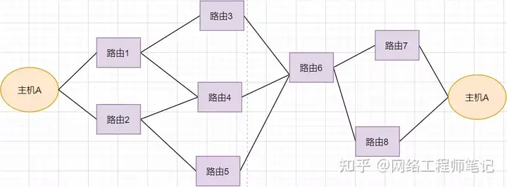

## 1.2 交换方式与接入网络

- **Circuit switching 与 Packet switching**。

  - Takeaway：线路交换为一次通信预留端到端资源，性能更可预测；分组交换按需使用共享资源，更灵活，但会产生排队和丢包。

  - Core Mechanism：

    | 对比项 | Circuit switching | Packet switching |
    | --- | --- | --- |
    | 资源 | 呼叫建立后预留固定资源片 | 分组到达时按需竞争 |
    | 数据形式 | 连续占用一条逻辑线路 | 切成多个 packet |
    | 节点行为 | 交换预留的资源片 | store-and-forward |
    | 主要问题 | 空闲时资源也可能被占用 | 排队、拥塞、丢包 |
    | 典型复用 | FDM、TDM、WDM、CDMA | Internet IP 网络 |

    - 线路交换中的复用：
      - FDM（Frequency-Division Multiplexing）：按频段分配资源。
      - TDM（Time-Division Multiplexing）：按时间帧和时隙分配资源。
      - WDM（Wavelength-Division Multiplexing）：在光纤中按波长分配资源。
      - CDMA（Code-Division Multiple Access）：按编码空间区分用户。
    - 分组交换网络又可分为：
      - Datagram network：无连接，每个分组携带完整目的地址，独立进行路由。
      - Virtual-circuit network：先建立虚电路，分组携带标签，路由器维护该呼叫状态，期间通常沿固定路径转发。

  - Pipeline：

    1. 线路交换先建立连接并分配资源，随后传输数据，结束时释放资源。
    2. 分组交换把数据切分为 packet。
    3. 每个中间节点接收、缓存并转发分组。
    4. 输出链路不足时，分组排队；缓存耗尽时分组被丢弃。

---

- **Access networks 与 Physical media**。

  - Takeaway：接入网把端系统接入第一个 ISP 或局部网络，物理媒体决定信号如何在节点之间传播；链路速率和传播环境共同限制端到端性能。

  - Core Mechanism：

    - 常见接入方式：modem、DSL、cable network、WLAN（802.11b/g/n 等）、数据中心网络。
    - 网络规模常用如下术语区分：
      - LAN（Local Area Network）：局域网。
      - WAN（Wide Area Network）：广域网。
      - MAN（Metropolitan Area Network）：城域网。
      - PAN（Personal Area Network）：个域网。
    - 导引型媒体（guided media）：双绞线、同轴电缆、光纤。光纤抗电磁干扰能力强，带宽高。
    - 非导引型媒体（unguided media）：在开放空间中传播无线电磁波或光信号，会受到衰减、干扰、多径和遮挡影响。

    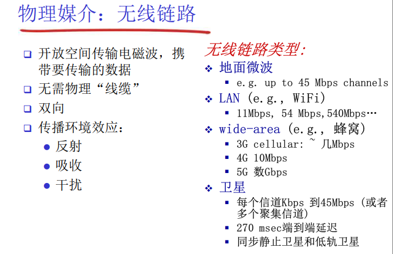

    - 蜂窝网络采用相邻小区覆盖区域的方式复用频谱；六边形是便于规划覆盖的理想化模型。

---

- **ISP 层次与 Internet 结构**。

  - Takeaway：Internet 通过接入 ISP、区域/骨干 ISP、对等互联点和内容提供商组成层次化的 network of networks；层次化有利于扩展和路由聚合。

  - Core Mechanism：

    - 端系统先连接 access ISP。
    - access ISP 通过 POP 接入更高层 ISP，多个 ISP 也可以通过 IXP 直接交换流量。
    - ICP 常自建内容分发网络，并同时连接多个 ISP。

    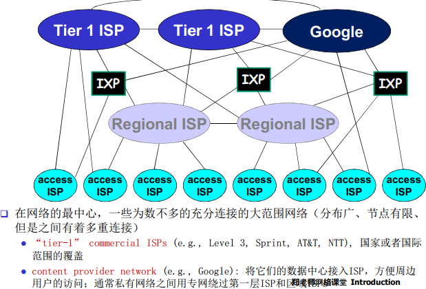

## 1.3 时延、丢包与吞吐量

- **Packet-switched network 的性能指标**。

  - Takeaway：端到端性能主要由节点处理、排队、传输和传播四类时延构成；拥塞来自到达速率超过输出能力，吞吐量通常受瓶颈链路限制。

  - Motivation：同一个应用请求可能经过多个路由器，任何一跳的处理能力、缓存和链路速率都可能成为瓶颈。

  - Core Mechanism：

    - 节点总时延：

      $$
      d_{\text{node}}=d_{\text{proc}}+d_{\text{queue}}+d_{\text{trans}}+d_{\text{prop}}
      $$

      其中，$d_{\text{proc}}$ 是检查首部和查表的处理时延，$d_{\text{queue}}$ 是等待输出链路的排队时延，$d_{\text{trans}}$ 是把比特推入链路的传输时延，$d_{\text{prop}}$ 是信号在介质中传播的时延。

    - 传输时延：

      $$
      d_{\text{trans}}=\frac{L}{R}
      $$

      $L$ 是分组长度（bit），$R$ 是链路带宽（bit/s）；它表示“发送完这一个分组”需要多久，不是信号到达远端需要多久。

    - 流量强度：

      $$
      \rho=\frac{La}{R}
      $$

      $a$ 是分组到达队列的平均速率（packet/s）。当 $\rho\geq 1$ 时，平均到达能力不小于输出能力，排队时延会快速增长，系统难以稳定。

    - 丢包：路由器的缓存有限，分组到达时若缓存已满，就会被丢弃；可靠性通常由传输层或应用层补偿。

    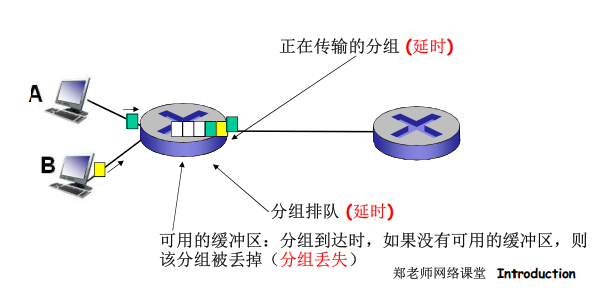

    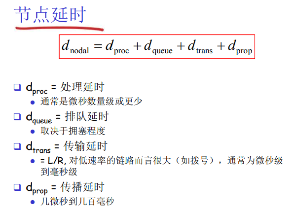

    - 吞吐量（throughput）：

      $$
      \text{throughput}=\frac{\text{file size}}{\text{transmission time}}
      $$

      对串联链路，在没有其他限制时，长时间平均吞吐量近似为：

      $$
      \min\{R_1,R_2,\ldots,R_n\}
      $$

      最低速率的链路称为 bottleneck link；实际还会受到协议开销、接收窗口、拥塞和服务器能力限制。

  - Pipeline：

    1. 计算每一跳的处理、排队、传输和传播时延。
    2. 沿路径累加各跳时延。
    3. 检查瓶颈链路和缓存占用，判断吞吐量与丢包风险。
    4. 用 traceroute 逐跳测量路径和时延；Linux 使用 traceroute，Windows 使用 tracert，连续的星号表示探测没有收到响应。

  - 相关阅读：[traceroute 命令详解](https://www.cnblogs.com/machangwei-8/p/10353279.html)。

## 1.4 协议、服务与分层

- **Protocol、Service 与 SAP**。

  - Takeaway：协议是同层 peer entities 之间的水平规则，服务是下层向上层提供的垂直能力；分层把复杂网络功能拆成可组合的模块。

  - Motivation：如果每个应用都要直接处理寻址、路由、差错、介质访问和信号编码，系统将难以实现、维护和演进。

  - Core Mechanism：

    - 协议（protocol）：规定对等层实体通信时的消息格式、字段含义、时序和动作。
    - 服务（service）：下层通过接口向上层提供的通信能力，通常由 service primitives 操作。
    - 服务访问点（SAP）：上层使用下层服务的层间接口。
    - 本层协议利用下层提供的服务，再向上层提供更高层服务。

  - 面向连接服务（connection-oriented service）通常先建立关联，适合较大的数据块和需要保序的通信；无连接服务（connectionless service）无需握手，适合零星数据，但可能不可靠、重复或失序。

---

- **TCP/IP 五层模型与封装**。

  - Takeaway：发送端逐层添加首部，接收端逐层移除首部；不同层看到的同一份数据有不同名称，这正是模块化协议栈的核心。

  - Core Mechanism：

    | 层次 | 典型功能 | 数据单元 |
    | --- | --- | --- |
    | 应用层 Application | 面向用户和应用进程的协议 | message |
    | 传输层 Transport | 进程到进程、可靠性、流控、拥塞控制 | TCP segment / UDP datagram |
    | 网络层 Network | 主机到主机、IP 编址和路由 | packet / IP datagram |
    | 数据链路层 Link | 相邻节点、成帧、MAC、差错检测 | frame |
    | 物理层 Physical | 在介质上传输信号 | bit |

    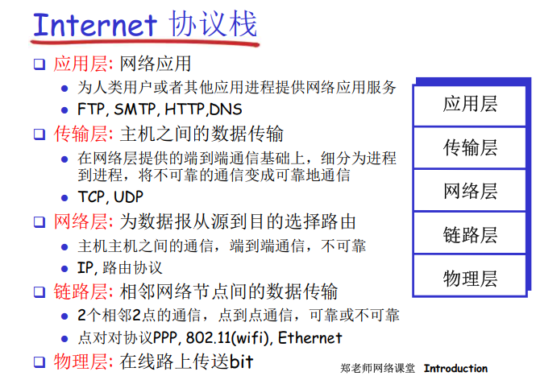

    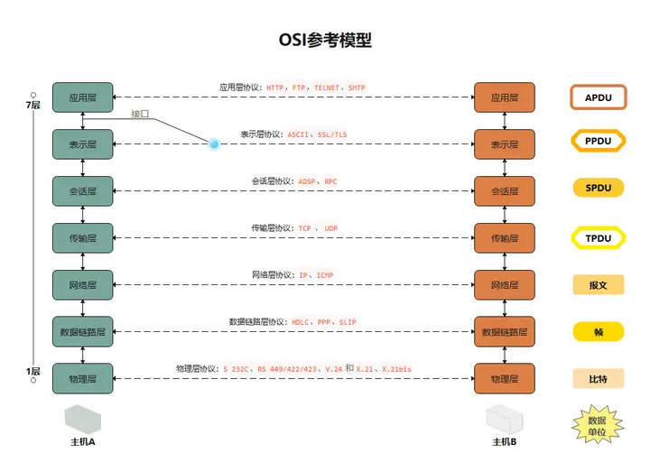

    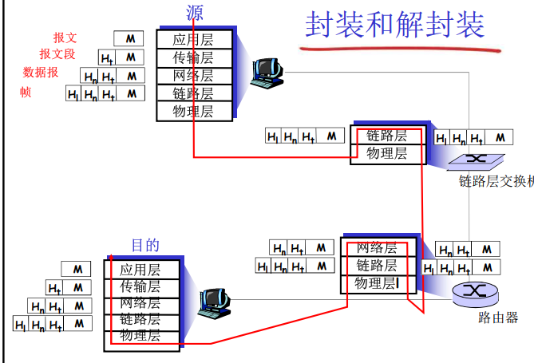

    - OSI 七层模型额外拆出了会话层和表示层。现代 Internet 中，它们的许多功能通常由应用层库或应用协议实现。
    - 会话相关功能负责建立和管理应用之间的交互状态；表示相关功能负责数据格式转换、编码和加密。不要把“OSI 的层数”误认为“必须存在七组独立协议”。

  - Pipeline：

    1. 应用层产生 message。
    2. 传输层加入端口、序号、确认号等信息，形成 segment/datagram。
    3. 网络层加入源/目的 IP，形成 IP datagram。
    4. 链路层加入源/目的 MAC 以及检错字段，形成 frame。
    5. 物理层把 frame 转成信号和 bit 发送。

~~~mermaid
flowchart TB
  P1["发送端应用进程"] --> L1["Application message"]
  L1 --> L2["Transport segment / datagram"]
  L2 --> L3["Network IP datagram"]
  L3 --> L4["Link frame"]
  L4 --> L5["Physical bits"]
  L5 --> N["多个路由器逐跳转发"]
  N --> R5["Physical"]
  R5 --> R4["Link"]
  R4 --> R3["Network"]
  R3 --> R2["Transport"]
  R2 --> R1["目标应用进程"]
~~~

# 2. 应用层：进程如何使用网络

## 2.1 进程寻址与 Socket

- **Socket：应用层与传输层之间的门**。

  - Takeaway：进程通过 socket 把应用数据交给 TCP 或 UDP；网络用 IP 地址定位主机，用 port number 定位主机上的目标 socket/进程。

  - Motivation：应用不应直接操作路由器或链路，只需要选择传输服务并读写一个通信端点。

  - Core Mechanism：

    - process 是运行在主机中的程序；client process 主动发起请求，server process 等待请求。
    - socket 像一扇门：应用层从一侧写入/读取，传输层从另一侧发送/接收。
    - TCP socket 代表一条可靠的字节流连接；UDP socket 代表一个无连接数据报端点。
    - 一个 TCP server 通常先监听 welcome socket，收到连接后为每个 client 创建独立的 connection socket。

    ~~~mermaid
    flowchart LR
      C["Client process"] --> CS["Client socket"]
      CS --> T["TCP / UDP"]
      T --> I["IP network"]
      I --> T2["TCP / UDP"]
      T2 --> SS["Server connection socket"]
      SS --> S["Server process"]
      W["Server welcome socket"] --> SS
    ~~~

  - Pipeline：

    1. server 创建 socket、绑定端口并监听。
    2. client 根据 server 的 IP 和端口发起连接或发送数据报。
    3. 传输层完成复用、可靠性或拥塞控制。
    4. 接收端 socket 把数据交给目标进程。

## 2.2 Web 与 HTTP

- **HTTP 与 Web object**。

  - Takeaway：Web 页面通常由一个 base HTML file 和多个 referenced objects 组成，每个对象都有自己的 URL；HTTP 负责在 client 和 server 之间传输这些对象。

  - Core Mechanism：

    - HTTP（HyperText Transfer Protocol）采用 C/S 模型，经典 HTTP/1.x 使用 TCP，server 默认监听 port 80，HTTPS 通常使用 TLS 和 port 443。
    - 浏览器先建立 TCP 连接，再发送 HTTP request；server 返回 HTTP response。
    - HTTP 本身是 stateless：server 默认不保存过去请求的应用层状态。cookies、session、数据库等机制可以在 HTTP 之上建立有状态的 Web 会话。
    - 常见响应状态码按类别理解：2xx 表示成功，3xx 表示重定向，4xx 表示客户端请求问题，5xx 表示服务器处理问题。

    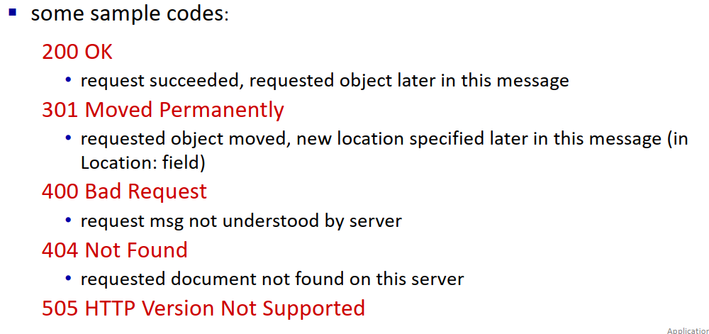

  - Pipeline：

    ~~~mermaid
    sequenceDiagram
      participant C as Browser
      participant S as Web Server
      C->>S: TCP connection
      C->>S: HTTP request
      S-->>C: HTTP response with HTML
      C->>S: Requests for referenced objects
      S-->>C: Object responses
    ~~~

  - **Persistent 与 Non-persistent HTTP**：

    | 特性 | Non-persistent HTTP | Persistent HTTP |
    | --- | --- | --- |
    | TCP 连接 | 每个对象通常建立一个连接 | 多个 request/response 复用一个连接 |
    | 基本代价 | 每个对象约需 1 次 TCP 握手 RTT + 1 次请求响应 RTT | 建立连接后，后续对象不再重复握手 |
    | 连接开销 | 多次连接带来 OS 和 TCP 开销 | 连接管理开销更低 |
    | 并行方式 | 浏览器可开启多个并行 TCP 连接 | 可顺序请求，也可使用 pipelining |

    - RTT（Round-Trip Time）是报文从 client 到 server 再返回所需的往返时间。在简化模型中，非持久连接每个对象约需 $2RTT$；持久连接建立后，无流水线时每个后续对象约需 $1RTT$，使用流水线时可把多个请求批量放入一个 RTT。还要另加对象传输时间和服务器处理时间。
    - FCFS（First-Come-First-Served）调度可能让小对象排在大对象后面，增加用户感知延迟。

    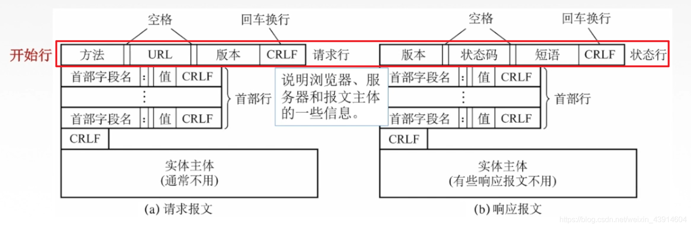

  - **Web cache 与条件请求**：

    - proxy/cache 的目标是在不访问 origin server 的情况下满足请求。
    - 命中缓存可以减少响应时间，也可以减小机构接入链路的流量。

    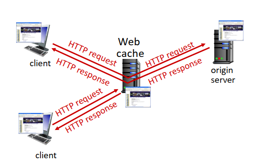

    - Last-Modified 表示对象最后修改时间，Date 表示 server 生成当前响应的时间；二者语义不同。
    - 浏览器可使用 If-Modified-Since 等条件请求验证缓存，server 在对象未改变时避免重复传输完整内容。

    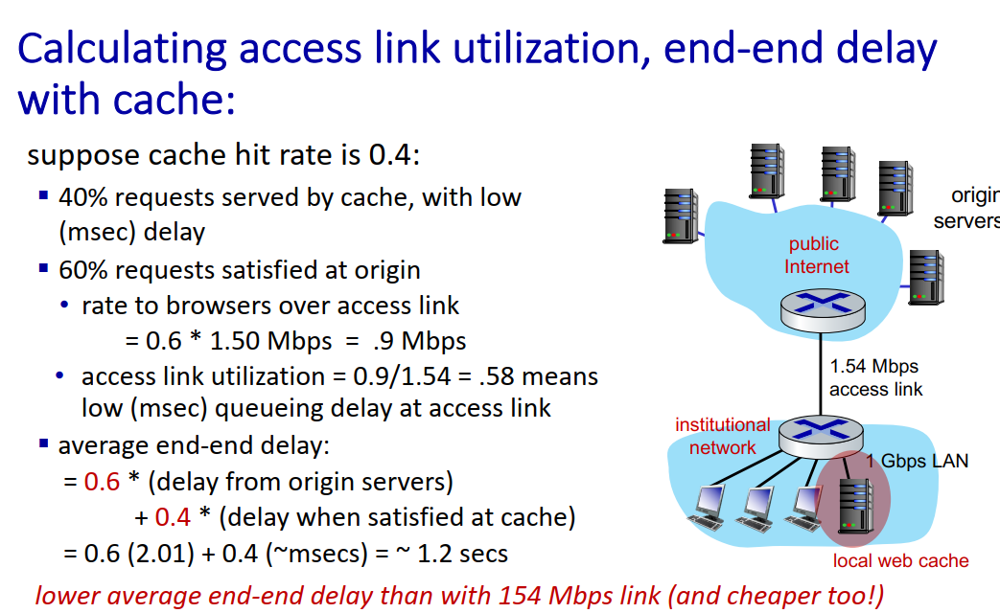

    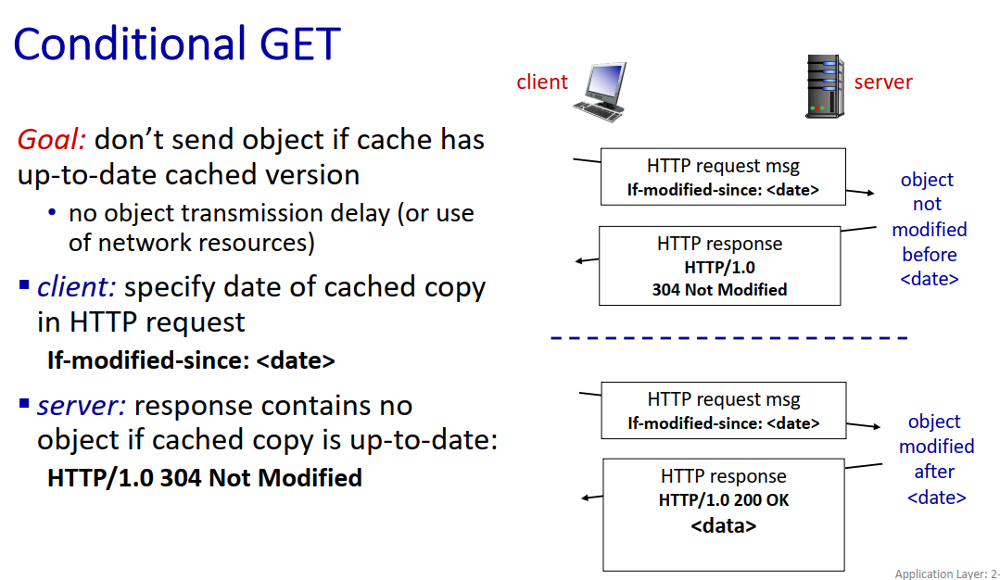

  - **HTTP/2 与 HTTP/3**：

    - HTTP/2 把对象拆成 frame，在同一连接中交错传输，并可表达优先级；它减少了应用层对象之间的 Head-of-Line（HOL）阻塞，但底层 TCP 的丢包仍可能阻塞整个连接。
    - HTTP/3 基于 QUIC/UDP，为不同 stream 提供独立的可靠传输，减少 TCP 级别的跨流 HOL blocking，并内置加密和拥塞控制。

    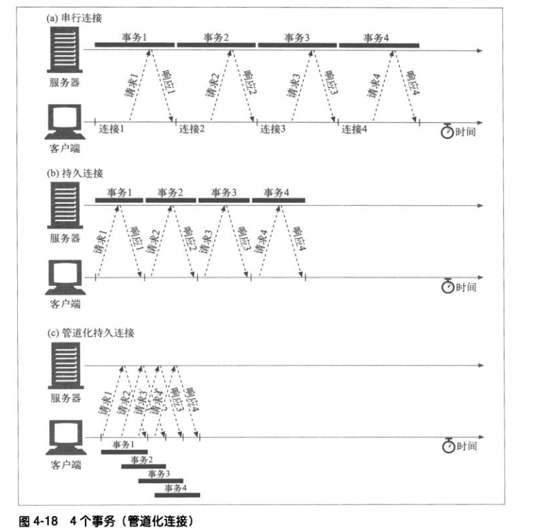

  - 相关阅读：[HTTP 持久连接与非持久连接](https://blog.csdn.net/neninee/article/details/79634187)、[Windows nc 命令用法](https://zhuanlan.zhihu.com/p/653076851)。

## 2.3 FTP：控制连接与数据连接

- **FTP（File Transfer Protocol）**。

  - Takeaway：FTP 使用两个并行的 TCP 连接分离控制和数据：控制连接默认使用 server port 21，数据连接在主动/被动模式下建立方式不同。

  - Core Mechanism：

    - 控制连接（control connection）传输命令和响应，属于 out-of-band 控制。
    - 数据连接（data connection）传输文件目录和文件内容；传统主动模式中 server 使用 port 20，passive 模式中 server 通知一个临时端口，由 client 发起数据连接。
    - 支持 ASCII 文本和 Binary 二进制传输模式。
    - FTP 会话需要维护登录、当前目录等状态，因此通常被视为 stateful service。

  - Pipeline：

    1. client 与 server:21 建立控制连接。
    2. 通过命令协商传输模式和数据端口。
    3. 建立数据连接并传输文件。
    4. 数据传输结束后关闭数据连接，控制连接可继续复用。

## 2.4 E-mail：SMTP、IMAP 与 POP3

- **E-mail 系统**。

  - Takeaway：邮件系统由 user agent、mail server 和邮件协议组成；SMTP 负责提交/转发邮件，IMAP 或 POP3 负责用户取信。

  - Core Mechanism：

    - mail server 包含 mailbox（收件箱）和 message queue（待发送队列）。
    - SMTP（Simple Mail Transfer Protocol）使用 TCP，典型交互分为 greeting、message transfer、closure 三个阶段。
    - 常见命令有 HELO、MAIL FROM、RCPT TO、QUIT；响应包含状态码和短语。
    - IMAP 把邮件和文件夹保存在 server，支持多设备同步、检索、删除和组织。
    - POP3 更偏向于把邮件取到 client 本地，具体保留策略由 client/server 配置决定。

    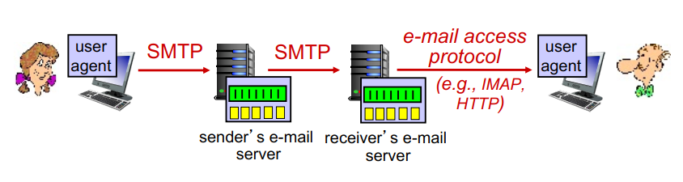

    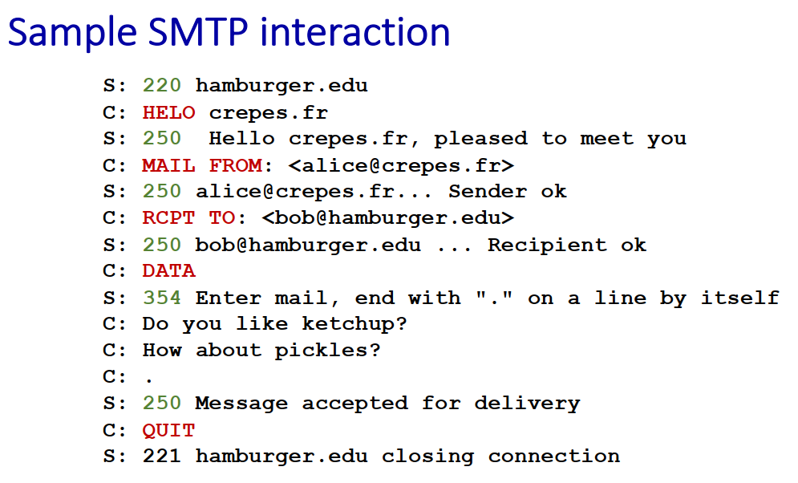

    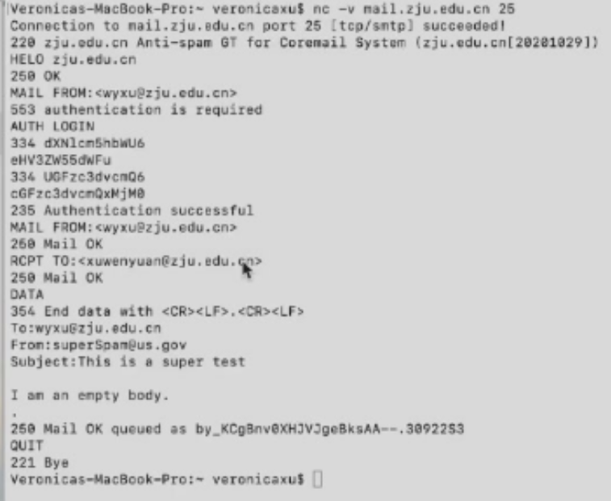

## 2.5 DNS：从名字到地址

- **DNS（Domain Name System）**。

  - Takeaway：DNS 是一个分布式、层次化的数据库，把 hostname/domain name 映射为 IP 地址及其他资源记录；缓存和分层授权让全球名称解析可扩展。

  - Motivation：人适合记忆域名，路由器和主机需要 IP 地址；还需要支持别名、邮件服务器、负载均衡和分布式管理。

  - Core Mechanism：

    - 层次结构：
      - root DNS servers。
      - TLD（Top-Level Domain）servers，例如 .com、.org。
      - authoritative DNS server，负责某个组织或域的权威记录。
      - local/recursive resolver，代表主机查询并缓存结果。

    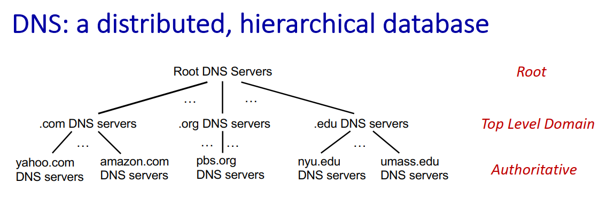

    - 查询模式：
      - iterative query：被询问的服务器返回“下一步应该问谁”。
      - recursive query：被询问的 resolver 负责继续查询，并把最终结果返回给请求者。

    ~~~mermaid
    flowchart LR
      H["Host"] --> L["Local DNS resolver"]
      L --> R["Root server"]
      R --> T["TLD server"]
      T --> A["Authoritative server"]
      A --> L
      L --> H
    ~~~

    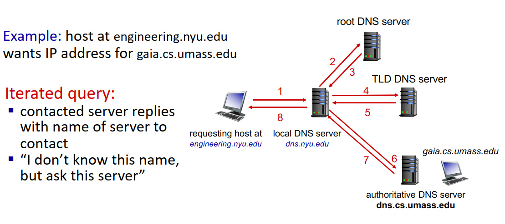

    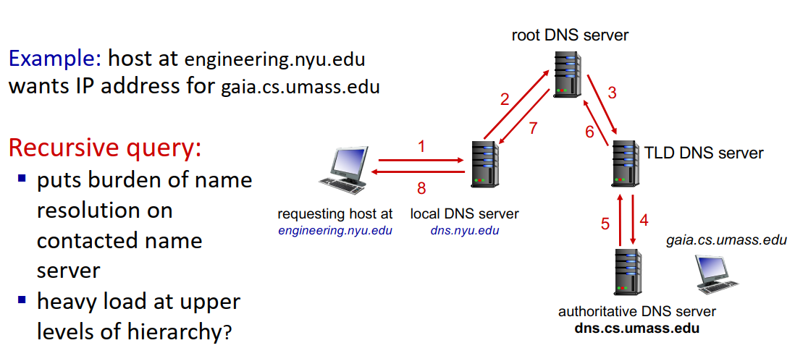

    - 解析逻辑：
      - 如果输入的是 alias，先找到 canonical name，再查询 canonical name 的 IP。
      - 如果输入的已经是 canonical name，则直接查询对应 IP。
      - DNS 也可以返回多个地址，以支持简单的负载均衡。

    - DNS resource record（RR）格式：

      $$
      (\text{name},\text{value},\text{type},\text{TTL})
      $$

      常见类型：

      | Type | 含义 |
      | --- | --- |
      | A | hostname 的 IPv4 地址 |
      | AAAA | hostname 的 IPv6 地址 |
      | NS | 某域的权威 DNS server |
      | MX | 接收该域邮件的 server |
      | CNAME | 当前 hostname 的别名 |

    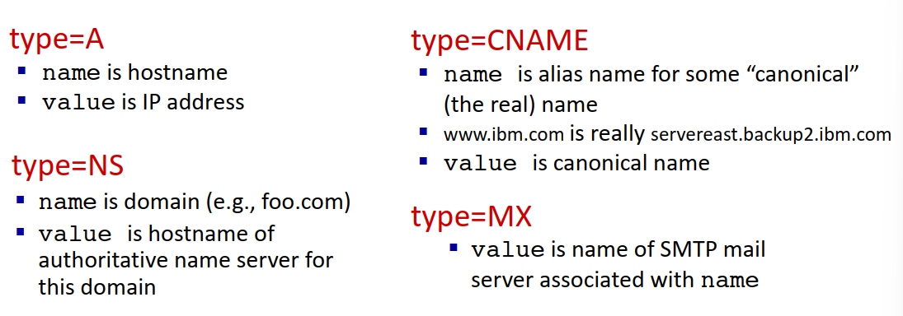

    - DNS TTL 是一条记录允许被缓存的时间；它不同于 IP 首部中的 TTL/hop limit。IP TTL 每经过一跳递减，用来避免路由环路中的分组无限存在。

    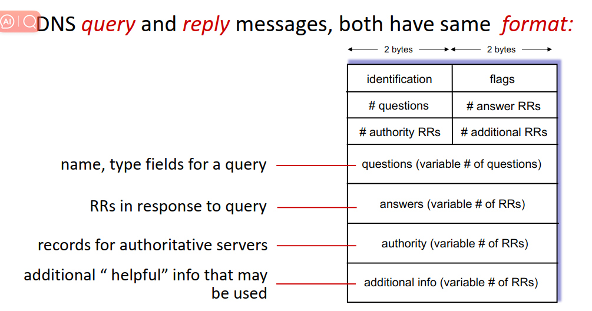

    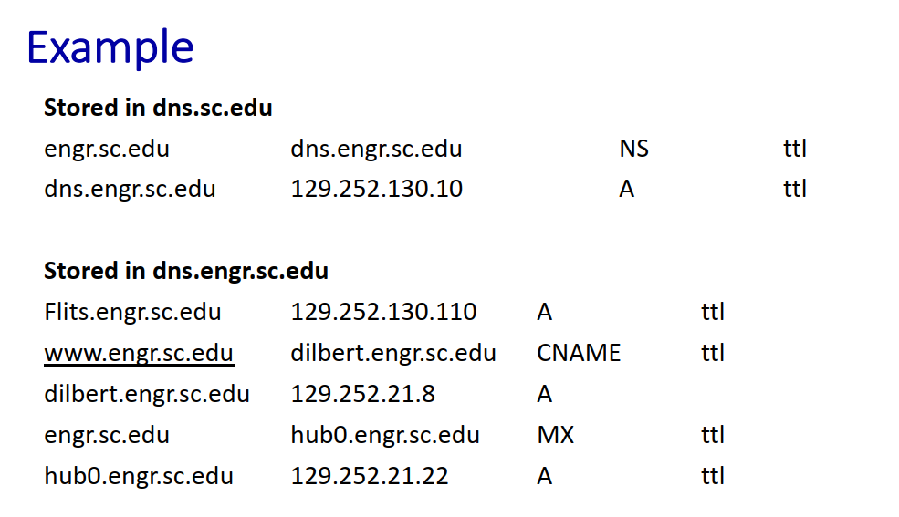

  - Pros：
    - 分层授权避免所有记录集中在一个数据库中。
    - 缓存可显著减少重复查询和根服务器压力。

  - Cons：
    - TTL 较长时记录变化不能立即传播。
    - DNS 可能受到 DDoS、缓存污染和 spoofing 攻击，需要验证和安全扩展。

## 2.6 P2P 文件分发

- **P2P 文件分发**。

  - Takeaway：P2P 让参与下载的 peer 同时上传已拥有的 chunk，随着 peer 增多，系统总上传能力也可能增大；tracker 负责发现参与同一 torrent 的 peers。

  - Core Mechanism：

    - 文件先切分成 chunks。
    - torrent 是交换同一文件 chunks 的 peer 集合。
    - tracker 维护参与者列表，peer 从其他 peer 获取缺失块。
    - tit-for-tat 优先与上传能力较好的伙伴交换；optimistic unchoke 用于探索新的交易伙伴。

    ~~~mermaid
    flowchart LR
      T["Tracker"] --> P1["Peer 1"]
      T --> P2["Peer 2"]
      T --> P3["Peer 3"]
      P1 <--> P2
      P2 <--> P3
      P1 <--> P3
    ~~~

    - 文件大小为 $F$、server 上传速率为 $u_s$、第 $i$ 个 peer 上传速率为 $u_i$、下载速率为 $d_i$、共有 $N$ 个 peer 时，经典模型给出：
      - C/S 下界：

        $$
        D_{CS}\geq\max\left\{\frac{NF}{u_s},\frac{F}{d_{\min}}\right\}
        $$

      - P2P 下界：

        $$
        D_{P2P}\geq\max\left\{\frac{F}{u_s},\frac{F}{d_{\min}},\frac{NF}{u_s+\sum_i u_i}\right\}
        $$

      其中 $d_{\min}=\min_i d_i$；这些是理想化下界，实际时间还受块选择、连接数、协议开销和节点在线时长影响。

    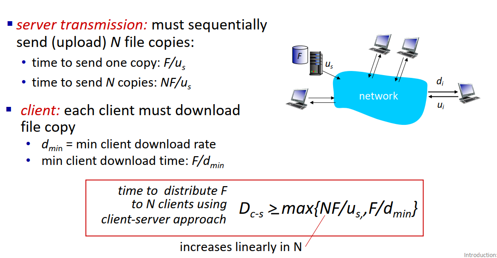

    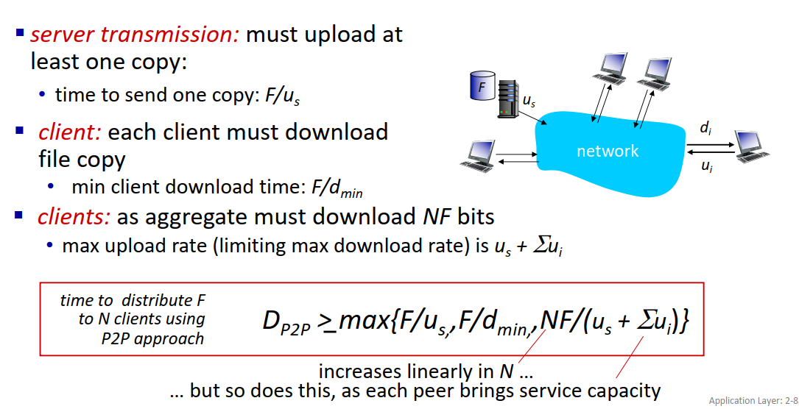

    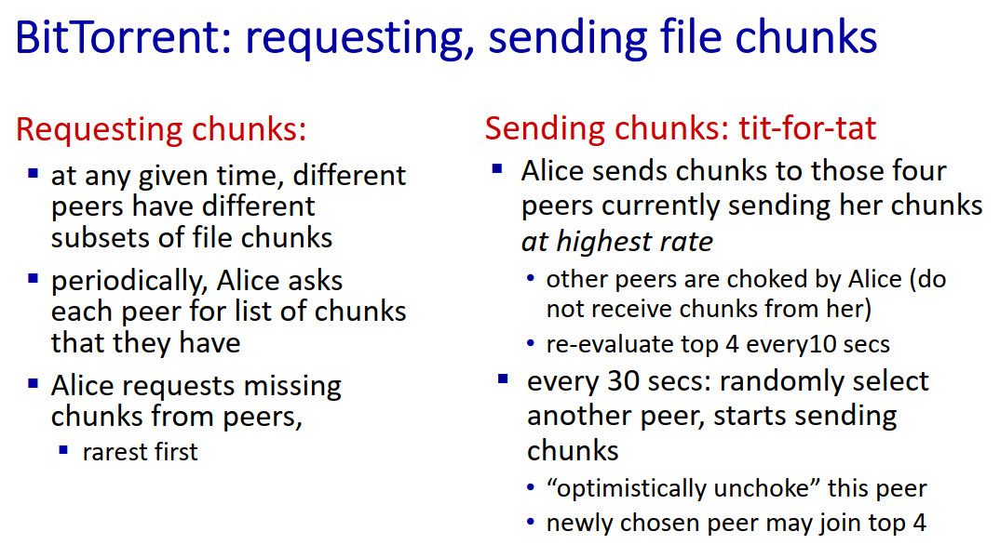

## 2.7 视频流、DASH 与 CDN

- **Streaming multimedia、DASH 与 CDN**。

  - Takeaway：视频流系统把编码、客户端缓冲、自适应码率和内容分发结合起来，在变化的 client-to-server 带宽下维持连续播放。

  - Core Mechanism：

    - video coding 利用空间冗余（同一帧内）和时间冗余（相邻帧之间）减少 bit 数。
    - CBR（Constant Bit Rate）码率固定；VBR（Variable Bit Rate）根据内容复杂度变化。
    - DASH（Dynamic Adaptive Streaming over HTTP）把同一视频编码成多个码率版本，并提供 manifest。
    - client 根据当前吞吐量、buffer occupancy 和设备能力选择下一段视频的 encoding rate。
    - CDN 在地理分散的站点保存多个副本，减少用户到源站的距离和骨干流量。

    ~~~mermaid
    flowchart LR
      O["Origin video"] --> E["Multiple encodings"]
      E --> C["CDN edge servers"]
      C --> M["Manifest"]
      M --> P["Client selects bitrate"]
      P --> B["Playout buffer"]
      B --> V["Video playback"]
    ~~~

  - Pipeline：

    1. origin 对视频编码出多个码率版本。
    2. CDN edge 缓存视频片段和 manifest。
    3. client 请求 manifest，获得片段和码率列表。
    4. client 逐段测量网络状况，选择合适版本。
    5. 片段进入 playout buffer，再连续播放。

  - Cons：
    - 网络带宽变化、拥塞和启动缓冲会影响播放体验。
    - 过于激进地切换码率可能造成卡顿或质量抖动。

# 3. 传输层：进程到进程的可靠通信

## 3.1 Multiplexing 与 Demultiplexing

- **传输层复用与分用**。

  - Takeaway：发送端把多个应用 socket 的数据汇聚到网络层，称为 multiplexing；接收端依据端口和地址把 segment 分发给正确 socket，称为 demultiplexing。

  - Core Mechanism：

    - IP 地址定位主机，port number 定位主机上的传输层端点。
    - UDP 通常依据 destination port number 分用。
    - TCP 依据四元组分用：

      $$
      (\text{source IP},\text{source port},\text{destination IP},\text{destination port})
      $$

    - TCP server 的同一个监听端口可以对应多个连接 socket，因为每个 client 的四元组不同。

    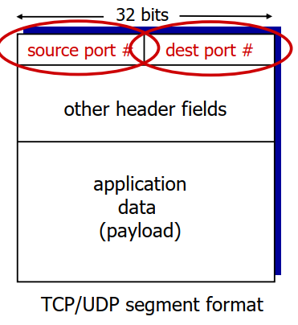

  - Pipeline：

    1. 应用进程写入 socket。
    2. 传输层加入端口和传输控制字段。
    3. 网络层传送 IP datagram。
    4. 接收端按协议和端口/四元组找到 socket。
    5. socket 把 payload 交给目标进程。

## 3.2 Reliable Data Transfer

- **可靠数据传输原理（rdt）**。

  - Takeaway：可靠传输不是信道天然提供的，而是发送方与接收方通过 checksum、sequence number、ACK、timer 和 retransmission 在不可靠信道上共同实现的。

  - Motivation：网络可能发生 bit error、packet loss、duplicate 和乱序；接收方必须判断数据是否正确，发送方必须知道何时重传。

  - Core Mechanism：

    - 用有限状态机（FSM）描述 sender 和 receiver 的状态、事件和动作。
    - rdt1.0：假设底层信道完全可靠，只需直接发送和交付。
    - rdt2.0：处理 bit errors，使用 checksum 以及 ACK/NAK；若 ACK/NAK 被破坏，发送方无法确定接收结果。
    - rdt2.1：加入 sequence number，让接收方识别重复分组。
    - rdt2.2：去掉 NAK，用带编号的 duplicate ACK 表达否定信息。
    - rdt3.0：同时处理丢包和差错，发送方使用倒计时器，超时或收到异常 ACK 时重传。

  - **Stop-and-Wait、GBN 与 SR**：

    | 机制 | 接收方行为 | 发送方重传 | 状态与代价 |
    | --- | --- | --- | --- |
    | Stop-and-Wait | 一次接收一个分组并确认 | 超时重传当前分组 | 实现简单，但链路利用率可能很低 |
    | GBN（Go-Back-N） | 通常只接收按序分组，返回 cumulative ACK | 从最早未确认分组开始批量重传 | 实现较简单，但可能重复发送已正确到达的分组 |
    | SR（Selective Repeat） | 可缓存乱序分组，对各分组单独确认 | 只重传缺失或超时分组 | 节省重传带宽，但需要更多缓存、定时器和序号状态 |

    - GBN 的窗口中可以同时存在已确认、已发送未确认和待发送分组；累计确认让窗口基底向前移动。
    - SR 的窗口基底停留在最早未确认分组；收到该分组 ACK 后，若后续分组也已确认，窗口可连续前移。

  - **Flow control**：

    - 接收方有有限的 receive buffer；如果应用读取速度低于网络到达速度，缓冲区可能溢出。
    - TCP 用 advertised receive window（通常记为 rwnd）告诉发送方还剩多少空间。
    - 当 rwnd 为 0 时，发送方会通过 zero-window probe 等方式确认接收方窗口是否重新打开，避免双方永久停滞。

  - Pipeline：

    1. 发送方给数据编号并计算校验信息。
    2. 接收方检查 checksum、序号和窗口范围。
    3. 正确数据交付应用层并返回 ACK。
    4. 发送方滑动窗口；超时或发现重复 ACK 时重传。

  - 相关阅读：[rdt1.0–rdt3.0](https://blog.csdn.net/qq_33936481/article/details/53152903)、[GBN 与 SR](https://blog.csdn.net/qq_44807642/article/details/103054914)。

## 3.3 UDP

- **UDP（User Datagram Protocol）**。

  - Takeaway：UDP 是无连接、不可靠、不保证顺序的数据报服务，开销小、无需握手，适合由应用自行控制可靠性、时延或发送节奏的场景。

  - Core Mechanism：

    - 有数据就发送，不维护连接建立状态。
    - 首部较小，按 datagram 保留消息边界。
    - 提供 checksum 以检测部分差错，但不负责重传、排序、流量控制或拥塞控制。
    - DNS、SNMP、部分实时应用和 HTTP/3 可使用 UDP；若需要可靠性或拥塞控制，可在应用层或 QUIC 中补充。

    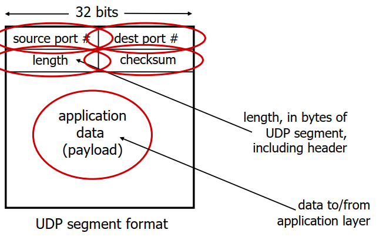

    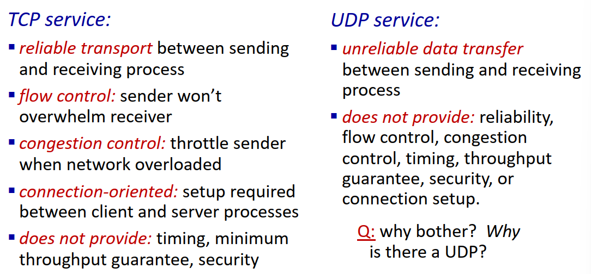

  - Pros：
    - 无需握手，不产生连接建立 RTT。
    - 应用可以自行决定重传、编码、超时和发送速率。
    - 保留数据报边界，适合消息型通信。

  - Cons：
    - 默认不可靠、不保序、不防止接收方溢出。
    - 应用自行补充控制机制时，必须正确处理拥塞和安全问题。

## 3.4 TCP

- **TCP（Transmission Control Protocol）**。

  - Takeaway：TCP 在两个进程之间提供面向连接、全双工、可靠有序的字节流；它通过序号、累计确认、超时重传、流量控制和拥塞控制把不可靠的 IP 服务变成可用的端到端传输服务。

  - Core Mechanism：

    - **面向字节流**：TCP 不理解应用消息，只把字节编号并切成 segment 传输；一次 write 不一定对应一次 read。
    - **可靠有序**：receiver 返回期望接收的下一个字节序号，ACK 通常是 cumulative ACK；SACK 可补充说明已经收到的非连续区间。
    - **流水线**：发送方允许多个 segment 在途，窗口大小由流量控制和拥塞控制共同限制。
    - **全双工**：同一连接的两个方向可以同时传输。

    - 发送窗口可用如下关系理解：

      $$
      \text{usable sending window}\approx\min(\text{cwnd},\text{rwnd})
      $$

      cwnd（congestion window）反映网络拥塞状态，rwnd（receive window）反映接收方缓冲区余量。

    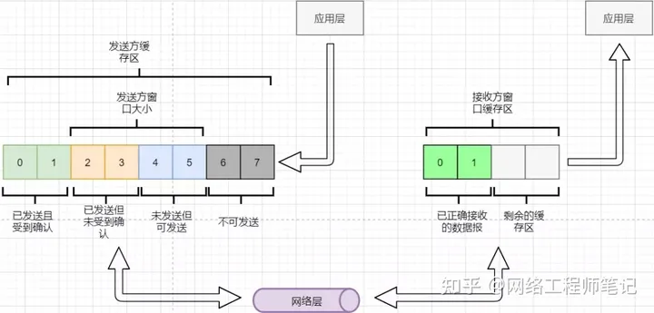

  - **连接建立：三次握手**：

    ~~~mermaid
    sequenceDiagram
      participant A as Client
      participant B as Server
      A->>B: SYN, seq=x
      B-->>A: SYN+ACK, seq=y, ack=x+1
      A->>B: ACK, ack=y+1
      A->>B: Application data
    ~~~

    1. client 发送 SYN，携带初始序号并进入等待状态。
    2. server 返回 SYN+ACK，确认 client 的序号并发送自己的初始序号。
    3. client 返回 ACK；双方进入 ESTABLISHED。
    4. 三次握手让双方确认彼此的发送/接收能力，并协商必要选项。

    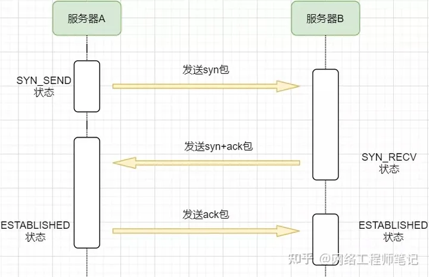

  - **连接关闭：四次挥手**：

    ~~~mermaid
    sequenceDiagram
      participant A as Endpoint A
      participant B as Endpoint B
      A->>B: FIN
      B-->>A: ACK
      B->>A: FIN
      A-->>B: ACK
      A-->>A: TIME_WAIT then close
      B-->>B: close
    ~~~

    - TCP 是全双工的，一个方向关闭不代表另一个方向立即关闭，因此通常需要分别关闭两个方向。
    - 主动关闭的一方进入 TIME_WAIT，等待约 2MSL；MSL（Maximum Segment Lifetime）是报文在网络中允许存在的最长时间。等待可使旧报文消失，并确保最后的 ACK 丢失时对端可以重传 FIN。

    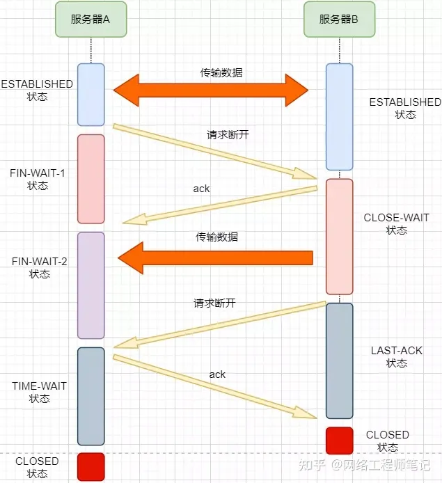

  - **Congestion control**：

    - 目标是让发送速率适应共享网络容量，避免持续把瓶颈队列推满。
    - 经典 AIMD 思路：无丢包时逐步增加发送速率，出现拥塞信号时降低速率。
    - 慢开始（slow start）：cwnd 在初始阶段快速增长，经典模型中近似按 RTT 翻倍。
    - 拥塞避免（congestion avoidance）：达到 ssthresh 后转为较缓慢的线性增长。
    - 快重传（fast retransmit）：收到多个相同 ACK 时，不必等计时器到期即可重传疑似丢失的 segment。
    - 快恢复（fast recovery）：对重复 ACK 造成的轻度拥塞降低 cwnd 后继续探测；超时通常表示更严重拥塞，需要更大幅度降低发送速率。
    - ECN（Explicit Congestion Notification）允许网络设备在不直接丢包的情况下标记拥塞。
    - 当 K 条 TCP 流共享带宽为 R 的瓶颈链路时，理想公平目标是每条流平均约为 R/K；实际公平性会受 RTT、并行连接和算法实现影响。

    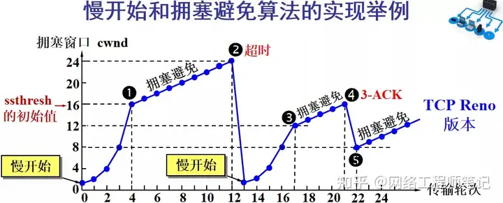

    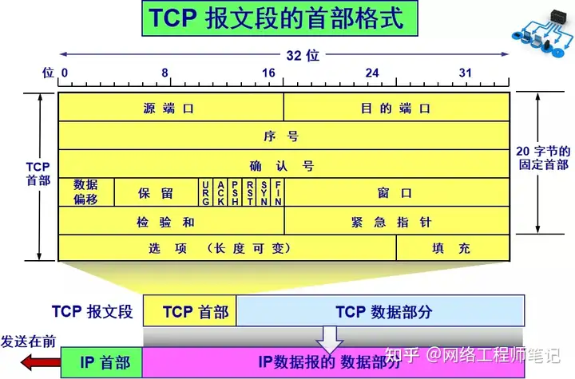

  - TCP 首部固定部分为 20 字节，加入选项后总长度通常为 20–60 字节；常见选项包括 MSS、窗口扩大、时间戳和 SACK。

    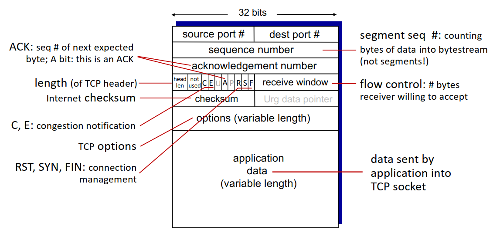

    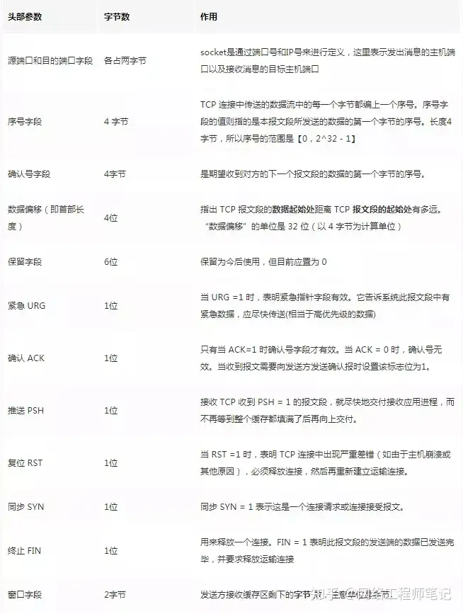

    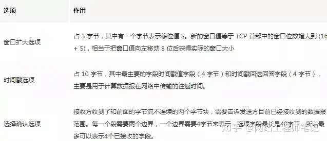

  - Pipeline：

    1. 三次握手建立连接和初始状态。
    2. 发送方根据 cwnd 和 rwnd 发送窗口内的字节。
    3. 接收方校验、按序交付并返回 ACK/SACK。
    4. 发送方根据 ACK、重复 ACK 和 timer 调整重传与发送窗口。
    5. 双方分别发送 FIN，完成半关闭和资源释放。

  - Pros：
    - 提供可靠、有序、全双工的字节流。
    - 具备接收方流量控制和网络拥塞控制。

  - Cons：
    - 建立连接需要握手，丢包会增加延迟。
    - 字节流没有应用消息边界，应用必须自己处理 framing。
    - 单个 TCP 连接可能受到 TCP 级别 HOL blocking 影响。

## 3.5 QUIC 与 TCP/UDP 的关系

- **QUIC（Quick UDP Internet Connections）**。

  - Takeaway：QUIC 在 UDP 之上提供可靠 stream、拥塞控制、加密和连接管理；同一连接中的多个 stream 可独立推进，HTTP/3 以此减少跨对象阻塞。

  - Core Mechanism：

    - 多个 application-level streams multiplex 在一个 QUIC connection 中。
    - 各 stream 具有独立的可靠传输状态，某个 stream 丢包通常不会阻塞其他 stream。
    - QUIC 自带 TLS 集成、认证和加密；典型新连接可在 1 RTT 左右建立安全状态，恢复连接可能更快，具体取决于握手和缓存状态。
    - QUIC 使用类似 TCP 的 loss detection 和 congestion control 思路，但不要求内核 TCP 栈升级。

    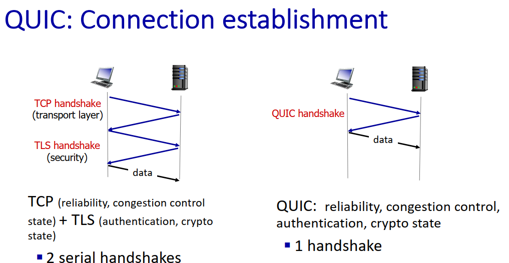

# 4. 网络层数据平面：分组如何逐跳转发

## 4.1 Forwarding、Routing 与 Router

- **网络层数据平面**。

  - Takeaway：forwarding 是本地、逐分组的动作；routing 是全局或区域性的路径计算。路由器通过输入端口、switching fabric 和输出端口完成数据平面处理。

  - Core Mechanism：

    - forwarding：读取目的地址，查 forwarding table，把 datagram 从输入链路转到输出链路。
    - routing：根据网络拓扑、链路代价和策略计算源到目的的路径，并生成或更新转发表。
    - 传统 destination-based forwarding 主要依据目的 IP；generalized forwarding 可以同时匹配入端口、源/目的 IP、协议、源/目的端口、VLAN 等字段。

    ~~~mermaid
    flowchart LR
      I["Input port parse header"] --> F["Forwarding table longest-prefix match"]
      F --> S["Switching fabric"]
      S --> Q["Output queue"]
      Q --> O["Output port schedule and transmit"]
    ~~~

    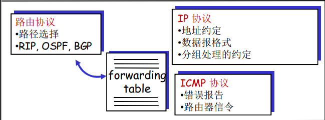

    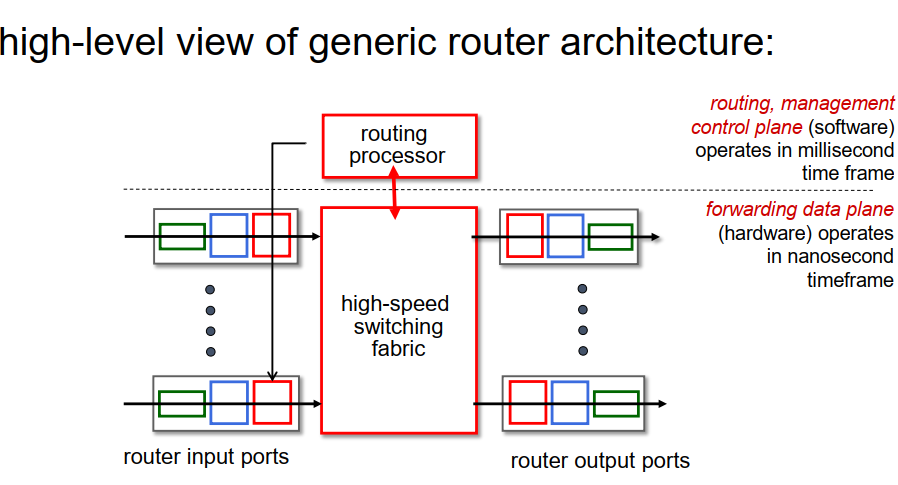

    - 输入端口：
      - 解析首部并进行最长前缀匹配（longest-prefix matching）。
      - 当数据报到达速度高于 switching fabric 处理速度时，形成 input queue。
    - Switching fabric：
      - memory：由 CPU 或交换控制逻辑复制数据，结构简单但受内存访问限制。
      - bus：所有输入输出共享总线，存在 bus contention。
      - interconnection network：通过并行内部链路提高多分组并发转发能力。
    - 输出端口：
      - 当到达速率高于输出链路速率时需要 buffer。
      - 调度规则包括 FIFO、priority scheduling、Round Robin（RR）和 Weighted Fair Queuing（WFQ）。

    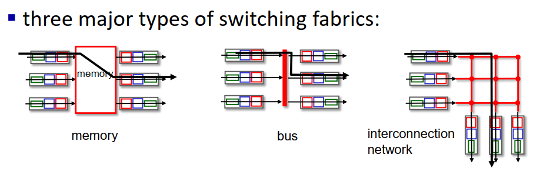

    - 缓存大小的经验估计：

      $$
      \text{buffer}\approx RTT\times C
      $$

      $C$ 是链路容量；当有大量独立流时，常见改进估计为 $RTT\times C/\sqrt{N}$。这些是工程经验，不是所有网络场景都成立的定理。

  - Pros：
    - 数据平面动作简单且可在硬件中高速并行执行。
    - 转发表与控制平面分离后，可以独立优化转发性能和路由算法。

  - Cons：
    - 队列管理不当会带来高时延、丢包和不同流之间的不公平。
    - TCAM 等高速匹配硬件成本高、容量有限。

## 4.2 IP：面向无连接的 Best-effort 服务

- **IP（Internet Protocol）**。

  - Takeaway：IP 负责跨越多个异构链路，把 datagram 尽力送到目标主机；它提供寻址、逐跳路由转发和必要的分片/重组，但不保证可靠、有序或不丢失。

  - Core Mechanism：

    - IP 是 connectionless、best-effort 服务：不维护后续数据报的连接状态，不承诺交付、顺序、重传或流量控制。
    - 主机和路由器都属于 network node；主机通常不执行路由转发，路由器既有 IP 接口又执行 routing。
    - IP 的三个主要功能：
      1. IP addressing：标识网络接口和目标主机。
      2. Routing/forwarding：把 datagram 送到最终目的。
      3. Fragmentation/reassembly：适配不同链路的 MTU。

    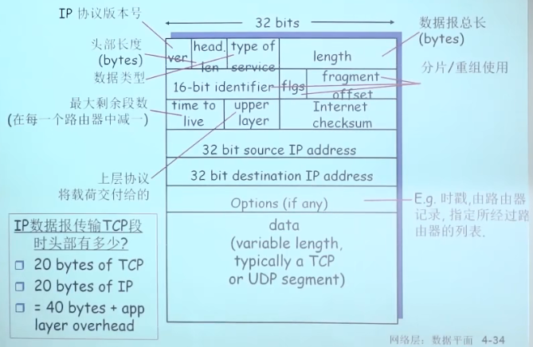

    - MTU（Maximum Transmission Unit）是链路允许承载的最大 IP packet 大小。
    - IPv4 中，过大的 datagram 可能被分片；各分片共享 identification，带有不同 fragment offset，最后一个分片的 MF 标志为 0；通常由最终目的主机重组。
    - 分片增加丢失概率和处理开销，现代系统通常尽量通过路径 MTU 发现避免分片。

    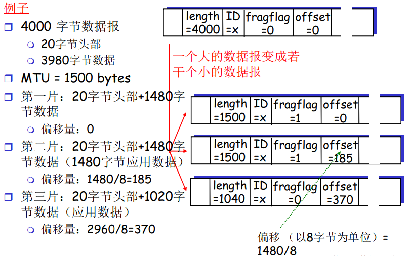

## 4.3 IPv4 编址、子网与 DHCP

- **IPv4 address 与 subnet**。

  - Takeaway：IPv4 地址是 32 bit，地址的高位网络前缀标识 subnet，低位部分标识接口；subnet mask 或 CIDR 前缀长度决定二者边界。

  - Core Mechanism：

    - IP 地址与主机/路由器的 interface 关联，而不是简单与整台设备关联；一台路由器通常有多个接口。
    - 同一 subnet 中的接口具有相同网络前缀，可以在不经过路由器的情况下直接通过链路互达。
    - 子网掩码中为 1 的 bit 表示网络部分，为 0 的 bit 表示主机部分；/22 表示前 22 bit 为网络前缀。
    - 子网地址通常主机位全 0，广播地址通常主机位全 1；具体可用地址范围还要结合地址规划和 IPv4 特殊用途判断。
    - private IP 只在局部网络中有意义，通常不会被 Internet 路由器作为公有目标地址转发。

    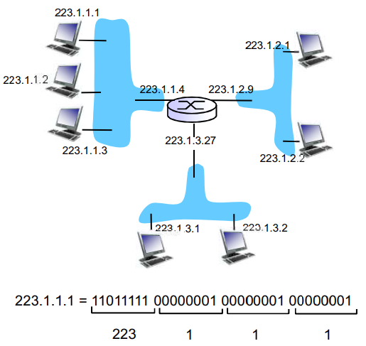

    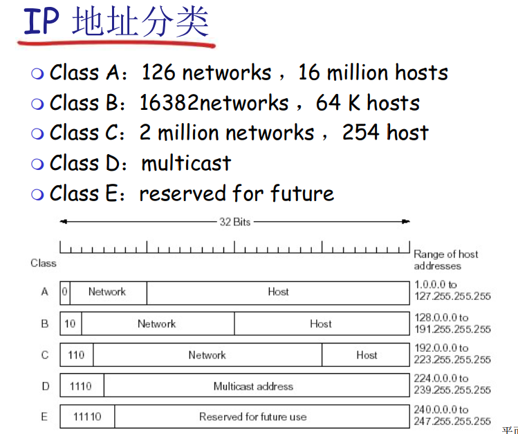

  - **CIDR 计算例子**：给定 192.168.23.35/21。

    - 子网掩码：255.255.248.0。
    - 网络地址：192.168.16.0/21。
    - 地址总数：$2^{32-21}=2048$。
    - 常规主机地址范围：192.168.16.1 到 192.168.23.254；192.168.16.0 为网络地址，192.168.23.255 为广播地址。

    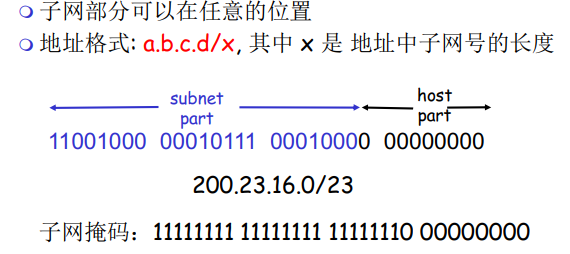

- **DHCP（Dynamic Host Configuration Protocol）**。

  - Takeaway：DHCP 让新加入网络的主机动态获得 IP 配置，并通过租约回收和更新有限地址资源。

  - Core Mechanism：

    - 主机加入网络时通常需要获得 IP address、subnet mask、default gateway 和 DNS server。
    - DORA 流程：
      1. Discover：主机广播 DHCP discover。
      2. Offer：DHCP server 提供地址和配置。
      3. Request：主机请求采用某个 offer。
      4. ACK：server 确认租约。
    - DHCP 还可以支持租约续期、重启后复用旧地址和移动用户临时接入；常见实现使用 UDP 端口 67/68。

    ~~~mermaid
    sequenceDiagram
      participant H as New host
      participant D as DHCP server
      H->>D: DHCP Discover
      D-->>H: DHCP Offer
      H->>D: DHCP Request
      D-->>H: DHCP ACK
    ~~~

    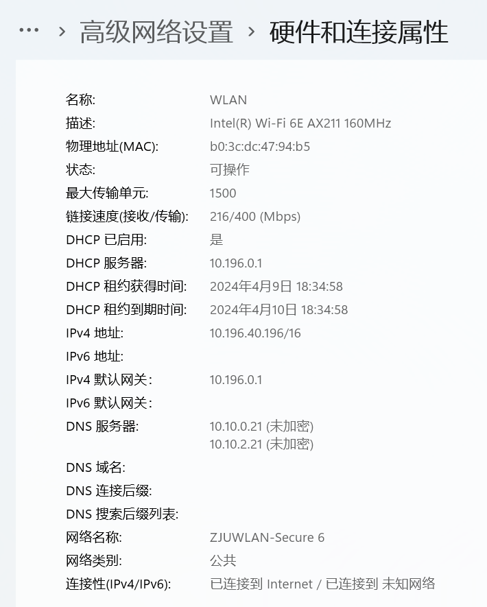

  - 地址块的分配由 Internet 地址管理体系协调；ICANN 负责 Internet 号码资源和域名体系中的协调工作，具体地址分配还涉及区域 Internet 注册机构。

## 4.4 IPv6

- **IPv6（Internet Protocol version 6）**。

  - Takeaway：IPv6 将地址扩展为 128 bit，并简化固定首部；路由器不负责分片，过大的 packet 通过 ICMPv6 等机制通知源端调整。

  - Motivation：IPv4 的 32 bit 地址空间不足，同时需要更适合扩展、流量标记和高效转发的首部设计。

  - Core Mechanism：

    - 固定基本首部 40 字节，包含 version、traffic class/priority、flow label、payload length、next header 和 hop limit。
    - hop limit 类似 IPv4 TTL，用于限制分组跨越的跳数。
    - IPv6 路由器不进行分片；源端需要依据路径 MTU 发送合适大小的 packet，过大时由 ICMPv6 通知源端。
    - IPv4 到 IPv6 的过渡可使用 tunneling：把 IPv6 datagram 封装进 IPv4 packet，在 IPv4 网络中传输，到隧道终点再解封装。

    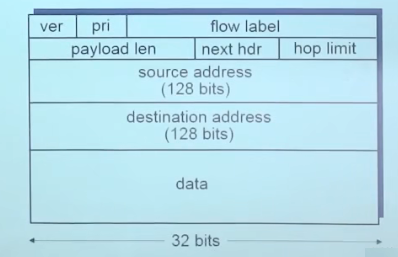

    

## 4.5 转发表、最长前缀匹配与路由聚集

- **Forwarding table 与 Longest Prefix Matching**。

  - Takeaway：路由器把目的 IP 与转发表中的网络前缀匹配，并选择匹配长度最长的条目；CIDR 的层次前缀还能把多条细粒度路由聚合成一条。

  - Core Mechanism：

    1. 取出 IP datagram 的 destination IP。
    2. 用不同条目的 subnet mask/CIDR prefix 与目标地址匹配。
    3. 若有多个匹配项，选择最长前缀。
    4. 根据 next hop 和 interface 转发。

    - route aggregation 把共享更长网络前缀的多条路由合并，减少路由表规模；更具体的路由可以覆盖聚合路由，因此仍必须使用 longest-prefix match。

    

    

  - 相关阅读：[CIDR 地址划分](https://blog.csdn.net/han156/article/details/77817031)、[最长前缀匹配](https://blog.csdn.net/weixin_43275631/article/details/109960686)。

## 4.6 NAT

- **NAT（Network Address Translation）**。

  - Takeaway：NAT 让多个 private hosts 通过一个或少量 public IP 访问外部网络，使用端口号区分并维护内部连接映射。

  - Core Mechanism：

    - 出站时，NAT 把内部源地址/源端口改写为 public IP/新端口，并在 NAT translation table 中记录映射。
    - 入站响应依据 public IP 和端口查表，再改写回内部目标地址/端口。
    - NAT 的可用端口空间是 16 bit，理论上最多约 65536 个端口，但实际还受到保留端口、协议和实现限制。

    ~~~mermaid
    flowchart LR
      H1["10.0.0.2:5150"] --> N["NAT 203.0.113.7:40001"]
      H2["10.0.0.3:5151"] --> N
      N --> I["Internet server"]
      I --> N
      N --> H1
      N --> H2
    ~~~

  - Pros：
    - 不必为每个内部设备从 ISP 申请公有地址。
    - 内部地址变化或更换 ISP 时，外部地址接口可以保持稳定。
    - 内部主机默认不直接暴露监听地址，减少无意入站连接。

  - Cons：
    - 破坏端到端可达性，入站连接需要额外配置。
    - 端口映射、协议嵌入地址和多层 NAT 会增加排障复杂度。
    - 地址不可见不等于完整安全边界，仍需防火墙、认证和加密。

  - **NAT traversal**：
    1. 静态配置端口转发，例如把 public:2500 映射到 10.0.0.1:2500。
    2. 通过 UPnP/IGD 请求 NAT 设备创建临时映射。
    3. 使用 relay server，让 client 和内部 server 都主动连接中继。

## 4.7 Generalized Forwarding

- **Match + Action：通用转发抽象**。

  - Takeaway：通用转发不只看目的 IP，而是把“匹配首部字段”和“执行动作”抽象成可编程规则，为中间盒和 SDN 提供统一接口。

  - Core Mechanism：

    - 匹配字段可以包括 ingress port、源/目的 IP、协议、源/目的端口和 VLAN。
    - 匹配成功后可以更新计数器，并执行 forward、drop、modify field、redirect 等动作。
    - 流表通常包含 priority、statistics 和 timeout；匹配不到时按默认规则处理。

    | Match | Action |
    | --- | --- |
    | ingress port = 1，IP dst = 10.2.0.3 | forward(3) |
    | ingress port = 2，IP dst = 10.2.0.3 | forward(3) |
    | ingress port = 1，IP dst = 10.2.0.4 | forward(4) |
    | ingress port = 2，IP dst = 10.2.0.4 | forward(4) |
    | ingress port = 4，IP src/dst = 10.2.0.4/10.2.0.3 | forward(3) |

# 5. 网络层控制平面：路径如何被计算

## 5.1 Link State 与 Dijkstra

- **Link-state routing**。

  - Takeaway：LS 路由让每个路由器获得足够完整的网络拓扑和链路代价，再在本地运行 Dijkstra 计算最短路径。

  - Core Mechanism：

    - 路由器向网络泛洪 link-state advertisement（LSA），每条记录包含邻居和链路代价。
    - sequence number 用于识别新旧消息、避免重复；age 随时间减少，过期记录被丢弃。
    - 每个路由器建立全局拓扑图，从自身出发运行 Dijkstra。

    - Dijkstra 每次从未确定节点中选取当前距离最小者，并用它松弛邻居：

      $$
      O(n^2)
      $$

      这是朴素实现的复杂度；使用优先队列可得到更适合稀疏图的实现复杂度。

  - Pipeline：

    1. 发现邻居并测量链路代价。
    2. 生成带序号和生命周期的 LSA。
    3. 在 AS 内泛洪 LSA，构建相同或近似相同的拓扑数据库。
    4. 运行 Dijkstra 得到最短路径树。
    5. 把下一跳写入 forwarding table。

  - Pros：
    - 收敛后每个节点拥有全局拓扑，路径计算较直接。
    - 对链路代价变化的响应通常较快。

  - Cons：
    - 泛洪和拓扑数据库占用控制流量、内存和 CPU。
    - 大规模网络需要层次化区域来控制状态规模。

    

## 5.2 Distance Vector 与 Bellman-Ford

- **Distance-vector routing**。

  - Takeaway：DV 路由器只维护到各目标的距离估计，并与邻居交换向量；Bellman-Ford 方程让每个节点通过邻居信息逐步逼近最短路径。

  - Core Mechanism：

    - 每个节点只知道自身到邻居的链路代价和邻居通告的距离向量。
    - 对节点 $x$ 到目标 $y$ 的估计：

      $$
      D_x(y)=\min_{v}\{c(x,v)+D_v(y)\}
      $$

      $v$ 是 $x$ 的邻居，$c(x,v)$ 是链路代价；取值表示“经哪个邻居走最便宜”。

    - 链路或节点状态改变时，节点向邻居发送新 DV；邻居收到后重新计算并继续传播。
    - 好消息传播快，坏消息可能传播慢，出现 count-to-infinity；split horizon 等机制可缓解环路。

  - Pipeline：

    1. 初始化到自身为 0、到直接邻居为链路代价、其他目标为无穷。
    2. 与邻居交换距离向量。
    3. 使用 Bellman-Ford 更新估计和下一跳。
    4. 若估计改变，则继续向邻居通告。

  - Pros：
    - 每个节点只需维护邻居信息，分布式实现简单。
    - 控制消息和局部状态通常比全局 LS 更小。

  - Cons：
    - 收敛可能慢，容易产生路由环路和 count-to-infinity。
    - 只看邻居的局部视图，故障传播需要多个交换周期。

    

    

## 5.3 LS 与 DV 对比

| 维度 | Link State | Distance Vector |
| --- | --- | --- |
| 节点视图 | 全局拓扑 | 邻居通告的距离 |
| 核心算法 | Dijkstra | Bellman-Ford |
| 消息传播 | 泛洪 LSA | 邻居之间交换 DV |
| 本地计算 | 较重 | 较轻 |
| 收敛 | 通常较快 | 可能较慢 |
| 典型问题 | 状态和泛洪开销 | 环路、count-to-infinity |

## 5.4 Autonomous System：RIP 与 OSPF

- **Intra-AS routing**。

  - Takeaway：Internet 先按自治系统（AS）分层；AS 内部可按性能选择路由协议，AS 之间还要叠加商业和管理策略。

  - Core Mechanism：

    - AS（Autonomous System）是一组由同一组织管理、具有共同路由策略的网络和路由器。
    - intra-AS protocol 关注 AS 内的可达性和性能；inter-AS protocol 还必须处理策略、商业关系和安全边界。

- **RIP（Routing Information Protocol）**。

  - Takeaway：RIP 是基于 DV 的较简单 IGP，以跳数作为主要度量并周期性和邻居交换路由信息。

  - Core Mechanism：
    - 路由器大约每 30 秒向邻居通告距离向量。
    - 通告通常携带目标网络和跳数，经典 RIP 的单次通告最多包含约 25 个目标网络。
    - 链路失效时，错误距离会通过邻居传播；split horizon、poisoned reverse 和超时机制用于缓解环路。

  

  

- **OSPF（Open Shortest Path First）**。

  - Takeaway：OSPF 是基于 LS 的 IGP，在 AS 内泛洪链路状态并运行最短路径计算，支持认证、多个链路代价和层次化区域。

  - Core Mechanism：
    - OSPF advertisement 携带邻居路由器和链路代价信息，并在 AS 内传播。
    - OSPF 报文直接承载在 IP 上，使用 IP protocol number 89，而不是 TCP/UDP 端口。
    - 大规模部署可划分 area，通过 backbone area 连接不同区域，降低单个拓扑数据库规模。
    - IS-IS 与 OSPF 都属于常见的 LS 类 IGP，思路相近。

  

  

  

## 5.5 BGP：AS 之间的路由

- **BGP（Border Gateway Protocol）**。

  - Takeaway：BGP 是连接 Internet 各个 AS 的事实标准；它以 path vector 传播可达前缀和 AS path，并依据本地策略选择和通告路径。

  - Motivation：AS 之间的“最佳路径”不只由链路长度决定，还涉及客户/提供商关系、流量方向、费用、可靠性和管理策略。

  - Core Mechanism：

    - eBGP：与相邻 AS 的边界路由器交换子网可达信息。
    - iBGP：把从外部获得的可达信息传播给本 AS 内的相关路由器。
    - BGP session 通常建立在半永久 TCP 连接上。
    - 重要属性：
      - AS-PATH：记录路径经过的 AS 序列，也可用于避免环路。
      - NEXT-HOP：指出下一跳路由器。
    - 输入/输出策略决定接受哪些路径、向哪些邻居通告哪些路径。

    ~~~mermaid
    flowchart LR
      A["AS 1"] <-->|"eBGP: prefix + AS-PATH"| B["AS 2"]
      B <-->|"eBGP"| C["AS 3"]
      B -->|"iBGP"| B1["AS 2 internal routers"]
      B1 --> F["Forwarding table"]
    ~~~

    - 热土豆路由（hot-potato routing）：在满足外部策略后，优先把分组交给本 AS 内部代价较小的出口，不一定选择整个 Internet 路径最短的出口。

  - Pipeline：

    1. 边界路由器通过 eBGP 学习相邻 AS 的前缀。
    2. 根据 import policy 过滤和修改候选路径。
    3. 在 AS 内通过 iBGP 传播可用信息。
    4. 按属性和本地策略选择路径。
    5. 通过 export policy 对外通告选定前缀。

  

  

  

  

## 5.6 SDN：控制平面与数据平面分离

- **SDN（Software-Defined Networking）**。

  - Takeaway：SDN 把高速执行转发规则的数据平面与逻辑上集中的控制平面分离，通过 OpenFlow 等接口下发 match-action 规则，使网络控制更可编程。

  - Core Mechanism：

    - 数据平面交换机维护 flow table，负责匹配和执行。
    - SDN controller 维护网络视图、计算策略并通过 southbound interface 下发规则。
    - network control applications 位于控制器之上，表达安全、流量工程和服务链等策略。

    ~~~mermaid
    flowchart TB
      A["Network control applications"] --> C["SDN controller logical control plane"]
      C -->|"OpenFlow / southbound API"| S1["Data-plane switch 1"]
      C -->|"OpenFlow / southbound API"| S2["Data-plane switch 2"]
      S1 <--> S2
      S1 --> H["Hosts"]
      S2 --> H
    ~~~

    

    - OpenFlow 的核心抽象是 match + action：
      - match：ingress port、MAC、VLAN、源/目的 IP、协议和端口等。
      - action：forward、drop、modify、redirect、count。
      - flow entry 还可以包含 priority、statistics 和 timeout。
    - controller 与交换机之间通过 OpenFlow 等协议交互；交换机执行控制器下发的规则。

    

  - Pros：
    - 控制逻辑集中，便于统一策略和自动化编程。
    - 数据平面设备可以用统一抽象支持多种转发行为。

  - Cons：
    - 控制器、控制信道和全局状态同步成为新的可靠性与扩展性问题。
    - 集中逻辑不等于物理单点，实际部署通常需要控制器集群和故障切换。

## 5.7 ICMP 与 SNMP

- **ICMP（Internet Control Message Protocol）**。

  - Takeaway：ICMP 是 IP 之上的控制和诊断协议，由 IP datagram 承载，用于报告不可达、TTL 超时等错误以及进行网络诊断。

  - Core Mechanism：
    - ping 通过 ICMP echo request/reply 测试可达性和 RTT。
    - traceroute 让探测分组逐步增加 TTL，通过接收 ICMP Time Exceeded 推断路径。
    - ICMP 报告错误，但通常不负责修复传输层数据；修复动作由主机、路由协议或应用决定。

    

    

- **SNMP（Simple Network Management Protocol）**。

  - Takeaway：SNMP 让 network management station 读取或修改设备的管理信息，并接收设备主动上报的事件。

  - Core Mechanism：
    - manager 通过 SNMP 与 agent 通信。
    - agent 暴露 MIB（Management Information Base）中的计数器、接口状态和设备参数。
    - 常见操作包括 GET、SET 和设备主动发送的 TRAP/notification。

# 6. 数据链路层与 LAN

## 6.1 链路层上下文与服务

- **Link layer：相邻节点之间的交付**。

  - Takeaway：链路层负责把一个 datagram 封装成 frame，并通过一条链路送到相邻节点；同一个 IP datagram 在不同链路上可以被重新封装成不同 frame。

  - Core Mechanism：

    - 点到点链路只有两个端点，典型协议包括 PPP 和 HDLC。
    - 广播链路由多个节点共享同一介质；多个节点同时发送会造成 collision。
    - 主要服务：
      - framing：加入 frame header/trailer。
      - link access：通过 MAC 协议获得共享信道访问权。
      - MAC addressing：使用链路层地址区分同一链路中的接口。
      - error detection/correction：检测或纠正 bit errors。
      - reliable delivery、flow control：在需要的链路上提供相邻节点级别的可靠性和速率匹配。
      - half-duplex/full-duplex：规定两个方向能否同时发送。

    ~~~mermaid
    flowchart LR
      N1["Node A"] -->|"frame on one link"| N2["Node B / router interface"]
      N2 -->|"new frame on next link"| N3["Next hop"]
      I["IP datagram"] -.->|"payload remains"| N2
    ~~~

    

    - 链路层主体通常在网络适配器（NIC，network interface card）和其控制芯片中实现，位于每个主机以及路由器的每个端口。

  - Pros：
    - 把不同物理链路的差异封装起来，为网络层提供统一的相邻节点服务。
    - 差错检测等操作可在网卡硬件中高速执行。

## 6.2 差错检测与纠正

- **EDC、Parity、Internet checksum 与 CRC**。

  - Takeaway：发送方附加冗余位，接收方依据冗余关系检测或纠正错误；CRC 用模 2 多项式除法取余，是链路层常见且强力的差错检测方法。

  - Core Mechanism：

    - EDC（Error Detection and Correction bits）是用于保护数据的冗余位，$D$ 是被保护的数据。
    - 奇偶校验：
      - 单 bit parity 可发现部分奇数位翻转。
      - 二维 parity 能在一定程度上定位错误行列。
    - Internet checksum：
      - 把数据按 16 bit 整数分组求和，再取反码形成 checksum。
      - TCP/UDP 会对伪首部、首部和数据计算校验；IPv4 传统上只对 IP 首部计算 checksum。
      - checksum 主要用于差错检测，不能恢复错误数据。
    - CRC（Cyclic Redundancy Check）：
      - 选择生成多项式 $G$，其比特长度为 $r+1$。
      - 发送端把 $D$ 左移 $r$ 位后除以 $G$，在 GF(2) 上用 XOR 代替减法，余数记为 $R$。
      - 发送比特串为 $D2^r\oplus R$，使其可以被 $G$ 整除。
      - 接收端用 $G$ 除收到的比特串；余数非零则判定出错。

      $$
      R=\operatorname{remainder}\left(\frac{D2^r}{G}\right)
      $$

      例：$G=1001$ 时，$r=3$；给 $D$ 补 3 个 0 后做 XOR 除法，所得余数若为 011，发送码字就在末尾附加 011。

    

    

## 6.3 多路访问协议

- **共享广播信道的 MAC 协议**。

  - Takeaway：多个节点共享一个广播信道时，MAC 协议要协调“谁在什么时候发送”，目标是在避免碰撞、公平性和空闲容量之间取得平衡。

  - Core Mechanism：

    - 信道划分协议：预先划分时间、频率或编码空间。
    - 随机接入协议：节点竞争全部信道，碰撞后随机退避重传。
    - 轮流协议：节点按轮次获得发送权。

    ~~~mermaid
    flowchart TB
      M["Multiple-access MAC"] --> C["Channel partition"]
      M --> R["Random access"]
      M --> T["Taking turns"]
      C --> C1["TDMA / FDMA / CDMA"]
      R --> R1["ALOHA / CSMA / CSMA-CD / CSMA-CA"]
      T --> T1["Polling / Token passing"]
    ~~~

### 信道划分协议

- **TDMA、FDMA 与 CDMA**。

  - Takeaway：信道划分通过预先分配资源消除碰撞，但活跃节点较少时，未使用的资源可能被浪费。

  - Core Mechanism：
    - TDMA 把时间划成 frame，再划成 N 个 slot，每个节点获得固定时隙，平均速率约为 R/N。
    - FDMA 把带宽 R 划成 N 个频段，每个节点获得一个频段，带宽约为 R/N。
    - CDMA 为节点分配不同 code，使多个节点可以同时发送，并在接收端按 code 分离。

  - Pros：
    - 碰撞少且容易保证公平。
    - 分配稳定，适合持续、可预测的负载。

  - Cons：
    - 节点必须等待自己的资源，即使其他资源空闲。
    - 突发负载和活跃节点数量变化时利用率可能较低。

### 随机接入协议

- **ALOHA、CSMA、CSMA/CD 与 CSMA/CA**。

  - Takeaway：随机接入允许节点在需要时竞争信道；监听和退避可以降低碰撞，但传播时延和无线环境仍使碰撞不可完全消除。

  - **时隙 ALOHA**：
    - 节点只在时隙起点发送，碰撞后在后续时隙以概率 $p$ 重传。
    - 唯一活跃节点时可以使用全部速率 R；实现分散，但需要时隙同步。
    - 大量节点、持续有数据时，最大效率为：

      $$
      \frac{1}{e}\approx 0.37
      $$

  - **纯 ALOHA**：
    - 帧一到达就发送，碰撞后以概率 $p$ 重传。
    - 不需要时隙同步，但 vulnerable period 更长，最大效率约为：

      $$
      \frac{1}{2e}\approx 0.18
      $$

  - **CSMA（Carrier Sense Multiple Access）**：
    - 发送前先监听信道，检测到忙则等待。
    - 传播时延使两个相距较远的节点可能同时认为信道空闲，因此监听仍不能消除碰撞。

  - **CSMA/CD（Collision Detection）**：
    - 主要用于共享式有线以太网。
    - 发送时继续监听，发现碰撞就停止发送并执行 binary exponential backoff。
    - 第一次冲突在 $\{0,1\}$ 中选 K，之后扩大随机范围，等待 K 个 slot time 后重传。
    - 经典效率近似：

      $$
      \text{efficiency}\approx\frac{1}{1+5d_{\text{prop}}/d_{\text{trans}}}
      $$

      $d_{\text{prop}}$ 越小、最大帧传输时间 $d_{\text{trans}}$ 越大，效率越接近 1。

  - **CSMA/CA（Collision Avoidance）**：
    - 主要用于 802.11 Wi-Fi；无线节点难以在发送时可靠地检测碰撞，因此通过监听、随机退避、链路层 ACK，必要时配合 RTS/CTS 来降低碰撞概率。
    - CSMA/CD 偏向“发送中检测碰撞”，CSMA/CA 偏向“发送前避免碰撞”，二者适用介质不同。

  - 相关阅读：[链路层复习笔记](https://blog.csdn.net/yongheng1123/article/details/110239883)。

### 轮流协议

- **Polling 与 Token Passing**。

  - Takeaway：轮流协议把发送权按顺序分配，既避免碰撞，又能在只有一个活跃节点时保持较高利用率。

  - Core Mechanism：
    - polling：指定一个 master，依次询问节点，并告诉它最多可以发送多少帧。
    - token passing：没有固定 master，token frame 按固定顺序在节点间传递，持有 token 的节点发送后交给下一个节点。

  - Pros：
    - 消除碰撞和随机接入中的空闲时隙。
    - 在多个活跃节点之间保持相对公平。

  - Cons：
    - polling 有轮询时延，master 故障会影响整个信道。
    - token 丢失或某节点故障可能破坏令牌环的正常运行。

## 6.4 MAC 地址与 ARP

- **MAC addressing**。

  - Takeaway：MAC 地址是链路层接口的平面地址，通常为 48 bit；它只在当前链路/局域网内用于帧交付，不替代跨网络的 IP 地址。

  - Core Mechanism：
    - NIC 而不是抽象的“主机”拥有 MAC 地址；路由器的每个接口也有自己的链路层地址。
    - 以太网广播地址为 FF-FF-FF-FF-FF-FF。
    - MAC 地址通常随网卡保持不变；IP 地址则随所在 subnet 和网络配置变化。
    - 适配器收到 frame 后检查 destination MAC；匹配自身或广播地址才提取其中的 IP datagram。

- **ARP（Address Resolution Protocol）**。

  - Takeaway：ARP 在同一个 LAN 内把目标 IP 解析为下一跳接口的 MAC，并用 ARP cache 缓存映射；跨子网时，主机解析的是默认网关的 MAC，而不是远端主机的 MAC。

  - Core Mechanism：

    - ARP 表项可表示为：

      $$
      \langle\text{target IP},\text{target MAC},\text{TTL}\rangle
      $$

    - 若目标映射不在缓存中：
      1. 主机广播 ARP request，目标 MAC 使用全 1 广播地址。
      2. 拥有目标 IP 的接口返回 ARP reply。
      3. 发送方把 IP–MAC 映射写入 ARP cache，过期后重新解析。
    - ARP 只在本地广播域内生效；DNS 负责 domain name 到 IP 的映射，ARP 负责本地 IP 到 MAC 的映射。

    ~~~mermaid
    sequenceDiagram
      participant A as Host A
      participant R as Default gateway
      participant B as Host B
      A->>A: DNS gives B's IP
      A->>R: ARP request for gateway MAC
      R-->>A: ARP reply
      A->>R: Frame MAC A -> R, IP A -> B
      R->>B: New frame MAC R -> B, same IP A -> B
    ~~~

    

  - **A → R → B 的逐跳封装**：
    1. A 生成源 IP=A、目的 IP=B 的 datagram。
    2. A 把 datagram 封装成源 MAC=A、目的 MAC=R 左接口的 frame。
    3. R 解封装 frame，读取目的 IP，查表决定出口。
    4. R 用右接口 MAC 作为新 frame 的源 MAC、B 的 MAC 作为目的 MAC。
    5. B 取出 IP datagram，交给上层；在没有 NAT 时，端到端 IP 通常保持不变，MAC 每一跳都会改变。

# 7. 物理层与无线网络

## 7.1 物理媒体与信号

- **Physical media**。

  - Takeaway：物理层把 bit 映射为可在介质中传播的电信号、光信号或电磁波；带宽、噪声、衰减和传播距离共同决定可达速率。

  - Core Mechanism：
    - guided media：双绞线、同轴电缆、光纤。
    - unguided media：无线电波、红外或其他开放空间信号。
    - 码元（symbol）是一次信号变化所携带的状态；bit rate 与 symbol rate（baud）在多电平调制下不必相等。

    

## 7.2 Nyquist 与 Shannon

- **无噪声与有噪声信道容量**。

  - Takeaway：Nyquist 给出理想低通信道的码元速率上限，Shannon 给出考虑噪声后的容量上限；提高带宽或信噪比都可能提高可达速率，但不能无限提高。

  - Core Mechanism：

    - Nyquist 准则：

      $$
      C=2W\log_2 V\quad(\text{bit/s})
      $$

      $W$ 是信道带宽，$V$ 是离散信号电平数；该公式假设理想、无噪声低通信道。

    - Shannon 定理：

      $$
      C=W\log_2\left(1+\frac{S}{N}\right)
      $$

      $S/N$ 是信噪比；即使使用无限多电平，有噪声信道的容量也受该上限约束。

    

    

## 7.3 编码、调制与无线

- **四种编码与调制关系**。

  - Takeaway：编码/调制的分类取决于输入数据是 digital 还是 analog，以及输出信号是 digital 还是 analog；实际系统通常还要结合采样、滤波和纠错。

  - Core Mechanism：

    | 输入数据 | 输出信号 | 典型过程 |
    | --- | --- | --- |
    | digital | digital | line coding |
    | digital | analog | digital modulation |
    | analog | digital | sampling / PCM / source coding |
    | analog | analog | analog modulation |

    - 无线链路是共享介质，常受干扰、衰减、移动性、多径和 hidden terminal 影响；这也是 Wi-Fi 更强调 CSMA/CA 和链路层确认的原因。

  - Pros：
    - 无线接入支持移动性和灵活部署。

  - Cons：
    - 信道状态变化快，误码、碰撞和可用带宽波动明显。

# 8. 跨层补充：安全、状态与工程问题

## 8.1 常见网络安全问题

- **Malware 与典型攻击**。

  - Takeaway：网络安全问题既可能来自恶意程序，也可能来自协议状态、地址伪造或资源耗尽；分类应看传播方式、伪装方式和攻击目标，而不是死记单一特征。

  - Core Mechanism：

    | 类型 | 核心特征 |
    | --- | --- |
    | Virus | 通常依附于宿主文件或程序传播，执行后触发恶意 payload |
    | Worm | 能自我复制并通过网络或系统漏洞传播，常造成资源耗尽 |
    | Trojan horse | 伪装成合法或有用的软件，重点是欺骗安装/执行，通常不以自我复制为定义 |
    | Spyware | 隐蔽收集用户、系统或网络信息 |

    - DDoS：大量恶意流量或请求耗尽带宽、连接表、CPU 或应用资源。
    - Spoofing：伪装成可信实体或伪造地址，诱导系统接受错误信息。
    - SYN flood：利用 TCP 半连接状态，发送大量伪造 SYN，使 server 消耗连接队列和相关资源；SYN cookies、连接速率限制、较短超时和边缘清洗可缓解。
    - DNS spoofing/cache poisoning：伪造或污染解析响应，使用户访问错误地址；缓存期限、响应验证和安全 DNS 机制会影响风险。

    - 普通 TCP/UDP socket 默认不提供机密性；TLS 可在应用层库中提供加密、数据完整性和端点认证，HTTPS 就是 HTTP over TLS。

    

  - 相关防御思路：
    - 保持软件和服务及时修补漏洞。
    - 使用最小权限、认证、加密和输入校验。
    - 对异常流量做限速、过滤、监控和故障隔离。

## 8.2 Stateful 与 Stateless

- **协议状态**。

  - Takeaway：stateless 表示协议实体不依赖并保存过去交互的状态；stateful 表示后续行为依赖此前建立或维护的信息。无状态底层协议之上仍可以构造有状态服务。

  - Core Mechanism：
    - 常见 stateless 例子：HTTP、UDP、DNS 的基础查询过程。
    - 常见 stateful 例子：TCP 连接、FTP 会话、SMTP/IMAP 会话。
    - HTTP 本身无状态，但 cookies、session ID 和 server-side session 可以在其上实现登录状态、购物车等有状态功能。
    - 判断重点是“协议实体是否保存并使用交互历史”，而不是简单把某个应用归为永远有状态或无状态。

## 8.3 应用层工程问题

- **TCP 字节流中的粘包与拆包**。

  - Takeaway：粘包与拆包不是 TCP 错误，而是应用层把有消息边界的数据映射到无边界字节流时产生的 framing 问题。

  - Core Mechanism：
    - 应用连续写入音频和文本，TCP 只把它们看作一串 bytes，并按自己的 segment 边界传输。
    - 一次 read 可能得到半条消息、完整一条消息或多条消息拼接。
    - 应用协议应使用长度前缀、分隔符、固定长度帧或自描述编码恢复消息边界。

    

- **长连接与 Keep-alive**。

  - Takeaway：复用持久 TCP 连接可以减少重复握手和资源开销，但需要设置空闲超时、连接上限和保活机制，避免资源长期被占用。

  - Core Mechanism：
    - 短连接适合低频、简单请求；长连接适合短时间内的多次交互。
    - 连接池、idle timeout、心跳和服务端并发限制共同决定可用性。

- **Stop-and-Wait 的链路利用率**。

  - Takeaway：当传播时延相对传输时延很大时，停等协议会让发送方大部分时间等待 ACK；流水线窗口可以提高链路利用率。

  - Core Mechanism：

    - 若 ACK 传输时间和处理时间可忽略，一个数据帧的周期约为：

      $$
      T_{\text{cycle}}\approx d_{\text{trans}}+2d_{\text{prop}}
      $$

    - 利用率近似为：

      $$
      \eta\approx\frac{d_{\text{trans}}}{d_{\text{trans}}+2d_{\text{prop}}}
      $$

      若计入 ACK 发送和处理时间，应把对应项加入分母。增大窗口、使用 GBN/SR 能让多个分组同时在途。

    - 常用传输时延：

      $$
      d_{\text{trans}}=\frac{\text{frame size}}{\text{bandwidth}}
      $$

# 9. 复习索引与课程记录

## 9.1 一条端到端排查路线

~~~mermaid
flowchart TD
  Q["应用请求失败"] --> A["DNS: 名字是否解析到正确 IP?"]
  A --> B["Transport: 端口、握手、rwnd/cwnd 是否正常?"]
  B --> C["Network: 路由、转发表、NAT、MTU 是否正常?"]
  C --> D["Link: ARP、MAC、VLAN、碰撞和 CRC 是否正常?"]
  D --> E["Physical: 链路、信号、带宽和干扰是否正常?"]
~~~

## 9.2 复习重点

- 计算：节点时延、吞吐量、CIDR/子网、CRC、ALOHA/CSMA 效率、Stop-and-Wait 周期。
- 协议解释：HTTP、DNS、DHCP、TCP/UDP、IP、ARP、RIP/OSPF/BGP、SDN/OpenFlow。
- 抓包分析：根据 Wireshark 中的 Ethernet、IP、TCP/UDP 和应用层字段，沿封装顺序定位问题。
- 复习材料：作业、quizzes、projects、slides 以及教材对应章节。

## 9.3 课程记录

- 原课程安排记录：作业 20 分（5 次纸质作业）、小测 10 分、实验 20 分、考试 50 分。
- 原考试记录：2024-04-27 10:30–12:30，可携带 4 页 A4 手写 cheat sheet。

## 9.4 零散术语

- One's complement：反码。
- Two's complement：补码。
- back-to-back：相继、连续发送。

# References

- 【中科大郑烇、杨坚全套《计算机网络（自顶向下方法 第 7 版）》课程】<https://www.bilibili.com/video/BV1JV411t7ow?p=4&vd_source=93bb338120537438ee9180881deab9c1>
- [DNS 理论](https://ephen.me/2015/dns-theory/)
- [IP 协议笔记](https://blog.csdn.net/E2242/article/details/124797598)
- [HTTP 与 Web 会话状态](https://blog.csdn.net/antony1776/article/details/83474496)
- [TCP 总结](https://zhuanlan.zhihu.com/p/368661050)
- [IP 层与网络层](https://blog.csdn.net/Rong_Toa/article/details/80639635)
- [RTT 计算](https://blog.csdn.net/weixin_44677382/article/details/105999368)
- [子网掩码](https://zhuanlan.zhihu.com/p/371400090)
- [通用转发和 SDN](https://blog.csdn.net/zheshiyangyang/article/details/134272781)
- [Dijkstra 算法](https://zhuanlan.zhihu.com/p/129373740)
- [CRC 与校验码](https://blog.csdn.net/weixin_43914604/article/details/104183321)
- [物理层学习资料](https://blog.csdn.net/weixin_43914604/article/details/104722679)
- [王道计算机网络学习笔记目录](https://blog.csdn.net/weixin_43914604/article/details/104722679)
