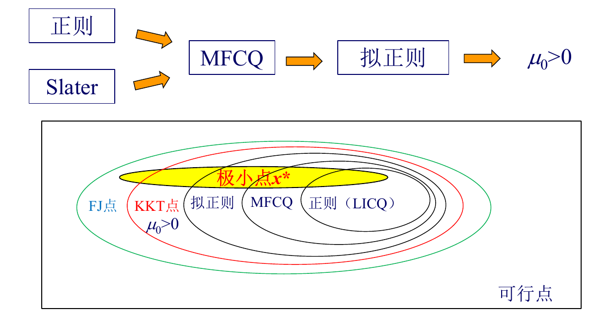

# 非线性规划

[TOC]

## 非线性规划问题

### Concepts
- 强制函数（Coercive）：$\|x\|\to\infty\ \Rightarrow\ f(x)\to\infty$。几何上函数在无穷远处趋于无穷，确保搜索范围不扩散到无穷远。
- 下水平集（Sublevel set）：$L_\alpha = \{x\in\mathbb{R}^n\mid f(x)\le \alpha\}$。
- 集合紧 $\Leftrightarrow$ 闭且有界（$\mathbb{R}^n$ 中）。
- 关键等价关系：$f$ 强制 $\Leftrightarrow$ 所有下水平集 $L_\alpha$ 紧。证明：(1) 强制 $\Rightarrow$ 有界——若 $L_\alpha$ 无界则存在 $\{x_k\}\subset L_\alpha$ 使 $\|x_k\|\to\infty$ 但 $f(x_k)\le\alpha$ 与强制矛盾；(2) 所有下水平集紧 $\Rightarrow$ 强制——取 $x_0$，$\|x\|\to\infty$ 时 $x\notin L_{f(x_0)}$ 故 $f(x)>f(x_0)$，即 $f(x)\to\infty$。

### Model
标准模型：
$$
\min f(x)\quad\text{s.t.}\quad g_j(x)\le 0,\quad h_i(x)=0
$$
其中 $x\in\mathbb{R}^n,\ f,g_j,h_i$ 连续可微。这里 $g_j$ 是不等式约束（$j=1,\dots,m$），$h_i$ 是等式约束（$i=1,\dots,p$）。

最优解存在性：若可行域非空有界闭，连续目标函数必能取得极小值（Weierstrass 定理）；无约束时若 $f$ 强制（$f(x)\to+\infty\ (\|x\|\to\infty)$），则所有下水平集紧，最优解常存在。

## 最优性条件

### 无约束极值问题
- 一阶必要条件（驻点）：若 $x^*$ 是局部极小点，则必有 $\nabla f(x^*)=0$。这是利用Taylor展开在极小点处一阶项必须为零推导所得。

- 二阶必要条件：$\nabla f(x^*)=0$ 且 $\nabla^2 f(x^*)\succeq 0$（Hessian 半正定）。若某方向 $p$ 使 $p^\top\nabla^2 f(x^*)p<0$，则沿该方向移动可降低函数值，矛盾。

- 二阶充分条件：$\nabla f(x^*)=0$ 且 $\nabla^2 f(x^*)\succ 0$（Hessian 正定），则 $x^*$ 为严格局部极小点。

- 直观理解：利用二次近似 $f(x^*+p)\approx f(x^*)+\frac12 p^\top\nabla^2 f(x^*)p$。$\nabla^2 f(x^*)\succ0$ 时，所有方向 $p$ 上的二次项均为正，函数在 $x^*$ 处呈碗口向上形态。矩阵正定性可用特征值全正或顺序主子式全正判定。

### 有约束极值问题

#### 等式约束：拉格朗日乘子法
拉格朗日函数：
$$
L(x,\nu)=f(x)+\nu^\top h(x)
$$
其中 $\nu\in\mathbb{R}^p$ 为拉格朗日乘子向量，每个分量 $\nu_i$ 对应一个等式约束 $h_i(x)=0$。

一阶必要条件：若可行点 $x^*$ 为局部极小点，则存在乘子 $\nu^*$ 使
$$
\nabla_x L(x^*,\nu^*)=0,\quad h(x^*)=0
$$
即 $\nabla f(x^*)+\sum_{i=1}^p \nu_i^* \nabla h_i(x^*)=0$——目标梯度与约束梯度的线性组合相平衡。乘子 $\nu_i^*$ 可理解为约束 $h_i$ 的"影子价格"或边际影响。

#### 不等式约束与可行方向
活跃集 $\mathcal{A}(x)=\{j\mid g_j(x)=0\}$，即在该点处取等号的不等式约束。向量 $d$ 为线性化可行方向需满足：
$$
\nabla h_i(x)^\top d=0,\quad \nabla g_j(x)^\top d\le 0\ (j\in\mathcal{A}(x))
$$
其中等式约束方向必须严格为零（保持可行），不等式约束方向允许非正（不违反约束或向内）。

直观必要性：若不存在同时满足上述条件且使 $\nabla f(x)^\top d<0$ 的方向（可行的下降方向），则 $x$ 可能是局部极小——因为沿任何可行方向都无法进一步降低目标函数值。

---

#### 一阶最优性条件

**Gordan引理**：设 $A_1,\dots,A_l$ 为 $l$ 个 $n$ 维向量，则下面两个命题恰有一成立：

1. 存在向量 $p$ 使 $A_j^\top p<0$ 对所有 $j=1,\dots,l$ 成立；

2. 存在不全为零的非负实数 $\mu_1,\dots,\mu_l$ 使得 $\sum_{j=1}^l \mu_j A_j = 0$。

即：
$$
\exists p,\ A_j^\top p<0\ (j=1,\dots,l) \quad\Longleftrightarrow\quad \not\exists\ \mu_j\ge0\text{ 不全为零},\ \sum\mu_j A_j=0
$$

几何含义：向量集合 $\{A_j\}$ 不可能全部位于某个超平面的同一侧（严格负半空间）而不存在非负线性相关关系。这是推导FJ条件和KKT条件的关键引理。

**Fritz John（FJ）必要条件**：对局部极小 $x^*$，存在不全为零的乘子 $\mu_0\ge0,\ \mu_j\ge0,\ \nu_i\in\mathbb{R}$，使
$$
\begin{cases}
\mu_0\nabla f(x^*)+\sum_j \mu_j \nabla g_j(x^*)+\sum_i \nu_i \nabla h_i(x^*)=0 \\
g_j(x^*)\le 0,\ h_i(x^*)=0 \\
\mu_j g_j(x^*)=0 \\
\mu_j\ge0,\ \sum_{j=0}^m \mu_j+\sum|\nu_i|\ne 0
\end{cases}
$$

两类情况：

1. $\mu_0>0$ 可归一化为KKT（需满足约束规格）。此时目标函数梯度参与平衡，最优性由目标与约束共同决定，拉格朗日乘子 $\mu_j/\mu_0$ 有具体的经济学解释（影子价格）。

2. $\mu_0=0$ 退化情形：约束"太奇异/太紧"，最优性完全由约束梯度平衡，目标梯度被排除——不是目标主导而是约束几何主导。这意味着不存在使所有 $\nabla g(x)^\top p<0$ 的可行方向，但可能存在 $\nabla g(x)^\top p=0$ 的边界可行方向。这一情形通常对应三种典型点：
   - **孤立点**：不存在任何可行方向，该点本身就像可行域中的一个"孤岛"
   - **特殊边界极小点**：$\nabla g(x)=0$（约束梯度在该处消失）
   - **非正则极小点**：起作用约束梯度线性相关（约束冗余或奇异，如两个约束面在该点相切）

**Karush–Kuhn–Tucker（KKT）条件**：若满足约束资格（CQ），可令 $\mu_0=1$ 归一化。对局部极小 $x^*$，存在乘子 $\lambda_j\ge0,\ \nu_i\in\mathbb{R}$（$\lambda_j$ 可全为0），使

$$
\nabla f(x^*)+\sum_j \lambda_j^* \nabla g_j(x^*)+\sum_i \nu_i^* \nabla h_i(x^*)=0
$$

以及

$$
g_j(x^*)\le 0,\ \ \lambda_j^*\ge 0,\ \ \lambda_j^* g_j(x^*)=0,\ \ h_i(x^*)=0
$$

这是最常用的一阶**必要条件**。KKT 条件的核心思想是：在最优解处，目标函数的负梯度（下降方向）可被约束梯度的非负线性组合所平衡。

#### 约束资格（CQ）：KKT必要性的保障

常见CQ：
- **LICQ**（线性无关，正则条件）：活跃约束梯度向量 $\{\nabla g_j(x^*),\ \nabla h_i(x^*)\}$ 线性无关。最常见、最易验证。

- **MFCQ**（Mangasarian–Fromovitz）：存在方向 $d$ 使 $\nabla h_i^\top d=0$ 且活跃不等式 $\nabla g_j^\top d<0$。比 LICQ 更弱（LICQ $\Rightarrow$ MFCQ）。

- **Slater条件**（凸问题）：存在严格可行点 $g_j(x)<0,\ h_i(x)=0$。即可行域有内点（nonempty interior），允许在约束面附近做完整的一阶分析，梯度空间完整。

- **拟正则条件**：$F(x^*) = T_\chi(x^*)$，即线性化可行方向锥等于真正切锥。
  - **切锥** $T_\chi(x)=\{p\mid\exists t_k\to0,\ \exists x_k\in\chi,\ x_k\to x^*,\ \frac{x_k-x^*}{t_k}\to p\}$：从真正可行域 $\chi$ 出发的所有可行切向量，由可行域的实际几何决定。
  - **线性化可行方向锥** $F(x)=\{p\mid\nabla h_i^\top p=0,\ \nabla g_j^\top p\le0\}$：将约束在 $x^*$ 附近作一阶线性近似，描述哪些方向可能保持可行。线性化预测的方向**至少**包含所有真实可行方向，但可能多估假方向。
  - 基本关系 $T_\chi(x)\subseteq F(x)$：若能沿 $p$ 走在可行域中，线性化后不会立即违反一阶近似。
  - $F(x^*)=T_\chi(x^*)$ 即拟正则——一阶线性化完美刻画可行方向，无尖点或孤立点。此条件下若线性化可行方向中无下降方向，由Farkas引理可推导KKT条件。

CQ的作用：排除奇异点，保证拉格朗日乘子存在且有意义，保证可行方向锥结构良好（$T_\chi = F$），使KKT成为最优性的必要条件。具体而言：
- 可行域在最优解处不出现尖点或孤立边界，可行方向可被梯度完整描述
- 线性化可行方向锥 $F(x)$ 完整刻画真实可行方向 $T_\chi(x)$，不含多余假方向
- KKT 乘子可以合理求解，不会出现无解（乘子不存在）或多解（乘子不唯一）的情况

常见CQ的关系：LICQ $\Rightarrow$ MFCQ $\Rightarrow$ 拟正则条件。LICQ 最强且最易验证，拟正则最弱但最难验证。对凸问题，Slater条件是最常用的选择。

---

#### 二阶最优性条件
- **临界锥 $C(x^*,\lambda^*,\nu^*)$**：由线性化可行方向中满足驻点互补关系的方向构成，是二阶分析的"舞台"。具体而言，
  $$
  C = \{p\mid \nabla h_i^\top p=0,\ \nabla g_j^\top p\le0,\ \nabla g_j^\top p=0\ (\forall j:\lambda_j>0)\}
  $$

- **二阶必要条件**：若 $x^*$ 是局部极小且 KKT 条件成立，则对任意 $p\in C$，有
  $$
  p^\top\nabla_{xx}^2 L(x^*,\lambda^*,\nu^*)\,p\ge 0
  $$

- **二阶充分条件**：若对所有非零 $p\in C$ 有
  $$
  p^\top\nabla_{xx}^2 L(x^*,\lambda^*,\nu^*)\,p>0
  $$
  则 $x^*$ 为严格局部极小。直觉：一阶平衡后，拉氏Hessian在可行自由度方向上必须向上弯。

### 凸规划

- **凸集**：$\forall x_1,x_2\in C,\ \theta x_1+(1-\theta)x_2\in C,\ 0\le\theta\le1$。凸集的任意交集仍为凸集。在凸规划中，可行域由凸集定义。

- **凸函数**：
  $$
  f(\theta x_1+(1-\theta)x_2)\le \theta f(x_1)+(1-\theta)f(x_2),\quad 0\le\theta\le1,\ \forall x_1,x_2 \quad\text{(Jensen不等式)}
  $$
  $<$ 严格凸，$\ge$ 凹，$>$ 严格凹，$=$ 线性。线性函数既是凸函数又是凹函数——这正是线性规划（LP）是凸规划的原因。
  - **一阶判定**（充要，对可微函数）：$f(x_2)\ge f(x_1)+\nabla f(x_1)^\top(x_2-x_1),\ \forall x_1,x_2$。几何意义：函数曲线上任意点处的切线（切平面）在函数图像下方，即函数图形位于其所有切线之上。该条件也可等价表述为梯度单调性 $(\nabla f(x_1)-\nabla f(x_2))^\top(x_1-x_2)\ge0$。
  - **二阶判定**（充要，对二次可微函数）：$\nabla^2 f(x)\succeq 0,\ \forall x$。几何意义：Hessian 矩阵半正定，函数曲线处处向上弯曲，没有鞍点或局部凸点。
  - 凸函数的非负线性组合仍为凸函数；凸函数与仿射函数的复合仍为凸函数。

- **凸规划**：目标 $f$ 和不等式约束 $g_j$ 为凸函数，等式约束 $h_i$ 为仿射函数。凸规划在理论和算法上都有极好的性质：
  - 全局极小充要条件：$\nabla f(x^*)^\top(x-x^*)\ge 0,\ \forall x$（无约束时 $\nabla f(x^*)=0$）。结合凸函数一阶条件 $f(x)\ge f(x^*)+\nabla f(x^*)^\top(x-x^*)$，该条件等价于 $f(x)\ge f(x^*)$，即 $x^*$ 为全局极小点。有约束时才可能有 $\nabla f(x^*)\ne0$。
  - 推论1：凸目标函数中 $\nabla f(x^*)=0$ 为全局极小充要条件（无约束情形）。
  - 推论2：凸目标函数中局部极小点必为全局极小点——凸规划最重要的性质之一。
  - 性质：最优解集为凸集（任意两个最优解的连线段均为最优解）；目标严格凸时最优解唯一存在。可行域为凸集（凸约束的交集）。KKT条件为全局极小点的充要条件（约束规格满足时）。
  - 凸规划是少数能够可靠求解到全局最优的优化问题类别之一，也是现代优化理论的基石。

## 对偶理论

### Lagrange对偶问题
原问题标准形式：
$$
\min_x f(x),\quad \text{s.t.}\ g_j(x)\le 0\ (j=1,\dots,m),\ h_i(x)=0\ (i=1,\dots,p)
$$
可行域 $\chi = \{x\in D\mid g_j(x)\le 0,\ h_i(x)=0\}$。Lagrangian：
$$
L(x,\lambda,\nu) = f(x) + \sum_{j=1}^m \lambda_j g_j(x) + \sum_{i=1}^p \nu_i h_i(x)
$$
其中 $\lambda_j\ge0$ 为不等式乘子，$\nu_i$ 为等式乘子。

#### 对偶函数
$$
g(\lambda,\nu) = \inf_{x\in D} L(x,\lambda,\nu)
$$

性质：
- **对偶函数必为凹函数**，即使原问题非凸。推理分三步：
  1. 固定 $x$ 时 $L(x,\lambda,\nu)=f(x)+\sum\lambda_j g_j(x)+\sum\nu_i h_i(x)$ 对 $(\lambda,\nu)$ 是仿射函数——它是乘子变量 $(\lambda,\nu)$ 的线性组合加上与 $(\lambda,\nu)$ 无关的常数项 $f(x)$。
  2. 对偶函数定义为 $g(\lambda,\nu)=\inf_{x\in D} L(x,\lambda,\nu)$，相当于对一族仿射函数取逐点最小值（下确界）。
  3. 一族仿射函数的下确界（下包络）必为凹函数。因此 $g$ 必是凹函数——该结论与原问题凸性无关，即使原问题是高度非凸的，对偶函数也一定是凹的。
- **下界性质**：$\forall \lambda\ge0,\nu$，有 $g(\lambda,\nu)\le p^* = \inf\{f(x)\mid x\in\chi\}$。
  证明：对任意可行 $x\in\chi$，$g_j(x)\le0,\ h_i(x)=0$，结合 $\lambda_j\ge0$ 得 $\sum\lambda_j g_j(x)\le0,\ \sum\nu_i h_i(x)=0$，故 $L(x,\lambda,\nu)\le f(x)$。两边对 $x$ 取 $\inf$ 得 $g(\lambda,\nu)\le\inf_{x\in\chi} f(x)=p^*$。
- 当 $g(\lambda,\nu)=-\infty$ 时下界为平凡下界、无有效信息，此时规定 $\operatorname{dom} g=\{(\lambda,\nu)\mid g(\lambda,\nu)>-\infty\}$。

#### Lagrange对偶问题
$$
\max_{\lambda,\nu} g(\lambda,\nu),\quad \text{s.t.}\ \lambda\ge 0
$$

- **对偶问题必为凸优化问题**，即使原问题非凸。原因有二：(1) 目标 $g$ 是凹函数，最大化凹函数等价于最小化凸函数（取负号即可）；(2) 约束 $\lambda\ge0$ 是仿射不等式。因此对偶问题总是凸优化问题，求解难度远低于原问题。

- 对一个非凸问题做Lagrangian松弛时，对偶问题求的实际上是原始非凸可行域的凸包上的最优值（凸闭包/双对偶后的最优值）。这是理解对偶松弛的关键直觉。

- LP的对偶是Lagrange对偶的特例。

- 等价问题的Lagrange对偶未必等价（隐式/显式约束表达不同）；但满足强对偶的凸规划等价问题则必等价。

> [!TIP]
> 见【Boyd】题5.13（P276）加深理解。

---

### 对偶性质

#### 弱对偶性
对任意可行 $x\in\chi$ 和 $\lambda\ge0$，有 $g(\lambda,\nu)\le f(x)$。这是因为：
$$
g(\lambda,\nu)=\inf_{x\in D} L(x,\lambda,\nu)\le L(x,\lambda,\nu)=f(x)+\sum\lambda_j g_j(x)+\sum\nu_i h_i(x)\le f(x)
$$
其中最后一个不等号利用了原可行点的约束条件 $g_j(x)\le0,\ h_i(x)=0$ 和 $\lambda_j\ge0$：$\sum\lambda_j g_j(x)\le0$ 且 $\sum\nu_i h_i(x)=0$。

最优值关系：
$$
d^* = g(\lambda^*,\nu^*) \le f(x^*) = p^*
$$

推论：
- 原问题与对偶问题的最优值互为对方的上下界：$d^*\le p^*$。
- 弱对偶性恒成立，无需凸性假设或约束规格。这是对偶理论中最基本的性质。
- 若 $p^*=-\infty$（原问题无下界），则对偶问题无可行解；若 $d^*=+\infty$（对偶无上界），则原问题无可行解。
- 两问题都有可行解则都有有限最优解；一个问题有无界解则另一问题必无可行解；两问题可同时无可行解。
- **对偶间隙**（duality gap）：$f(x)-g(\lambda,\nu)\ge0$，衡量给定原对偶可行解与最优界之间的距离。间隙为零时即达到强对偶。

#### 强对偶性
$p^* = d^*$（零对偶间隙）。强对偶性并非总是成立，需要一定条件，如凸问题+Slater条件、线性规划（LP）、凸锥规划等。

**Slater条件**：若原问题是凸优化，且存在严格可行点 $g_j(x)<0,\ h_i(x)=0$（即不等式约束所围区域有内点），则：
- 强对偶成立（$p^*=d^*$），对偶最优解存在（对偶问题可达）
- KKT条件成为必要且充分条件

> [!NOTE]
> Slater条件只是诸多保证强对偶性条件中的一种（约束规格）。对于线性规划，Slater条件自动满足。若某些不等式约束为仿射函数，可放宽为"相对内点"条件。

### 对偶博弈诠释

#### 二人零和博弈视角
考虑一个二人零和博弈，定义损失/支付函数 $K(x,y)$，其中：
- 玩家 I（原问题角色）选择决策 $x$（原问题变量）
- 玩家 II（对偶角色）选择决策 $y$（对偶变量）

玩家 I 的目标是最小化损失，玩家 II 的目标是最大化损失（零和：一方所得即另一方所失）。从不同立场出发，两个玩家会采取不同的策略：

- 玩家 I 保守估计最坏情况，选择 $x$ 以最小化最大可能损失：$\inf_x \eta(x)=\inf_x \sup_y K(x,y)$。

- 玩家 II 同样保守，选择 $y$ 以最大化所能保证的最小赢得：$\sup_y \zeta(y)=\sup_y \inf_x K(x,y)$。

**弱对偶**对应于 $\sup_y \inf_x K(x,y) \le \inf_x \sup_y K(x,y)$——玩家 II 的最大保证收益不可能超过玩家 I 的最小可能最大损失。这反映了后手优势：先选者处于劣势。

#### 极大极小定理（Minimax）
**鞍点定理**：博弈存在均衡解 $(x^*,y^*)$ 当且仅当支付函数 $K$ 存在鞍点，满足：
$$
K(x^*,y)\le K(x^*,y^*)\le K(x,y^*),\quad \forall x,y
$$
鞍点 $(x^*,y^*)$ 同时是 $x^*$ 最小化 $K$（对固定的 $y^*$）和 $y^*$ 最大化 $K$（对固定的 $x^*$）。鞍点存在等价于强对偶成立：
$$
\sup_y \inf_x K(x,y) = \inf_x \sup_y K(x,y)
$$

**存在鞍点的充分条件**（凸—凹结构）：
- $X,Y$ 为非空紧集（保证极值存在）
- $\forall y,\ K(\cdot,y)$ 为连续凸函数（对第一个变量凸）
- $\forall x,\ K(x,\cdot)$ 为连续凸函数（对第二个变量凸）

在此条件下，min-max 顺序交换不影响最优值，即"最大化最小值"等于"最小化最大值"。

#### Lagrange对偶的博弈解释
将原问题和对偶问题重新表述为博弈形式：
- **原问题** $\min_x\max_{\lambda\ge0,\nu} L(x,\lambda,\nu)$：玩家 I 先选择 $x$，玩家 II 后选择乘子最大化惩罚——对应**最小化最大损失**（保守策略）。

- **对偶问题** $\max_{\lambda\ge0,\nu}\min_x L(x,\lambda,\nu)$：玩家 II 先定乘子，玩家 I 后选 $x$ 应对——对应**最大化最小赢得**（保证收益）。

- Lagrangian $L(x,\lambda,\nu)$ 即为博弈中的 payoff 函数，同时也是原问题目标函数与约束惩罚的加权和。在鞍点 $(x^*,\lambda^*,\nu^*)$ 处，原问题与对偶问题达到一致最优值，即强对偶成立。

## Review

核心概念与关键结论总结。

1. **强制函数与下水平集紧性的等价关系**
   $f$ 强制（$\|x\|\to\infty\Rightarrow f(x)\to\infty$）$\Leftrightarrow$ 所有下水平集 $L_\alpha=\{x\mid f(x)\le\alpha\}$ 紧（闭且有界）。

   证明思路：(1) 若 $f$ 强制，则 $L_\alpha$ 有界（否则存在无界序列与强制矛盾），$f$ 连续故 $L_\alpha$ 闭；(2) 若所有下水平集紧，取 $x_0$，$\|x\|\to\infty$ 时 $x\notin L_{f(x_0)}$，故 $f(x)>f(x_0)$。这是 Weierstrass 定理在无约束优化中的直接应用。

2. **FJ条件与 $\mu_0=0$ 的含义**
   FJ 条件：存在不全为零乘子使 $\mu_0\nabla f(x^*)+\sum\mu_j\nabla g_j(x^*)+\sum\nu_i\nabla h_i(x^*)=0$，$g_j(x^*)\le0$，$h_i(x^*)=0$，$\mu_j g_j(x^*)=0$。

   $\mu_0=0$ 为退化情形：约束资格不满足，最优性由约束梯度主导，目标梯度被排除在一阶条件之外，无法归一化为KKT。此时可行域几何退化，出现尖点或孤立点。

3. **一个CQ例子 + 直觉**
   MFCQ：存在 $d$ 使 $\nabla h_i^\top d=0$ 且活跃不等式 $\nabla g_j^\top d<0$。

   边界点仍有向内可行方向，可行域几何不退化，保证对偶乘子存在且 KKT 成立。比 LICQ 更弱（LICQ $\Rightarrow$ MFCQ）。

4. **凸函数一阶判定条件 + 几何意义**
   一阶条件（充要）：$f(x_2)\ge f(x_1)+\nabla f(x_1)^\top(x_2-x_1),\ \forall x_1,x_2$。

   几何意义：切线在函数图像下方，函数位于其所有切线之上。等价于梯度单调性 $(\nabla f(x_1)-\nabla f(x_2))^\top(x_1-x_2)\ge0$。

5. **对偶函数 $g(\lambda,\nu)$ 为何是凹函数**
   $g(\lambda,\nu)=\inf_x L(x,\lambda,\nu)$。三步推理：(1) 固定 $x$ 时 $L$ 对 $(\lambda,\nu)$ 仿射；(2) 对偶函数是对一族仿射函数取逐点下确界；(3) 仿射函数族的下确界必为凹函数。

   故 $g$ 必凹——该结论与原问题凸性无关。

6. **数学规划无最优解的三种情况**
   (1) 可行域为空：没有任何点满足所有约束，问题不可行。(2) 目标在可行域上无下界：最优值为 $-\infty$，极小值不存在（如 $\min -x^2$ 在 $\mathbb{R}$ 上）。(3) 有下确界但不可达：最优值有限但可行域中取不到，常见于可行域不紧（如 $\min 1/x,\ x>0$，下确界 0 但不可达）或目标不闭。理解这三种情况有助于判断优化问题的可解性。

7. **凸规划拉格朗日函数对 $x$ 凸的原因**
   凸规划中 $f,g_j$ 凸，$h_i$ 仿射，$\lambda_j\ge0$。故 $L=f+\sum\lambda_j g_j+\sum\nu_i h_i$ 为凸函数非负线性组合加仿射，对 $x$ 凸。

   这保证了KKT驻点即为全局极小点。

8. **博弈解释及强对偶意义**
   原问题 $\min_x\max_{\lambda\ge0,\nu} L$（最小化最大损失，先选 $x$ 后定乘子）；对偶 $\max_{\lambda\ge0,\nu}\min_x L$（最大化最小赢得，先定乘子后选 $x$）。

   强对偶等价于存在鞍点，min-max 顺序可交换，博弈达均衡。

9. **无约束问题二阶充分条件**
   $\nabla f(x^*)=0,\ \nabla^2 f(x^*)\succ 0$。几何：二次近似在所有方向向上弯，呈碗口向上形态，故为严格局部极小。正定性可用特征值或顺序主子式判定。

10. **等式约束一阶必要条件**
    $L(x,\nu)=f(x)+\nu^\top h(x)$，$\nabla_x L(x^*,\nu^*)=0,\ h(x^*)=0$。

    即目标梯度与约束梯度的线性组合相平衡，乘子 $\nu^*$ 反映约束的边际代价。

11. **不等式约束KKT条件**
    $$
    \nabla f(x^*)+\sum_j\lambda_j\nabla g_j(x^*)+\sum_i\nu_i\nabla h_i(x^*)=0
    $$
    $$
    g_j(x^*)\le0,\quad h_i(x^*)=0,\quad \lambda_j g_j(x^*)=0
    $$

    互补松弛：非活跃约束（$g_j<0$）$\Rightarrow\lambda_j=0$；$\lambda_j>0\Rightarrow$ 约束活跃（$g_j=0$）。

12. **LICQ及其作用**
    LICQ：活跃约束梯度 $\{\nabla g_j(x^*),\ \nabla h_i(x^*)\}$ 线性无关。保证KKT乘子唯一存在，使KKT成为可计算验证的必要条件。是最常用的约束资格。

13. **凸优化中KKT为充要条件的条件与原因**
    条件：凸目标（$f$凸）+ 凸不等式约束（$g_j$凸）+ 仿射等式约束（$h_i$仿射）+ Slater条件（$\exists x,\ g_j(x)<0$，可行域有内点）。原因：凸问题满足强对偶（$p^*=d^*$），故KKT与全局最优性等价——既必要又充分。

14. **凸函数一阶与二阶判定条件**
    一阶（充要）：$f(x_2)\ge f(x_1)+\nabla f(x_1)^\top(x_2-x_1),\ \forall x_1,x_2$——几何上切线在函数图像下方。
    二阶（充要）：$\nabla^2 f(x)\succeq0,\ \forall x$——Hessian半正定，曲线向上弯。

15. **弱对偶性**
    $g(\lambda,\nu)=\inf_x L\le L\le f(x)$，故 $d^*\le p^*$。对偶间隙 $f(x)-g(\lambda,\nu)\ge0$ 恒成立。弱对偶性不需要任何凸性或约束规格假设，总是成立。

16. **强对偶充分条件及结果**
    凸优化+Slater条件（$\exists x,\ g_j(x)<0,\ h_i(x)=0$，可行域有严格内点）$\Rightarrow$ $p^*=d^*$，对偶最优解可达，KKT成为充要条件。

17. **二阶必要/充分条件（含临界锥）**
    临界锥 $C=\{p\mid \nabla h_i^\top p=0,\ \nabla g_j^\top p\le0,\ \nabla g_j^\top p=0\ (\forall j:\lambda_j>0)\}$：线性化可行方向中，对乘子为正的活跃约束取等号的方向。
    - 必要条件：$p^\top\nabla_{xx}^2 L\ p\ge0,\ \forall p\in C$
    - 充分条件：$p^\top\nabla_{xx}^2 L\ p>0,\ \forall p\in C\setminus\{0\}$

---

**核心脉络速览**：
- 无约束极小 $\to$ $\nabla f=0$ + $\nabla^2 f\succ0$（二阶充分）
- 等式约束 $\to$ Lagrange乘子法：$\nabla f + \nu^\top\nabla h =0$
- 不等式约束 $\to$ KKT条件 + CQ（LICQ/MFCQ/Slater）
- 凸规划 $\to$ 局部极小=全局极小，KKT充要
- 对偶理论 $\to$ 弱对偶恒成立，强对偶需Slater条件
- 博弈视角 $\to$ 鞍点 $\Leftrightarrow$ 强对偶
