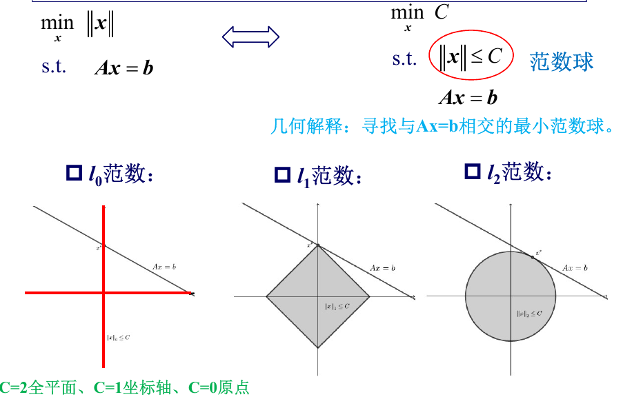
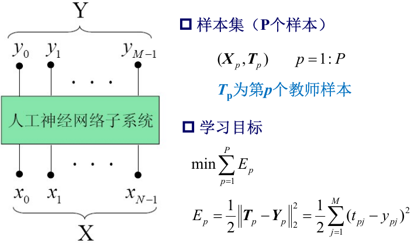

# Application
[TOC]

## 逼近与拟合

当方程 $Ax=b$ 不好解时（不可能精确满足/解太多/有噪声），把"差多少"与"解本身要好看"写成目标函数，通过最小化得到一个"最好"的解。

### 范数逼近

用不同范数衡量误差 $r=Ax-b$，每种范数侧重不同。

**$l_2$ 范数（最小二乘）**——最小化残差平方和，最常用、好算、理论成熟。
$$
\min_x \|Ax-b\|_2^2
$$
推导得正则方程 $A^TAx=A^Tb$，列满秩时闭式解（否则用伪逆）：
$$
x^*=(A^TA)^{-1}A^Tb
$$
每个误差平方后被放大，大误差被重点惩罚，因此对离群点敏感——优化器拼命照顾野值点，整体解被拽歪。
从最小二乘估计角度，此解是 BLUE（若噪声高斯），但离群点破坏这一性质。

**$l_\infty$ 范数（极小极大/Chebyshev）**——让最坏误差尽可能小：
$$
\min_x \|Ax-b\|_\infty = \min_x \max_i |a_i^Tx-b_i|
$$
改写为LP（只有一个公共 $t$，由最差残差决定）：
$$
\min t \quad \text{s.t.}\quad -t \le a_i^Tx-b_i \le t \quad \forall i
$$
例：极小极大跟踪控制。系统输出 $y(k)$ 跟踪参考 $r(k)$，误差 $e(k)=y(k)-r(k)$：
$$
\min_{u(\cdot)} \max_k |e(k)|
$$
设计控制输入 $u$ 使"无论何时出现的最大误差"尽量小，保证最坏情况可控。

**$l_1$ 范数（绝对值和）**——线性惩罚，更抗离群点：
$$
\min_x \|Ax-b\|_1 = \sum_i |r_i|
$$
改写为LP（每个残差独立控制 $t_i$）：
$$
\min \mathbf{1}^T t \quad \text{s.t.}\quad -t_i \le r_i \le t_i \quad \forall i
$$
$l_2$ 中离群点误差平方后权重极大，优化器会拼命照顾该点以致解被拽歪；$l_1$ 按绝对值线性惩罚，大误差不会爆炸，因此更鲁棒。

**带约束的范数逼近**：变量范围 $l\le x\le u$，概率单纯形 $x\ge 0,\ \mathbf{1}^Tx=1$，信赖域 $\|x-x_0\|\le d$
现实问题常附加此类约束，使解符合物理意义或算法稳定性。

### 罚函数逼近

用更一般的"惩罚曲线"衡量误差，核心思想：**别让大误差权重太大**。

一般形式，$\phi(\cdot)$ 表示"误差为 $u$ 时的不爽程度"：
$$
\min_x \sum_{i=1}^m \phi_i(r_i),\quad r=Ax-b
$$

常见罚函数：
- $p$ 次罚：$\phi(u)=|u|^p$，对应 $l_p$ 范数（$p=2$ 即最小二乘）
- 带死区线性：$|u|\le a$ 不罚，超过线性罚
- log barrier：靠近边界剧增，强制不越界

Huber 罚函数（鲁棒最小二乘），专门处理最小二乘对野值敏感的问题，
核心思路：减小估计器对大误差的灵敏度。
$$
\phi_{\text{hub}}(u)=
\begin{cases}
u^2, & |u|\le M\\
M(2|u|-M), & |u|>M
\end{cases}
$$
小误差用平方（精细平滑、好优化），大误差改线性（不让离群点一票否决），降低估计器对大误差灵敏度。

### 最小范数问题

欠定方程 $Ax=b$（未知数多于方程）有无穷多解，此时需要选一个"最好"的解。
$$
\min \|x\| \quad \text{s.t.}\quad Ax=b
$$
含义：在所有可行解里挑量值最小（能量小、误差小、最不敏感）。

稀疏优化——希望零越多越好。理想目标用 card($x$)即非零元素个数（也称 $l_0$"范数"，但它不是真范数）：
$$
\min \text{card}(x)\quad \text{s.t.}\quad Ax=b
$$
$l_0$ 组合优化太难解，用 $l_1$ 近似（可写为 LP，便于求解）：
$$
\min \|x\|_1\quad \text{s.t.}\quad Ax=b
$$

$l_2$ 最小范数解——欠定时的最小能量解，推导得 $x^*=A^T(AA^T)^{-1}b$（伪逆形式）：
$$
\min \|x\|_2^2\quad \text{s.t.}\quad Ax=b
$$

几何直觉：将 $\|x\|\le C$ 视为范数球——$l_2$ 圆/椭圆光滑，$l_1$ 菱形有尖角（与可行域相交时易落坐标轴→稀疏），$l_0$ 轴对齐离散结构（最稀疏）。

### 正则化逼近

双准则优化：希望 $\|Ax-b\|$ 小（拟合好），也希望 $\|x\|$ 小/平滑/稀疏（模型别太复杂、别乱抖）。

**Tikhonov / 岭回归（$l_2$ 正则最小二乘）**
$$
\min_x \|Ax-b\|_2^2 + \gamma \|x\|_2^2
$$
两种解法：
① 化为增广范数逼近问题
$$
\begin{bmatrix}
A \\ \sqrt{\gamma}\, I
\end{bmatrix}
x =
\begin{bmatrix}
b \\ 0
\end{bmatrix}
$$
② 直接求解得闭式解：
$$
x^*=(A^TA+\gamma I)^{-1}A^Tb
$$
$\gamma\|x\|_2^2$ 把 $x$ 往 0 拉，解决 $A^TA$ 病态/多重共线性。从估计角度，放弃无偏性换取更小方差（bias-variance tradeoff）。
$\|x\|_2\le c$ 边界是圆/椭球，光滑易处理，这是处理病态最小二乘的典型方法。

**光滑正则化**——让解不抖动：
$$
\min_x \|Ax-b\|_2^2 + \gamma\|x\|_2^2 + \delta\|Dx\|_2^2
$$
$D$ 为差分矩阵：一阶差分让相邻点差小（平滑先验），二阶差分约束弯曲程度（更像光滑曲线）。

**LASSO（$l_1$ 正则→稀疏模型）**
$$
\min_x \|Ax-b\|_2^2 + \gamma\|x\|_1
$$
等价约束形式（便于几何理解）：
$$
\min_x \|Ax-b\|_2^2 \quad \text{s.t.}\quad \|x\|_1 \le c
$$
$l_1$ 把小系数压成 0 → 自动特征选择。与 $l_2$ 正则的关键差异：
约束边界形状不同——$l_2$ 是球（最优解通常不在轴上），$l_1$ 是菱形（尖角在轴上，解更易落坐标轴）。例：多项式拟合 $y\approx\sum_{k=0}^K w_k x^k$ 写为 $y=\Phi w+e$，
常规做法是最小二乘 $\min\|\Phi w-y\|_2^2$，但多项式阶数高时易过拟合。加 $l_1$ 正则得稀疏 $w$，高阶项系数多归零，模型简洁、可解释性更强。

**Square-root LASSO 与回归向量筛选**
$$
\min_x \|Ax-b\|_2 + \gamma\|x\|_1
$$
可写为 SOCP 凸优化求解。两步法：先用 SR-LASSO 得稀疏 $x^*$，再保留非零对应向量做最小二乘（启发式特征筛选）。

### 有导师学习

神经网络训练本质是优化问题：

## 几何问题

## 统计估计

## Review

1. **稀疏解与解析解分别用什么范数？**
   稀疏→$l_1$ 范数正则（如 LASSO），促使解出现零元素；解析/平滑→$l_2$ 范数正则（如 Tikhonov/Ridge），闭式解且更平滑。

2. **最小二乘的解析解与成立条件？**
   目标 $\min_x \|Ax-b\|_2^2$，正规方程 $A^TAx=A^Tb$，若 $A^TA$ 可逆则：
   $$
   x^*=(A^TA)^{-1}A^Tb
   $$
   成立条件：$A$ 列满秩（否则需用伪逆 $A^+$）。

3. **$l_\infty$ 范数逼近的等价线性规划？**
   $$
   \min t\quad \text{s.t.}\quad -t\le a_i^Tx-b_i\le t\ \forall i
   $$

4. **$l_1$ 范数逼近的等价线性规划？**
   $$
   \min \mathbf{1}^T t\quad \text{s.t.}\quad -t_i\le a_i^Tx-b_i\le t_i\ \forall i
   $$

5. **LASSO 的目标形式与等价约束形式？**
   $$
   \min_x \|Ax-b\|_2^2+\gamma\|x\|_1 \iff \min_x \|Ax-b\|_2^2\ \text{s.t.}\ \|x\|_1\le c
   $$

6. **Tikhonov 正则化（岭回归）的闭式解？**
   $$
   x^*=(A^TA+\gamma I)^{-1}A^Tb
   $$

7. **为什么 $l_1$ 正则比 $l_2$ 更容易得到稀疏解？**
   几何直觉：$l_1$ 范数球有尖角，最优解更容易落在坐标轴上，从而使部分分量为零。

8. **Huber 罚函数的分段形式与意义？**
   $$
   \phi_{\text{hub}}(u)=
   \begin{cases}
   u^2, & |u|\le M\\
   M(2|u|-M), & |u|>M
   \end{cases}
   $$
   小误差平方惩罚（精细平滑），大误差线性惩罚（抗离群点），增强鲁棒性。

9. **最小范数问题在欠定方程中的意义？**
   当 $Ax=b$ 解不唯一时，通过 $\min \|x\|\ \text{s.t.}\ Ax=b$ 选取"能量最小/最平滑/最稀疏"的代表解。

10. **Square-root LASSO 的形式与用途？**
    $$
    \min_x \|Ax-b\|_2+\gamma\|x\|_1
    $$
    SOCP 可解，得到稀疏解后用于特征筛选。
