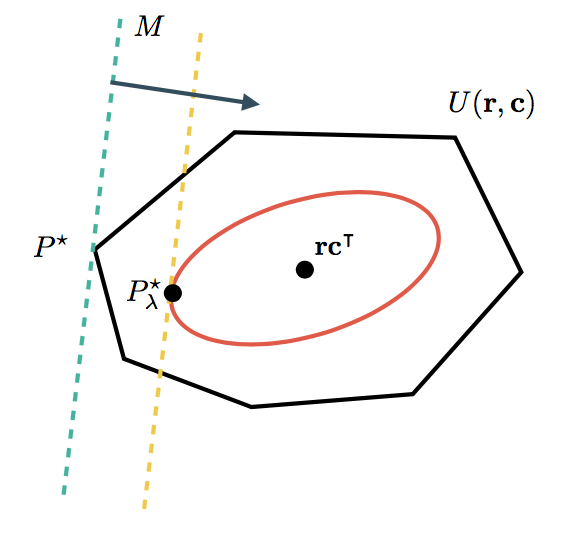

# OT Intro
[TOC]

## Takeaway

最优输运 (Optimal Transport, OT) 研究的是：给定两个分布或两组供需量，在满足边际约束的前提下，找到总代价最小的转移方案。

它不仅能求最小运输成本，还可以用这个成本衡量两个分布之间的差异

## Problem Setup

设源分布为

$$
r=(r_1,\cdots,r_n)^\top\in\mathbb{R}^n_{\ge 0}
$$

目标分布为

$$
c=(c_1,\cdots,c_m)^\top\in\mathbb{R}^m_{\ge 0}
$$

并且总质量相同：

$$
\sum_{i=1}^n r_i=\sum_{j=1}^m c_j
$$

若 $r,c$ 被归一化为概率分布，则还满足

$$
r^\top \mathbf{1}_n=1,\quad c^\top \mathbf{1}_m=1,\quad r_i\ge 0,\quad c_j\ge 0
$$

> [!TIP]
>
> 若把分布想象成土堆，$P_{ij}$ 表示把第 $i$ 堆土搬到第 $j$ 个位置的数量，那么最优输运也称为 Earth Mover's Distance (EMD)

若 $M\in\mathbb{R}^{n\times m}$ 是代价矩阵，$M_{ij}$ 表示把单位质量从 $i$ 转移到 $j$ 的代价，则可行域
$$
U(r,c)=\left\{P\in\mathbb{R}^{n\times m}_{\ge 0}\mid P\mathbf{1}_m=r,\ P^\top\mathbf{1}_n=c\right\}
$$

最优输运问题为

$$
d_M(r,c)=\min_{P\in U(r,c)}\sum_{i,j}P_{ij}M_{ij}
$$

对应的最优输运矩阵为

$$
P^\star=\arg\min_{P\in U(r,c)}\langle P,M\rangle
$$

若用 Frobenius inner product 表示，则

$$
\langle P,M\rangle_F=\operatorname{tr}(P^\top M)=\sum_{i=1}^n\sum_{j=1}^m P_{ij}M_{ij}
$$

原始 OT 的线性规划形式为

$$
\begin{aligned}
\min_{P\ge 0}\quad &\sum_{i=1}^n\sum_{j=1}^m P_{ij}M_{ij}\\
\text{s.t.}\quad &\sum_{j=1}^m P_{ij}=r_i,\quad i=1,\cdots,n\\
&\sum_{i=1}^n P_{ij}=c_j,\quad j=1,\cdots,m
\end{aligned}
$$

其对偶形式为

$$
\begin{aligned}
\max_{\alpha,\beta}\quad &\sum_{i=1}^n\alpha_i r_i+\sum_{j=1}^m\beta_j c_j\\
\text{s.t.}\quad &\alpha_i+\beta_j\le M_{ij},\quad i=1,\cdots,n,\ j=1,\cdots,m
\end{aligned}
$$

其中 $\alpha,\beta$ 是两个边际约束对应的对偶变量。由强对偶性，原问题有最优解时，原问题与对偶问题的最优值相等。

### Kantorovich 形式

连续形式，寻找一个联合分布或耦合 $\pi$：

$$
\inf_{\pi\in\Pi(\mu,\nu)}\int_{X\times Y}c(x,y)\,d\pi(x,y)
$$

其中

$$
\Pi(\mu,\nu)=\left\{\pi\in\mathcal{P}(X\times Y)\mid (\operatorname{proj}_X)_{\#}\pi=\mu,\ (\operatorname{proj}_Y)_{\#}\pi=\nu\right\}
$$

## Wasserstein Distance

当 $r,c$ 都是概率分布时，$d_M(r,c)$ 可以作为分布间距离使用，通常称为 Wasserstein distance。

与 KL 散度、TV 距离等分布差异度量相比，Wasserstein distance 的特点是显式引入了代价矩阵 $M$。因此它不仅关心两个位置上的概率质量是否相同，也关心把质量从一个位置移动到另一个位置有多贵。

连续分布上的 $p$-Wasserstein distance 定义为

$$
W_p(\mu,\nu)=\left(\inf_{\pi\in\Pi(\mu,\nu)}\int_{X\times Y}d(x,y)^p\,d\pi(x,y)\right)^{1/p}
$$

离散情形下，若 $M_{ij}=d(x_i,y_j)^p$，则

$$
W_p(r,c)=\left(\min_{P\in U(r,c)}\sum_{i,j}P_{ij}d(x_i,y_j)^p\right)^{1/p}
$$

当 $p=1$ 时，常与 EMD 对应：

$$
W_1(r,c)=\min_{P\in U(r,c)}\sum_{i,j}P_{ij}d(x_i,y_j)
$$

### 与 KL 散度的区别

KL 散度定义为

$$
\operatorname{KL}(p,q)=\sum_i p_i\log\frac{p_i}{q_i}
$$

KL 是逐点比较，$p_i$ 与 $q_i$ 在同一个位置上相比较，不会显式考虑位置之间的结构关系。OT 可以通过代价矩阵 $M$ 编码结构信息。

例如分类任务中，把“汽车”错分成“卡车”和错分成“斑马”在交叉熵下可能同样严重；但在 OT 中可以设置

$$
M_{\text{汽车},\text{卡车}}<M_{\text{汽车},\text{斑马}}
$$

从而让损失反映类别之间的语义距离。

## Solution: Sinkhorn-Knopp 算法

### Entropic Regularization

- Motivation: 普通 OT 是线性规划，可以用单纯形法、对偶单纯形法等方法求解。但当 $n,m$ 很大时，直接求解会比较慢。

- Takeaway:

  为提高计算效率，可以加入熵正则项：
  $$
  d^\lambda_M(r,c)=\min_{P\in U(r,c)}
  \sum_{i,j}P_{ij}M_{ij}-\frac{1}{\lambda}h(P),
  \quad \lambda>0
  $$

  其中

  $$
  h(P)=-\sum_{i,j}P_{ij}\log P_{ij}
  $$

  熵越大，运输矩阵越平滑、越分散。

  设正则化问题的最优解为 $P^\star_\lambda$，则

  $$
  \sum_{i,j}(P^\star_\lambda)_{ij}M_{ij}
  $$

  称为 Sinkhorn distance。

  > [!TIP]
  >
  > 注意这里不把熵正则项本身计入距离值。

- Pros：

  - 原始线性规划的最优解通常在 $U(r,c)$ 的顶点处取得，所以 $P^\star$ 往往稀疏

  - 熵正则鼓励更平滑、更均衡的输运矩阵

  - 正则化后的问题可以用 Sinkhorn 迭代快速近似求解

---

### Takeaway

熵正则化后的 OT 有一个重要结构：
$$
(P^\star_\lambda)_{ij}=\alpha_i\beta_j e^{-\lambda M_{ij}}
$$

其中 $\alpha_i,\beta_j$ 是缩放因子，用来保证 $P^\star_\lambda$ 的行和为 $r$、列和为 $c$。

因此可以先令

$$
K_{ij}=e^{-\lambda M_{ij}}
$$

再不断交替缩放行和列，使矩阵满足边际约束。

### Pipeline

输入：$M,r,c,\lambda$

1. 初始化 $P_{ij}=e^{-\lambda M_{ij}}$
2. 缩放每一行，使 $P\mathbf{1}_m=r$
3. 缩放每一列，使 $P^\top\mathbf{1}_n=c$
4. 重复步骤 2 和步骤 3，直到行和、列和收敛
5. 输出 $P$ 和 $\sum_{i,j}P_{ij}M_{ij}$

常见实现形式：

$$
P\leftarrow \operatorname{diag}\left(\frac{r}{P\mathbf{1}_m}\right)P
$$

$$
P\leftarrow P\operatorname{diag}\left(\frac{c}{P^\top\mathbf{1}_n}\right)
$$

### 向量形式

更常见的 Sinkhorn 迭代写法是引入缩放向量

$$
u\in\mathbb{R}^n,\quad v\in\mathbb{R}^m
$$

初始化

$$
u=\frac{\mathbf{1}_n}{n},\quad v=\frac{\mathbf{1}_m}{m}
$$

令

$$
K=e^{-\lambda M}
$$

然后迭代

$$
\begin{aligned}
u&\leftarrow r\oslash(Kv)\\
v&\leftarrow c\oslash(K^\top u)
\end{aligned}
$$

其中 $\oslash$ 表示逐元素除法。收敛后

$$
P^\star_\lambda=\operatorname{diag}(u)K\operatorname{diag}(v)
$$

对应运输成本为

$$
C^\star=\langle P^\star_\lambda,M\rangle_F
$$

> [!NOTE]
>
> 为什么要加了正则化才好求解，正常不应该是有正则化求解更难吗？ 
>
> 
>
> 原始 OT 是线性规划，因此最优解通常出现在可行域 $U(r,c)$ 的极点上，解可能比较稀疏。
>
> 加入熵正则后，优化目标更偏好平滑的输运矩阵。几何上可以理解为：原本沿着线性目标方向寻找可行域边界上的极点；加入熵正则后，解会从边界向内部移动，因此更平滑，也更适合数值计算。

### ML

若把 $C^\star$ 作为机器学习损失函数，在 Sinkhorn 迭代收敛后，对两个边际分布的梯度可写为
$$
\frac{\partial C^\star}{\partial r}=\frac{\log u}{\lambda},
\quad
\frac{\partial C^\star}{\partial c}=\frac{\log v}{\lambda}
$$

## Applications

### Wasserstein Loss

OT 距离可以作为损失函数。若模型输出为概率分布 $p_\theta$，标签或目标分布为 $q$，可以定义

$$
\mathcal{L}(\theta)=W_p(p_\theta,q)
$$

或使用熵正则近似

$$
\mathcal{L}(\theta)=C^\star(p_\theta,q)
$$

这种损失相比交叉熵可以引入类别之间的结构信息。

### 分布匹配

若有两个数据集 $X_1$ 和 $X_2$，它们可以看成两个经验分布。令 $M_{ij}$ 表示样本 $x_i\in X_1$ 与样本 $x_j\in X_2$ 之间的距离，例如欧氏距离，则可以通过 OT 得到从 $X_1$ 到 $X_2$ 的 soft mapping。

求得输运矩阵 $P^\star$ 后，可以用插值方式把 $X_1$ 向 $X_2$ 靠近：

$$
x_i'=\alpha x_i+(1-\alpha)\sum_{j=1}^m \bar{P}_{ij}x_j
$$

其中 $\bar{P}$ 表示按行归一化后的输运矩阵，$\alpha$ 控制保留原样本的程度。

## References

- [Optimal Transport入门简述](https://coderlemon17.github.io/posts/2022/07-16-ot/#11-%e6%9c%80%e4%bc%98%e8%be%93%e8%bf%90-optimal-transport)
- [最优传输 (Optimal transport) 和 sinkhorn 迭代](https://kaizhao.net/blog/optimal-transport/)
