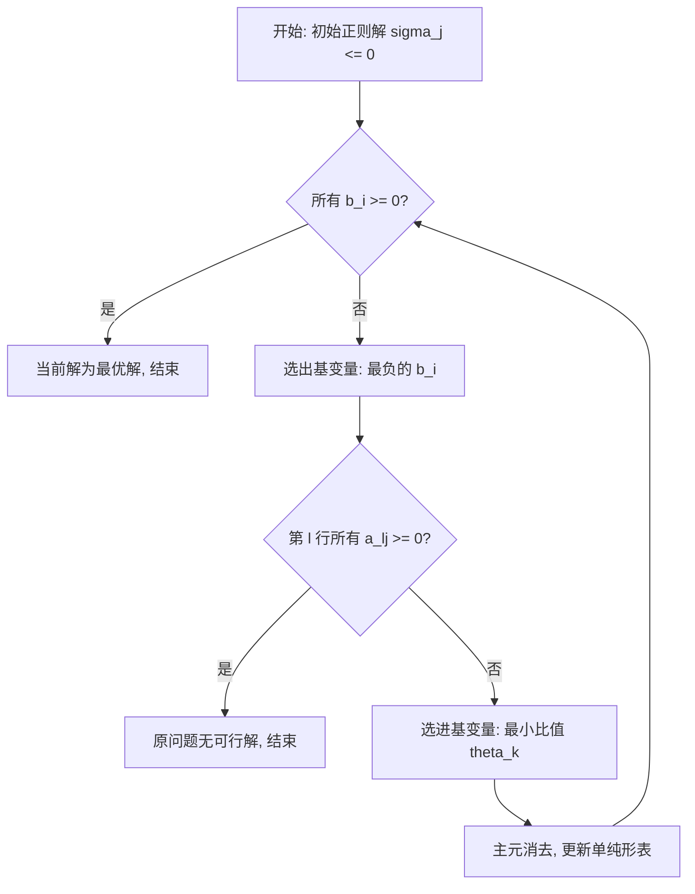

# 线性规划的对偶理论
[TOC]

对偶理论：每个 LP 问题伴生一个"镜像"问题——原问题的解在对偶变量中呈现，为经济分析（影子价格）、灵敏度计算和大规模求解提供关键工具。每个 LP 有唯一对偶问题，共享最优值（强对偶性，duality gap = 0）。对偶性催生了**对偶单纯形法**（先满足 $\sigma_j \leq 0$ 再恢复 $b_i \geq 0$）和**影子价格**（资源边际价值）。

对偶理论、灵敏度分析使其不仅是求解工具，更是理解优化问题结构的框架。

<!--more-->

## Core Mechanism
### What — 对偶问题的构造
#### 标准对偶对
$$
\begin{aligned}
\text{(P)} \quad \max \quad & z = \mathbf{c} \mathbf{x} \\
\text{s.t.} \quad & A \mathbf{x} \leq \mathbf{b} \\
& \mathbf{x} \geq \mathbf{0}
\end{aligned}
\qquad\Longleftrightarrow\qquad
\begin{aligned}
\text{(D)} \quad \min \quad & w = \mathbf{b}^T \mathbf{y} \\
\text{s.t.} \quad & A^T \mathbf{y} \geq \mathbf{c}^T \\
& \mathbf{y} \geq \mathbf{0}
\end{aligned}
$$
$\mathbf{x} \in \mathbb{R}^n$，$\mathbf{y} \in \mathbb{R}^m$，$A \in \mathbb{R}^{m \times n}$。

**对称性**：
| 原问题（P） | 对偶问题（D） |
|:-----------:|:-------------:|
| $\max$ | $\min$ |
| $\leq$ 约束 | $y_i \geq 0$ |
| $x_j \geq 0$ | $\geq$ 约束 |
| 系数矩阵 $A$ | $A^T$ |
| RHS $\mathbf{b}$ | 目标系数 $\mathbf{b}^T \mathbf{y}$ |
| 目标系数 $\mathbf{c}$ | RHS $\mathbf{c}^T$ |

#### 一般形式的对偶转换（7 步法）
| 步骤 | 操作 | 说明 |
|:----:|:----|:----|
| **1** | 对偶变量个数 $= m$ | 由原约束个数决定 |
| **2** | 对偶目标系数 $= \mathbf{b}$ | 原 $\max \to$ 对偶 $\min$；方向相反亦然 |
| **3** | 对偶约束个数 $= n$ | 由原变量个数决定 |
| **4** | 对偶约束系数 $= A^T$ | 第 $j$ 个对偶约束系数是原 $A$ 的第 $j$ 列 |
| **5** | 对偶约束 RHS $= \mathbf{c}^T$ | 第 $j$ 个对偶约束右边是 $c_j$ |
| **6** | 对偶约束符号由**原变量 $x_j$ 范围**决定 | 见下表 |
| **7** | 对偶变量范围由**原约束符号**决定 | 见下表 |

##### 约束符号规则
| 原变量 $x_j$ 范围 | 原目标 $\max$ $\to$ 对偶约束 | 原目标 $\min$ $\to$ 对偶约束 |
|:-----------------:|:---------------------------:|:---------------------------:|
| $x_j \leq 0$ | $\leq$ | $\geq$ |
| $x_j \geq 0$ | $\geq$ | $\leq$ |
| 无约束（free） | $=$ | $=$ |

##### 变量范围规则
| 原约束符号 | 原目标 $\max$ $\to$ $y_i$ | 原目标 $\min$ $\to$ $y_i$ |
|:----------:|:-------------------------:|:-------------------------:|
| $\leq$ | $y_i \geq 0$ | $y_i \leq 0$ |
| $\geq$ | $y_i \leq 0$ | $y_i \geq 0$ |
| $=$ | 无约束（free） | 无约束（free） |

> **口诀**：原约束 $\leq$ → $y_i \geq$，$\geq$ → $y_i \leq$。验证：对偶的对偶是原问题。

### Why
对偶变量度量资源边际价值（影子价格）；$c\mathbf{x} \leq \mathbf{b}^T\mathbf{y}$（弱对偶性）给出原最优值的界；$c\mathbf{x}^* = \mathbf{b}^T\mathbf{y}^*$ 是最优性充要条件；互补松弛性揭示约束"绷紧"程度。对偶理论也是对偶单纯形法和原-对偶内点法的理论基础。

### How — 对偶性质
$P$: $\max\{z = \mathbf{c}\mathbf{x} \mid A\mathbf{x} \leq \mathbf{b},\; \mathbf{x} \geq \mathbf{0}\}$，$D$: $\min\{w = \mathbf{b}^T\mathbf{y} \mid A^T\mathbf{y} \geq \mathbf{c}^T,\; \mathbf{y} \geq \mathbf{0}\}$。

#### 性质 1：对称性
$$
(D(P)) = P
$$
#### 性质 2：弱对偶性（Weak Duality）
若 $\mathbf{x}$、$\mathbf{y}$ 分别是 $P$、$D$ 的可行解：
$$
z = \mathbf{c} \mathbf{x} \leq \mathbf{b}^T \mathbf{y} = w
$$
**推论**：$P$ 最优值 $\leq$ $D$ 最优值；$P$ 无界 $\Rightarrow$ $D$ 无可行解；$D$ 无界 $\Rightarrow$ $P$ 无可行解。

#### 性质 3：最优性条件（Optimality Criterion）
$\mathbf{x}^*$、$\mathbf{y}^*$ 分别为 $P$、$D$ 的可行解且：
$$
\mathbf{c} \mathbf{x}^* = \mathbf{b}^T \mathbf{y}^*
$$
则它们是最优解。

#### 性质 4：强对偶性（Strong Duality）
若 $P$（或 $D$）有最优解则 $D$（或 $P$）也必有最优解且最优值相等：
$$
\max z = \mathbf{c} \mathbf{x}^* = \mathbf{b}^T \mathbf{y}^* = \min w
$$

#### 性质 5：互补松弛性（Complementary Slackness）
$(\mathbf{x}^*, \mathbf{y}^*)$ 为最优解的充要条件：
$$
\begin{aligned}
(A\mathbf{x}^* - \mathbf{b})^T \mathbf{y}^* &= 0 \\
(\mathbf{x}^*)^T (A^T \mathbf{y}^* - \mathbf{c}^T) &= 0
\end{aligned}
$$
引入 $\mathbf{x}_s$（$A\mathbf{x} + \mathbf{x}_s = \mathbf{b}$）和 $\mathbf{y}_s$（$A^T\mathbf{y} - \mathbf{y}_s = \mathbf{c}^T$）后：
$$
\begin{aligned}
(\mathbf{x}_s^*)^T \mathbf{y}^* &= 0 \\
(\mathbf{x}^*)^T \mathbf{y}_s^* &= 0
\end{aligned}
$$
**含义**：原约束松弛 $\Rightarrow$ $y_i^* = 0$；$y_i^* > 0$ $\Rightarrow$ 原约束取等式；$x_j^* > 0$ $\Rightarrow$ 对应对偶约束取等式；对偶剩余 $> 0$ $\Rightarrow$ $x_j^* = 0$。
#### 性质间关系汇总
| 原问题 $P$ 情形 | 对偶问题 $D$ 情形 |
|:---------------:|:-----------------:|
| 有最优解 | 有最优解，$c\mathbf{x}^* = \mathbf{b}^T\mathbf{y}^*$ |
| 无界解 | 无可行解 |
| 无可行解 | 无界解 **或** 无可行解 |

## 对偶单纯形法（Dual Simplex Method）
对偶单纯形法用对偶视角求解**原问题**：先满足最优性，再恢复可行性。
### What — 与原始单纯形法的区别
| 对比维度 | 原始单纯形法 | 对偶单纯形法 |
|:--------:|:-----------:|:-----------:|
| **初始条件** | **基可行解**（$b_i \geq 0$） | **正则解**（$\sigma_j \leq 0$，$\max$） |
| **迭代方向** | 保持可行性 → 满足最优性 | 保持最优性 → 恢复可行性 |
| **进基选择** | $\max\{\sigma_j \mid \sigma_j > 0\}$ | $\min\{|\sigma_j / a_{lj}| \mid a_{lj} < 0\}$ |
| **出基选择** | $\min\{b_i / a_{ik} \mid a_{ik} > 0\}$ | $\min\{b_i \mid b_i < 0\}$（最负优先） |
| **终止条件** | $\sigma_j \leq 0$ | $b_i \geq 0$ |
| **无界/不可行** | $\sigma_k > 0$ 但 $\mathbf{p}_k \leq \mathbf{0}$ | $b_l < 0$ 但 $a_{lj} \geq 0$ |
### How — 算法流程（$\max$ 问题）
1. **初始化**：找正则解（$\sigma_j \leq 0$，允许 $b_i < 0$）
2. **可行性检验**：所有 $b_i \geq 0$ 则最优
3. **出基**：$b_l = \min\{b_i \mid b_i < 0\}$
4. **无可行解**：第 $l$ 行 $a_{lj} \geq 0$ 则无可行解
5. **进基**：$\theta_j = \sigma_j / a_{lj}$（$a_{lj} < 0$），选 $\theta_k = \min\{\theta_j\}$ 对应 $x_k$
6. **主元消去**：以 $a_{lk}$ 为主元消元，返回步 2
### Pipeline

### 典型应用场景
| 场景 | 说明 |
|:----|:----|
| **新增约束后重新优化** | 从破坏的约束行快速恢复可行性 |
| **灵敏度分析** | $\mathbf{b}$ 变化后修正，无需从头求解 |
| **整数规划割平面** | 每加 Gomory 割平面即增一约束，标准策略 |
| **初始正则解易得** | 全 $\geq$ 约束 $\min$ 问题，标准化后得 $\sigma_j \leq 0$ 初始表 |
## 影子价格（Shadow Price）
### 定义
对偶变量 $y_i^*$ 的经济含义——$b_i$ 增一单位（最优基不变）时目标最优值的改变量：
$$
y_i^* = \frac{\partial z^*}{\partial b_i}
$$
对 $\max$ 问题，最优表中松弛变量检验数的相反数即影子价格：
$$
y_i^* = -\sigma_{s_i}
$$
> **推导**：$x_{s_i}$ 对应 $\mathbf{e}_i$，最优表中为 $B^{-1}\mathbf{e}_i$，$\sigma_{s_i} = 0 - \mathbf{c}_B B^{-1}\mathbf{e}_i = -y_i^*$。

### 经济解释
| $y_i^*$ | 含义 |
|:-------:|:----|
| $>0$ | **紧缺资源**——约束取等式，增一单位带来 $y_i^*$ 利润 |
| $=0$ | **资源有剩余**——约束不紧，增资源不改善目标 |
| $<0$ | 仅 $\min$ 问题或特殊符号约定 |

在**当前最优基不变**范围内有效，超此范围需灵敏度分析。
## 利用对偶理论求解最优解
### 求对偶问题的最优解
$\mathbf{y}^* = \mathbf{c}_B B^{-1}$ 从原问题最优表读取。对 $\max$ 问题，初始单位矩阵对应列检验数的相反数即 $\mathbf{y}^*$：
$$
y_i^* = -(\text{最优表中 } x_{si} \text{ 的检验数})
$$
### 求原问题的最优解
从对偶最优表读取（对 $\min$ 问题的对偶 $\to$ 原 $\max$）：
$$
x_j^* = -(\text{对偶最优表中 } y_{sj} \text{ 的检验数})
$$
**互补松弛性反推**：$\mathbf{y}^*$ 非零分量 $\Rightarrow$ 对应原约束取等式；对偶不取等式的约束 $\Rightarrow$ $x_j^* = 0$。唯一最优解时互补松弛给出唯一 $\mathbf{x}^*$，多重解时仅确定范围。
## Pros
- **理论深刻**：弱/强对偶性、互补松弛性构成完整理论体系
- **经济解释直观**：影子价格为资源定价提供数学依据
- **算法价值**：对偶单纯形法与原-对偶内点法提升优化效率
- **降维优势**：$n \gg m$ 时求解对偶问题大幅降维
- **交互分析**：灵敏度分析与参数规划的基础
## Cons
- **抽象门槛高**：对偶变量缺乏物理对应物时易困惑
- **初始正则解不易得**：对偶单纯形法要求 $\sigma_j \leq 0$
- **退化循环敏感**：需 Bland 规则或扰动法防护
- **互补松弛性可能欠定**：多重最优解时无法唯一确定
- **仅 LP 适用**：非线性优化存在对偶间隙
## References
- 【运筹学】应试向基础教程（已完结）<https://www.bilibili.com/video/BV1Uw411f7WM>
- 运筹学 | 例题详细讲解对偶问题及对偶单纯形法 <https://www.bilibili.com/video/BV1eN411X7fP>
- 基本单纯形法解线性规划问题示例 <https://www.bilibili.com/video/BV11f4y1x7sK>
- 线性规划的单纯形算法理论——含证明 <https://zhuanlan.zhihu.com/p/364011259>
- 线性规划03-可行域的顶点 <https://zhuanlan.zhihu.com/p/718833223>
- Duality in Linear Programming — MIT OpenCourseWare <https://ocw.mit.edu/courses/15-084j-nonlinear-programming-spring-2004/resources/lecture2_duality/>
