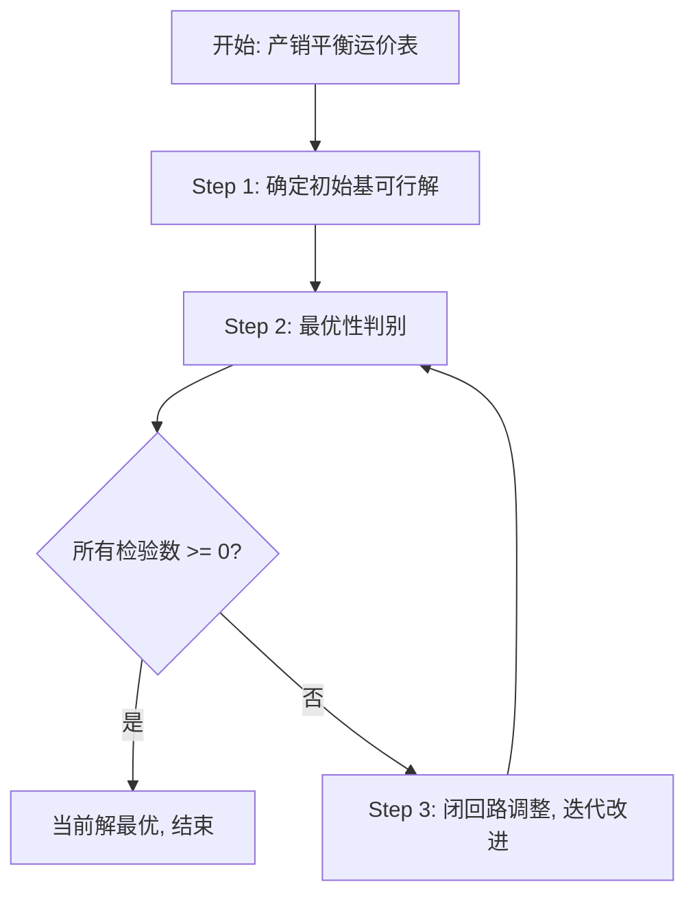

# 运输问题
[TOC]
<!--more-->

## Takeaway

一个带有特殊结构的 LP，minimum-cost flow 和 discrete optimal transport

## Core Mechanism
### 数学模型

给定若干供给点 supply nodes 和若干需求点 demand nodes，决定从每个供给点向每个需求点运输多少货物，使得 **总运输成本最小**，同时满足供给量和需求量约束

$m$ 产地 $A_i$（供应 $a_i$），$n$ 销地 $B_j$（需求 $b_j$），运价 $c_{ij}$，运量 $x_{ij}$。

标准形式：
$$
\displaystyle\min z = \sum_{i=1}^{m}\sum_{j=1}^{n} c_{ij} x_{ij}
$$
约束：
$$
\begin{aligned}
\sum_{j=1}^{n} x_{ij} &= a_i \;(i=1,\ldots,m) & \text{(供应)}\\
\sum_{i=1}^{m} x_{ij} &= b_j \;(j=1,\ldots,n) & \text{(需求)}\\
x_{ij} &\geq 0 \quad (\forall i,j)
\end{aligned}
$$
将约束写成$Ax=b$，元素 0/1，每列两个 1

产销平衡条件（有解充要）：$\displaystyle\sum a_i = \sum b_j$

每个变量$x_{ij}$同时出现在两个约束中

约束有$m+n-1$个

变量数是：$$mn$$

所以可行域的维度通常是：

$$
mn-(m+n-1)=(m-1)(n-1)
$$
一个 basic feasible solution 最多有：

$$
m+n-1
$$
个正变量（稀疏性）。

#### 特殊结构

系数矩阵 $A$ 完全单位模（totally unimodular TU）：元素 0/1，每列两个 1

标准有向 incidence matrix 通常一列是：$$+1,\ -1$$

而运输问题这里是一列：$$+1,\ +1.$$

但是只要把 demand rows 全部乘以 $-1$，就得到有向网络的 incidence matrix：bipartite network incidence matrix

$$
\tilde A = \begin{pmatrix} \text{supply rows}\\ -\text{demand rows} \end{pmatrix}.
$$

- 说明基可行解都是整数

> [!NOTE]
>
> Insight: 
>
> 这对应图论中的一棵 spanning tree：在 bipartite graph 上，基变量构成一个无环连通结构
>
> **minimum-cost flow problem** on a bipartite graph

### 产销不平衡

$\sum a_i\neq\sum b_j$ 时：

| 情形 | 处理 | 虚拟节点运价 |
|------|------|:------------:|
| **供过于求** | 加虚拟销地 $B_{n+1}$，需求 $b_{n+1}=\sum a_i-\sum b_j$ | $c_{i,n+1}=0$ |
| **供不应求** | 加虚拟产地 $A_{m+1}$，供应 $a_{m+1}=\sum b_j-\sum a_i$ | $c_{m+1,j}=0$ |

### 求解

运输问题可以直接用 simplex method 解，但因为结构特殊，有更高效的 **transportation simplex method**

## Pipeline — 表上作业法

**3×4 数值示例**：$a=[16,10,22]$（总计 48），$b=[8,14,12,14]$（总计 48）✓

| 产地\销地 | $B_1$ | $B_2$ | $B_3$ | $B_4$ |
| :-------: | :---: | :---: | :---: | :---: |
|   $A_1$   |   4   |  12   |   4   |  11   |
|   $A_2$   |   2   |  10   |   3   |   9   |
|   $A_3$   |   8   |   5   |  11   |   6   |

$\displaystyle\min z = 4x_{11}+12x_{12}+4x_{13}+11x_{14}+2x_{21}+10x_{22}+3x_{23}+9x_{24}+8x_{31}+5x_{32}+11x_{33}+6x_{34}$

供应：$x_{11}+x_{12}+x_{13}+x_{14}=16,\; x_{21}+x_{22}+x_{23}+x_{24}=10,\; x_{31}+x_{32}+x_{33}+x_{34}=22$

需求：$x_{11}+x_{21}+x_{31}=8,\; x_{12}+x_{22}+x_{32}=14,\; x_{13}+x_{23}+x_{33}=12,\; x_{14}+x_{24}+x_{34}=14$

非负：$x_{ij}\geq0$。

### Step 1: 初始基可行解

基变量数 $m+n-1$。有三种方法

#### 1\. Northwest Corner Rule

西北角法

- Takeaway: 从左上角开始分配，能分多少分多少。

- Pros: simple  
- Cons: 不看成本

* * *

#### 2\. Least Cost Method

最小元素法

- Takeaway: 每次选当前最低成本 $c_{ij}$ 的格子分配。

- Cons: greedy，不保证最优。

* * *

#### 3\. Vogel’s Approximation Method, VAM

沃格尔法（VAM）

- Takeaway: VAM 会计算每行、每列的 penalty：
  $$
  \text{penalty} = \text{second smallest cost} - \text{smallest cost}
  $$
  penalty 大表示如果不选最小成本格子，损失较大。  
  所以 VAM 每次优先处理 penalty 最大的行或列。

- Pros: 通常能给出质量较高的初始解。

### Step 2: 最优性判别

$\sigma_{ij}=c_{ij}-z_{ij}$ 为非基变量 $x_{ij}$ 增 1 单位的总成本变化。最小化问题 $\sigma_{ij}\geq0$ 最优。
#### 1. 闭回路法
从非基变量出发，水平/垂直移动，遇**基变量**才**直角转弯**（90°），回起点形成封闭回路。唯一确定。起点第 0 顶点；偶顶点（0,2,4,…）运价取正，奇顶点（1,3,5,…）取负：
$$
\sigma_{ij}=(\text{偶顶点运价之和})-(\text{奇顶点运价之和})
$$
非基变量增 1→奇顶点减 1、偶顶点加 1 以保持平衡。

- Cons: 麻烦

#### 2. 位势法（MODI）
闭回路法需为每个非基变量构造回路，繁琐。位势法用**对偶变量**一次求全部 $\sigma_{ij}$：
1. 设产地 $u_i$、销地 $v_j$
2. 对**基变量**：$u_i+v_j=c_{ij}$（$m+n-1$ 个方程）
3. 令 $u_1=0$，依次解出 $u_i,v_j$
4. 对**非基变量**：$\sigma_{ij}=c_{ij}-(u_i+v_j)$

和reduced cost一样，只是有特殊的形式
### Step 3: 迭代改进
$\sigma_{ij}<0$ 时入基：
1. **进基**：选 $\min\sigma_{ij}<0$
2. **闭回路**：以该非基变量为起点构造唯一闭回路
3. **出基**：闭回路**所有奇顶点**中运量最小的基变量
4. **调整**（$\theta$ = 出基变量运量）：奇顶点减 $\theta$，偶顶点加 $\theta$，进基 $0+\theta$；出基变 0，退基
5. **更新基**，返回 Step 2

**退化**：奇顶点最小 $\theta$ 对应多个基变量时，仍可正常迭代。
---
## Pros
- **高效率**：直接在运价表操作，避免单纯形表冗余
- **整数解**：TU 性质保证 $x_{ij}$ 自动整数
- **直观**：供需分配表一目了然
- **稳定**：每步目标严格下降（无退化时）
- **基础**：**最小费用流问题**特例，网络单纯形法跳板
## Cons
- **仅适用于平衡运输**：$\sum a_i\neq\sum b_j$ 需加虚拟节点
- **规模受限**：$m,n>50$ 时手工不可行
- **退化模糊**：出基选择不唯一，可能增加迭代
- **无法处理转运**：需转为一般网络流
- **无系统化灵敏度分析**：不如一般 LP
---
## References
- Dantzig, G. B. (1951). Application of the Simplex Method to a Transportation Problem. *Activity Analysis of Production and Allocation*.
- Hillier, F. S. & Lieberman, G. J. *Introduction to Operations Research*. 10th ed., Chapter 9: Transportation and Assignment Problems.
- 胡运权. 《运筹学基础及应用》. 第 7 版，第四章：运输问题.
