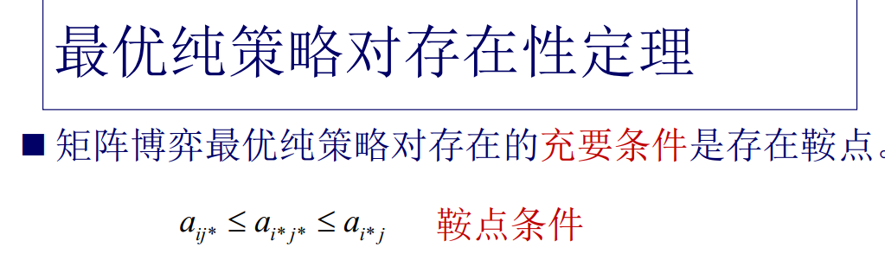
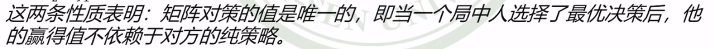
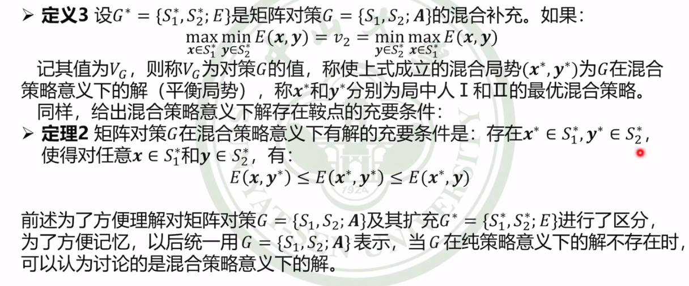
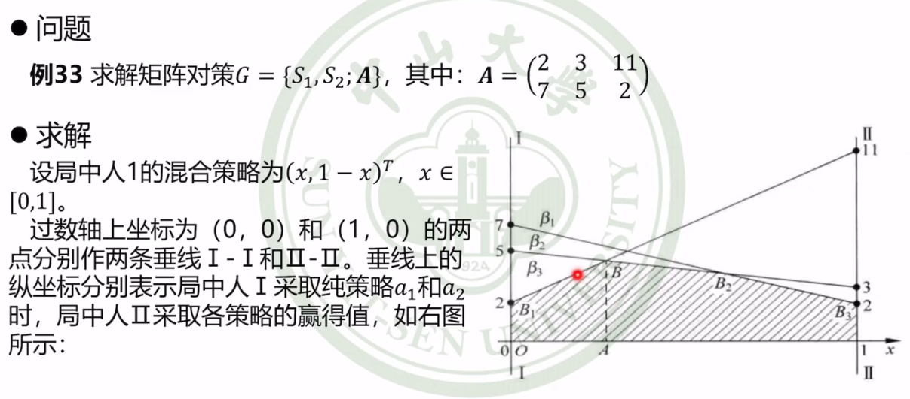
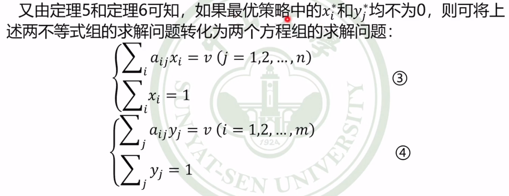
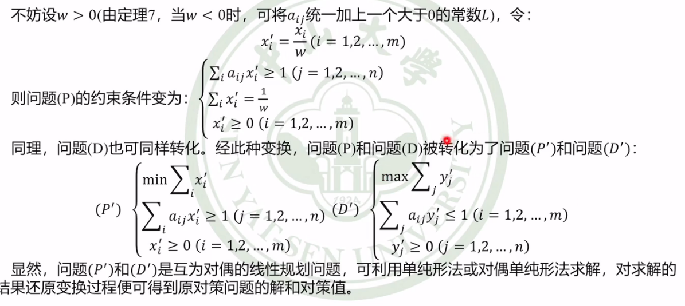
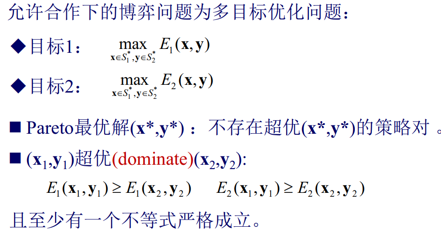

# 博弈论
[TOC]

博弈论（Game Theory）研究理性决策者在冲突与合作中的策略选择。核心概念是 **Nash 均衡**——策略组合中任何局中人单方面偏离都无法提高自身收益。二人有限策略博弈归结为**矩阵博弈**（零和）或**双矩阵博弈**（非零和）；纯策略均衡由鞍点给出，无纯策略解时混合策略均衡必定存在（Nash 定理）。

<!--more-->

## Takeaway

博弈论的三要素——**局中人**、**策略集**、**赢得函数**——刻画了多决策主体的交互决策问题。Nash 均衡是其核心解概念：在均衡策略下，无人有动机单方面偏离。矩阵博弈（零和）的鞍点 = 纯策略 Nash 均衡；混合策略推广保证了有限博弈永远有解。

---

## 矩阵博弈（二人零和）

- **矩阵博弈（Matrix Game）**. von Neumann & Morgenstern, 1944.

  - Takeaway: 二人零和博弈归结为收益矩阵 $A = (a_{ij})_{m \times n}$——行局中人 I 的收益即列局中人 II 的损失。核心解概念：鞍点（纯策略均衡）或混合策略均衡（概率组合）。

  - Core Mechanism:

    ### 纯策略与鞍点

    I 与 II 的决策逻辑均是在最坏中求最好：
    - **maximin**（I）：$\displaystyle v_I = \max_i \min_j a_{ij}$
    - **minimax**（II）：$\displaystyle v_{II} = \min_j \max_i a_{ij}$

    基本不等式恒成立：$v_I \le v_{II}$。

    **鞍点充要条件**：若存在 $(i^*, j^*)$ 使
    $$
    a_{i^*j^*} = \max_i \min_j a_{ij} = \min_j \max_i a_{ij}
    $$
    则 $(i^*, j^*)$ 为鞍点，对应**纯策略 Nash 均衡**——任一局中人单方面改变策略都无法获利。

    

    | 解的类型 | 说明 |
    |----------|------|
    | **唯一解** | 矩阵仅有一个鞍点 |
    | **多个解** | 满足**无差别性**（赢得值相同）和**可交换性**（交叉组合仍为鞍点） |
    | **无纯策略解** | $v_I < v_{II}$，必须引入混合策略 |

    

    ### 混合策略

    无鞍点时，局中人按**概率分布**随机化选择：
    - I 的策略：$x = (x_1, \dots, x_m)^\top$，$\sum x_i = 1$
    - II 的策略：$y = (y_1, \dots, y_n)^\top$，$\sum y_j = 1$

    期望收益：$E(x, y) = x^\top A y$。

    > **Nash 定理**：任何有限策略博弈在混合策略意义下**必定存在**均衡解。

    

    ### 混合策略求解

    **图解法**（适用于 $2 \times n$ 或 $m \times 2$）：
    在二维坐标中绘制各纯策略的期望收益直线，找下包络线的最高点：
    - **I 的视角**：对 II 的每个纯策略 $j$，画出 $x^\top A e_j$ 作为 $x_1$ 的函数，取这些直线构成的**下包络线**，其最高点即 I 的最优混合策略
    - **II 的视角**：对 I 的每个纯策略 $i$，画出 $e_i^\top A y$ 作为 $y_1$ 的函数，取**上包络线**的最低点

    

    **方程组法**：若均衡中 $x_i^* > 0$ 或 $y_j^* > 0$，则对应不等式在最优处取等号：
    $$
    \sum_j a_{ij} y_j^* = V \;\;(\text{对 } x_i^* > 0), \qquad
    \sum_i a_{ij} x_i^* = V \;\;(\text{对 } y_j^* > 0)
    $$
    $V$ 为博弈值。应先删除**严格占劣策略**（被其他策略在所有情况下严格支配的策略）简化矩阵。

    

    **线性规划法**：混合策略均衡等价于一对对偶线性规划。令 $x_i' = x_i / V$ 标准化后可调用单纯形法。

    原问题（I）：$\max V$ s.t. $\sum_i a_{ij} x_i \ge V$，$\sum_i x_i = 1$，$x_i \ge 0$

    对偶问题（II）：$\min V$ s.t. $\sum_j a_{ij} y_j \le V$，$\sum_j y_j = 1$，$y_j \ge 0$

    

---

## 双矩阵博弈（二人非零和）

- **双矩阵博弈（Bimatrix Game）**. Nash, 1950.

  - Takeaway: 二人非零和博弈用两个矩阵 $(A, B) = \{(a_{ij}, b_{ij})\}$ 分别表示局中人 I 和 II 的收益。Nash 均衡依然是核心解概念，但零和博弈的对偶性质不再成立，且均衡可能不唯一或不存在纯策略解。

  - Core Mechanism:

    博弈结构由收益对偶表 $(a_{ij}, b_{ij})$ 给出。求解思路：
    - **严格意义解**：满足无差别性和可交换性、且为 Pareto 最优的 Nash 均衡
    - **完全弱意义解**：反复迭代删除**严格劣策略**后剩余博弈的严格意义解（也是原博弈的 Nash 均衡）

    

  - 示例：囚徒困境

    |         | 合作（沉默） | 背叛（认罪） |
    |---------|:----------:|:----------:|
    | 合作    | $(2, 2)$   | $(0, 5)$   |
    | 背叛    | $(5, 0)$   | $(4, 4)$   |

    "背叛"是双方的**严格占优策略** → 唯一 Nash 均衡为（背叛, 背叛），但（合作, 合作）Pareto 更优——揭示个体理性与集体理性的根本矛盾。

  - 示例：军备竞赛

    |       | B 扩军 | B 裁军 |
    |-------|:-----:|:-----:|
    | A 扩军 | $(-3000, -3000)$ | $(10000, -\infty)$ |
    | A 裁军 | $(-\infty, 10000)$ | $(0, 0)$ |

    两国均因惧怕被侵略而选择扩军 → 均衡（扩军, 扩军），本质与囚徒困境同构——相互牵制导致双方陷入次优均衡。

---

## 求解总流程

1. **检查鞍点**：计算 $v_I = \max_i \min_j a_{ij}$ 与 $v_{II} = \min_j \max_i a_{ij}$。若相等，即得纯策略 Nash 均衡
2. **删除占劣策略**：若 $v_I < v_{II}$，删除严格劣策略以简化矩阵
3. **求解混合策略**：$2 \times n$ 或 $m \times 2$ → 图解法；小规模方阵 → 方程组法；一般情形 → 线性规划法

---

## Pros
- 提供理性交互决策的统一理论框架
- Nash 定理保证混合策略均衡在有限博弈中必然存在
- 与线性规划紧密联系，可计算
- 揭示个体理性与集体理性的内在张力（囚徒困境范式）

## Cons
- Nash 均衡不唯一时难以预测实际结果
- 完全理性假设（共同知识等）现实中常不成立
- 双矩阵博弈的严格意义解可能不存在
- 策略空间大时，求解计算复杂度高

---

## References
- von Neumann, J. & Morgenstern, O. (1944). *Theory of Games and Economic Behavior.* Princeton University Press.
- Nash, J. (1950). Equilibrium points in n-person games. *PNAS*, 36(1), 48-49.
- 【运筹学】应试向基础教程 — Bilibili
