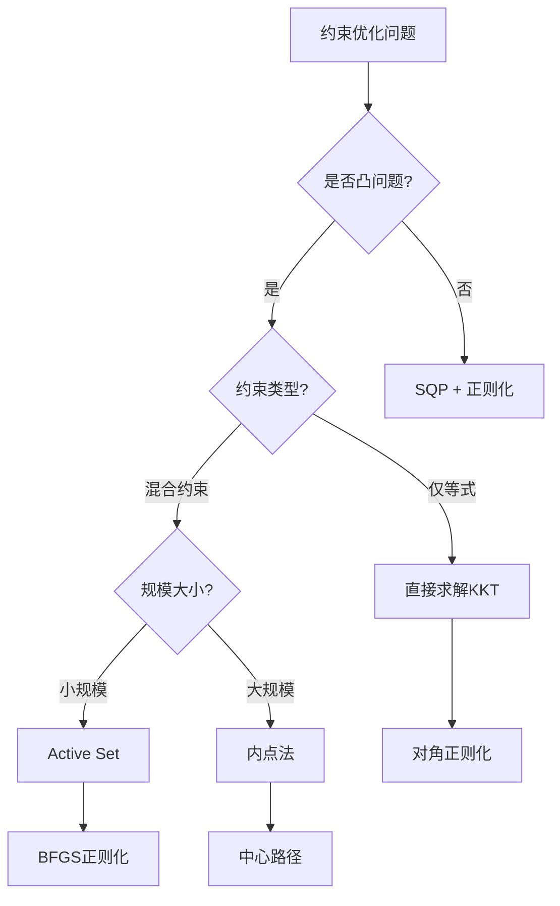
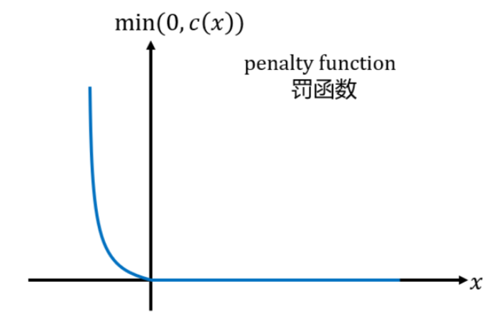

# 带约束最优问题

## 约束优化理论基础

### Problem Statement

$$
\min f(x) \quad \text{s.t.} \quad 
g_j(x) = 0,\ j = 1,\ldots,m_1; \quad
g_j(x) \leq 0,\ j = m_1+1,\ldots,m_1+m_2
$$

这类问题称为**非线性规划(NLP)**。**LICQ**: 在 $x^*$ 处活跃约束梯度线性无关:
$$
\{\nabla g_j(x^*) : j \in \{1,\ldots,m_1\} \cup J(x^*)\} \text{ 线性无关}
$$
LICQ保证可行域在 $x^*$ 附近具有良好的局部结构。

- 可行点: 满足所有约束的点 $x \in \mathbb{R}^n$
- 可行域: $\mathcal{X} = \{x : g_j(x) = 0, j \leq m_1; g_j(x) \leq 0, j > m_1\}$
- 活跃约束: $g_j(x) = 0$; 活跃集: $J(x) = \{j \in \{m_1+1,\ldots,m_1+m_2\} : g_j(x) = 0\}$

## KKT Conditions

> 约束优化的基石, 连接理论与算法的桥梁

### KKT条件详述

KKT是确认候选点为严格局部极小值的**一阶必要条件**。Suppose $x^* \in \mathcal{X}$ is a local minimizer, and LICQ holds at $x^*$. Then there exists a vector of Lagrange multipliers $\lambda^* = [\lambda_1^*, \ldots, \lambda_{m_1+m_2}^*]^\top$ with Lagrangian:
$$
L(x,\lambda) = f(x) + \sum_{i=1}^{m_1}\lambda_i g_i(x) + \sum_{i=m_1+1}^{m_1+m_2}\lambda_i g_i(x)
$$
such that the following conditions are satisfied:

1. **Stationarity**: $\displaystyle \frac{\partial L(x^*, \lambda^*)}{\partial x} = 0$

2. **Primal feasibility**: $g_j(x^*) = 0\ (j \leq m_1)$, $g_j(x^*) \leq 0\ (j > m_1)$

3. **Complementary slackness**: $\lambda_j^* g_j(x^*) = 0,\ \forall j$ — 要么约束 $j$ 被激活, 要么 $\lambda_j^* = 0$ (或两者皆有)

4. **Dual feasibility**: $\lambda_j^* \geq 0,\ j > m_1$

**严格互补条件**: 对每个 $j \in \{m_1+1,\ldots,m_1+m_2\}$, $\lambda_j^*$ 和 $g_j(x^*)$ 恰好一个为零。

### 对偶理论与正则化

#### 对偶理论

##### 等式约束对偶化

仅含等式约束: $\min_x f(x)\ \text{s.t.}\ h(x)=0$

可写为硬惩罚函数:
$$
\min_x f(x) + P_\infty(h(x)),\quad P_\infty(x) = \begin{cases}0,&x=0\\+\infty,&x\neq0\end{cases}
$$

拉格朗日对偶化(软惩罚替代硬惩罚):
$$
d(\lambda) := \min_x [f(x) + \lambda^\top h(x)],\quad \min_x \max_\lambda [f(x) + \lambda^\top h(x)]
$$

对偶函数 $d(\lambda)$ 表示给定 $\lambda$ 下 Lagrangian 的下确界。$h(x) \neq 0$ 时内层 max 将问题推至无穷大。凸优化中 $\min/\max$ 可交换(强对偶)。

##### 一般约束问题的对偶理论

原始问题标准形式:
$$
\begin{align}
p^* = \min & \quad f_0(x) \\
\text{s.t.} & \quad f_i(x) \leq 0,\ i=1,\ldots,m \\
& \quad h_j(x) = 0,\ j=1,\ldots,p
\end{align}
$$

Lagrangian 完整形式:
$$
L(x,\lambda,\nu) = f_0(x) + \sum_{i=1}^m \lambda_i f_i(x) + \sum_{j=1}^p \nu_j h_j(x)
$$
其中 $\lambda_i \geq 0$ (不等式约束对偶变量), $\nu_j$ 无符号限制(等式约束对偶变量)。

对偶函数: $g(\lambda,\nu) = \inf_{x \in \text{dom}f_0} L(x,\lambda,\nu)$

**性质**:

1. **凹性**: $g(\lambda,\nu)$ 关于 $(\lambda,\nu)$ 总是凹函数(即使原问题非凸):
   $$
   \begin{align}
   g(\theta(\lambda_1,\nu_1)+(1-\theta)(\lambda_2,\nu_2)) &= \inf_x L(x,\theta(\lambda_1,\nu_1)+(1-\theta)(\lambda_2,\nu_2)) \\
   &= \inf_x [\theta L(x,\lambda_1,\nu_1)+(1-\theta)L(x,\lambda_2,\nu_2)] \\
   &\geq \theta \inf_x L(x,\lambda_1,\nu_1)+(1-\theta)\inf_x L(x,\lambda_2,\nu_2) \\
   &= \theta g(\lambda_1,\nu_1)+(1-\theta)g(\lambda_2,\nu_2)
   \end{align}
   $$

2. **下界性质**: 对任意可行 $x$ 和 $\lambda \geq 0, \nu$: $g(\lambda,\nu) \leq f_0(x)$

对偶问题完整形式:
$$
\begin{align}
d^* = \max & \quad g(\lambda,\nu) \\
\text{s.t.} & \quad \lambda \geq 0
\end{align}
$$

##### 弱对偶与强对偶

- **弱对偶**: $d^* \leq p^*$ 总是成立
  $$
  L(\tilde{x},\lambda,\nu) = f_0(\tilde{x}) + \sum \lambda_i f_i(\tilde{x}) + \sum \nu_j h_j(\tilde{x}) \leq f_0(\tilde{x})
  $$
  $$
  g(\lambda,\nu) = \inf_x L(x,\lambda,\nu) \leq L(\tilde{x},\lambda,\nu) \leq f_0(\tilde{x})
  $$

- 对偶间隙: $p^* - d^*$; $=0$ 为强对偶, $>0$ 存在间隙

- **Slater条件**(凸优化强对偶充分条件): $\exists x \in \text{relint}(\text{dom}f_0)$ 使得 $f_i(x) < 0,\ \forall i$ 且 $Ax = b$

##### KKT条件的对偶解释

$x^*$ 和 $(\lambda^*,\nu^*)$ 分别为原/对偶问题最优解 $\iff$:
1. 原始可行性: $f_i(x^*) \leq 0,\ h_j(x^*) = 0$
2. 对偶可行性: $\lambda^* \geq 0$
3. 互补松弛: $\lambda_i^* f_i(x^*) = 0$
4. 梯度条件: $\nabla f_0(x^*) + \sum \lambda_i^* \nabla f_i(x^*) + \sum \nu_j^* \nabla h_j(x^*) = 0$

经济学解释: $\lambda_i^*$ 为"影子价格"—$\lambda_i^* > 0$ 则约束是"紧的", 放松可改善目标; $f_i(x^*) < 0$ 则约束松, $\lambda_i^* = 0$

##### 二次规划的对偶

原始QP: $\min \frac{1}{2}x^T Q x + c^T x$ s.t. $Ax = b,\ Gx \leq h$

通过拉格朗日对偶化:
$$
\max -\frac{1}{2}(A^T\nu+G^T\lambda+c)^T Q^{-1}(A^T\nu+G^T\lambda+c)+b^T\nu+h^T\lambda \quad \text{s.t.}\ \lambda \geq 0
$$

对偶关系: QP的对偶仍为QP, 变量从 $n$ 变 $m$

##### 线性规划的对偶

原始LP: $\min c^T x$ s.t. $Ax = b,\ x \geq 0$
对偶LP: $\max b^T y$ s.t. $A^T y \leq c$
对偶定理: 若都可行则 $c^T x^* = b^T y^*$

##### 半定规划(SDP)的对偶

原始SDP: $\min \text{tr}(CX)$ s.t. $\text{tr}(A_i X) = b_i,\ X \succeq 0$
对偶SDP: $\max b^T y$ s.t. $\sum y_i A_i + S = C,\ S \succeq 0$
内点条件下强对偶几乎总是成立

#### 正则化

KKT条件求出的解是关于 $(x,\lambda)$ 的**驻点**。若解为极小值点, 则Hessian应有 $\dim(x)$ 个正特征值, $\dim(\lambda)$ 个负特征值(Quasi-definite系统)。这种特征值分布使KKT系统具有准对角性质, 保证优化方向始终朝着最小化, 在使用牛顿法时避免收敛到非极小值点。

标准KKT系统:
$$
\begin{bmatrix} H & A^T \\ A & 0 \end{bmatrix} \begin{bmatrix} \Delta x \\ \Delta \lambda \end{bmatrix} = \begin{bmatrix} -\nabla f - A^T \lambda \\ -c \end{bmatrix}
$$

病态性: 特征值分布不当(理想要求Quasi-definite), 条件数恶化(约束接近线性相关时 $A^T A$ 接近奇异), 数值不稳定

**对角正则化**:
$$
\begin{bmatrix} H + \delta_x I & A^T \\ A & -\delta_\lambda I \end{bmatrix}
$$
固定($\delta_x = \delta_\lambda = \epsilon$), 自适应(根据条件数动态调整), 或特征值修正

**Tikhonov正则化**: $\min f(x) + \frac{\alpha}{2}\|x\|^2$ s.t. $g(x)=0$, Hessian $\to \nabla^2 f(x) + \alpha I$, 保证正定性, 解的唯一性和稳定性改善, $\alpha$ 控制偏差-方差权衡

**约束正则化**: $g(x) + \epsilon e = 0$ (随机扰动) 或 $\min f(x) + \frac{\rho}{2}\|g(x)\|^2$ (投影正则化)

**Example**: 牛顿法添加正则化以保证收敛到极小值
```julia
function regularized_newton_step(x,λ)
    H = ∇2f(x) + ForwardDiff.jacobian(xn -> ∂c(xn)'*λ, x)
    C = ∂c(x)
    K = [H C'; C 0]
    e = eigvals(K)
    while !(sum(e .> 0) == length(x) && sum(e .< 0) == length(λ))
        K = K + Diagonal([ones(length(x)); -ones(length(λ))])
        e = eigvals(K)
    end
    Δz = K\[-∇f(x)-C'*λ; -c(x)]
    Δx = Δz[1:2]; Δλ = Δz[3]
    return Δx, Δλ
end
```
> 解决了收敛于极小值的问题, 但仍有超调现象。通过特征值判断Quasi-definite计算量很大。

KKT条件只能找到驻点, 无法区分极小/极大/鞍点。二阶条件通过曲率分析排除鞍点。

### 二阶最优性条件

Hessian of Lagrangian:
$$
\nabla_x^2 L(x,\lambda) = \begin{bmatrix}
\frac{\partial^2 L}{\partial x_1^2} & \cdots & \frac{\partial^2 L}{\partial x_1 \partial x_n} \\
\vdots & \ddots & \vdots \\
\frac{\partial^2 L}{\partial x_n \partial x_1} & \cdots & \frac{\partial^2 L}{\partial x_n^2}
\end{bmatrix}
= \frac{\partial}{\partial x} \left( \frac{\partial L}{\partial x} \right)^\top
$$

Suppose $x^* \in \mathcal{X}$ satisfies KKT for some $\lambda^*$. If:
$$
p^\top \nabla_x^2 L(x^*, \lambda^*) p > 0,\ \forall p \in M^* \setminus \{0\}
$$
where $M^*$ is the set of $w \in \mathbb{R}^n$ satisfying:
$$
\begin{aligned}
w^\top \nabla g_j(x^*) &= 0, && j = 1,\ldots,m_1 \quad \text{(等式约束)} \\
w^\top \nabla g_j(x^*) &= 0, && j \in \{i \in J(x^*) : \lambda_i^* > 0\} \quad \text{(活跃且乘子正)} \\
w^\top \nabla g_j(x^*) &\geq 0, && j \in \{i \in J(x^*) : \lambda_i^* = 0\} \quad \text{(活跃但乘子零)}
\end{aligned}
$$
then $x^*$ is a **strict local minimum** ($M^*$ 为切锥)。不需要Hessian整体正定, 只需在 $M^*$ 上正定。

应用: 证明SQP收敛性, 验证Bang-Bang控制严格最优性, 设计逃离鞍点算法

| 条件 | 要求 | 作用 |
|------|------|------|
| KKT(一阶必要) | 梯度平稳、可行性、互补松弛 | 筛选候选点 |
| 二阶必要 | Hessian在临界子空间上半正定 | 排除非最优驻点 |
| 二阶充分 | Hessian在临界子空间上严格正定 | 确认严格局部最优 |

## 约束优化算法



### Active Set Method

核心: 启发式估计活跃约束集 $\mathcal{W}_k$, 将IQP转化为一系列EQP逐步逼近最优解

1. 估计当前点的活跃约束集 $\mathcal{W}_k$
2. 求解EQP: $\min \frac{1}{2}x^T Q x + c^T x$ s.t. $a_j^T x = b_j,\ j \in \mathcal{W}_k$
3. 若 $\lambda_j \geq 0$ 则最优; 否则移除 $\lambda_j < 0$ 的约束, 重复

优缺点: 好的heuristic下可达几千赫兹(如MIT DARPA挑战赛); 估计差时效果不好

### Penalty Methods

核心: 将约束优化转化为一系列无约束优化

| 方法 | 优点 | 缺点 | 适用场景 |
|------|------|------|----------|
| 对数障碍法 | 保证可行性, 理论完备 | 只处理不等式, 需严格可行点 | 中小规模凸优化 |
| L1罚函数 | 精确罚函数, 实现简单 | 非光滑, 矩阵病态 | 快速原型, 非精确求解 |
| L2罚函数 | 光滑, 数值稳定 | 非精确, 需大惩罚参数 | 一般非线性优化 |

**内罚法(Barrier)**: 仅适用于不等式约束。引入障碍函数(如倒数/对数障碍), 求解无约束问题, 不断减小 $\rho$ 使解收敛

1. 初始化 $\rho_0 > 0$, 找严格可行点 $x_0$
2. 最小化 $f(x) + \frac{1}{\rho_k} \sum B(g_j(x))$
3. $\rho_{k+1} = \alpha \rho_k$, $0 < \alpha < 1$
4. $\rho_k$ 足够小时停止


优点: 每个近似解都可行, 中小规模凸优化的 gold standard, 收敛较快
缺陷: $\rho$ 减小致Hessian病态(梯度悬崖), 仅适用于不等式约束, 需严格可行初始点

**外罚法**: $\min f(x) + \lambda P(x)$, $\lambda \to \infty$。分为L1和L2两种。

**L1罚函数(精确罚函数)**:
$$
F_\rho(x) = f(x) + \rho\left(\sum_{j=1}^{m_1} |g_j(x)| + \sum_{j=m_1+1}^{m_1+m_2} \max\{g_j(x),0\}\right)
$$
有限 $\rho$ 可得精确解, 但非光滑(墙角效应), 难以高精度, Hessian病态(条件数大)



**L2罚函数(二次罚函数)**:
$$
F_\rho(x) = f(x) + \frac{\rho}{2}\left(\sum_{j=1}^{m_1} g_j(x)^2 + \sum_{j=m_1+1}^{m_1+m_2} \max\{g_j(x),0\}^2\right)
$$

光滑但非精确, $\rho$ 大导致Hessian病态(等式约束为例):
$$
\nabla_{xx}^2 F(x,\rho) \approx \nabla_{xx}^2 L(x,\lambda^*) + \sigma \nabla c(x)\nabla c(x)^T
$$
右边第二项最大特征值趋于无穷, 条件数增大, 求解子问题难度增加。


对比:

| 方法 | 优点 | 缺点 |
|------|------|------|
| 二次罚函数 | 简单易实现, 可处理非线性约束 | 需大$\rho$导致数值不稳定 |
| 障碍函数 | 保证内点解 | 无法处理等式约束 |
| 增广Lagrangian | 允许有限$\rho$收敛 | 需估计Lagrange乘子 |

### Sequential Quadratic Programming(SQP)

> 处理非线性约束的最有效方法之一

在 $x^k$ 处对目标函数二次近似, 约束线性近似:
$$
f(x^k+p) \approx f(x^k) + \nabla f(x^k)^T p + \frac{1}{2} p^T \nabla_x^2 L(x^k, \lambda^k) p
$$
$$
g_j(x^k+p) \approx g_j(x^k) + \nabla g_j(x^k)^T p
$$

QP子问题:
$$
\begin{align}
\min_p & \ f(x^k) + \nabla f(x^k)^T p + \frac{1}{2} p^T \nabla_x^2 L(x^k, \lambda^k) p \\
\text{s.t.} & \ g_j(x^k) + \nabla g_j(x^k)^T p = 0,\ j=1,\ldots,m_1 \\
& \ g_j(x^k) + \nabla g_j(x^k)^T p \leq 0,\ j=m_1+1,\ldots,m_1+m_2
\end{align}
$$

$$
L(x,\lambda) = f(x) + \sum_{j=1}^{m_1+m_2} \lambda_j g_j(x),\quad
\nabla_x^2 L(x,\lambda) = \begin{bmatrix}
\frac{\partial^2 L}{\partial x_1^2} & \cdots & \frac{\partial^2 L}{\partial x_1 \partial x_n} \\
\vdots & \ddots & \vdots \\
\frac{\partial^2 L}{\partial x_n \partial x_1} & \cdots & \frac{\partial^2 L}{\partial x_n^2}
\end{bmatrix}
$$

> 用 $\nabla_x^2 L$ 而非 $\nabla^2 f$ 为考虑约束曲率; 实际常用BFGS更新Lagrangian Hessian

**Off-the-shelf NLP Solvers**:
- Open source: IPOPT (Interior Point OPTimizer), SNOPT (Sparse Nonlinear OPTimizer)
- Commercial: NLPQLP (Nonlinear Programming using Quadratic Lagrangian), FFSQP, NPSQP

### 增广拉格朗日法(ALM)

> PHR Augmented Lagrangian Method — 融合拉格朗日法+惩罚法, 避免大惩罚系数的数值不稳定。轨迹规划常用。

#### For Equality-Constrained

**Uzawa方法**: 交替优化 $x$ 和 $\lambda$, 在对偶函数上执行对偶梯度上升
$$
d(\lambda) := \min_x [f(x) + \lambda^\top h(x)],\quad \min_x \max_\lambda [f(x) + \lambda^\top h(x)]
$$
局限: $L$ 非严格凸时对偶函数非光滑(多个 $x$ 使 $L$ 取极小, 函数跳跃拐角), 梯度不存在, 对偶梯度上升失效

**PHR方法**: 引入邻近点正则化项平滑minimax问题, 同时避免交换min和max顺序的复杂性
$$
\min_x \max_\lambda \left[ f(x) + \lambda^\top h(x) - \frac{1}{2\rho} \|\lambda - \bar{\lambda}\|^2 \right]
$$
$\rho > 0$: 正则化参数, $\bar{\lambda}$: 先验拉格朗日乘子估计(如上轮迭代结果)

优势: 避免对偶梯度上升不可行性, 直接优化原始问题, 正则化迫使乘子更新不过度偏离历史值

内层求解(闭式解): $\lambda^*(\bar{\lambda}) = \bar{\lambda} + \rho h(x)$

代入得无约束形式:
$$
\min_x \left[ f(x) + \bar{\lambda}^\top h(x) + \frac{\rho}{2} \|h(x)\|^2 \right]
$$

算法:
1. 初始化 $\bar{\lambda}_0$, $\rho_0$
2. 迭代:
   - $x_k = \arg\min_x [f(x) + \bar{\lambda}_k^\top h(x) + \frac{\rho_k}{2} \|h(x)\|^2]$
   - $\bar{\lambda}_{k+1} = \bar{\lambda}_k + \rho_k h(x_k)$
3. 当 $\|h(x_k)\| < \epsilon$ 时终止

增广Lagrangian: $L(x,\lambda,\rho) = f(x) + \bar{\lambda}_k^\top h(x) + \frac{\rho_k}{2} \|h(x)\|^2$
因此称为融合拉格朗日法+惩罚法

#### For Inequality-Constrained

引入松弛变量 $s \in \mathbb{R}^m$, 将不等式约束转化为等式约束:
$$
\begin{cases}
\min_{x,s} f(x) \\
\text{s.t.}\quad g(x) + [s]^2 = 0,\ s \geq 0
\end{cases}
$$
松弛变量 $s$ 也被当作决策变量进行优化。

增广拉格朗日函数:
$$
\mathcal{L}_\rho(x,\mu) = f(x) + \frac{\rho}{2} \left\| \max\left(g(x) + \frac{\lambda}{\mu}, 0\right) \right\|^2 - \frac{\lambda}{2\rho} \|\mu\|^2
$$

乘子更新: $\mu^{k+1} = \max(\mu^k + \rho g(x^{k+1}), 0)$

通过松弛变量 $s$ 在可行域和约束边界之间建立缓冲带, 使非凸约束的优化轨迹更平滑。惩罚项 $\|\max(g(x)+s,0)\|^2$ 使解在远离可行域时受到更强惩罚。

#### ALM优势

- 理论: 有限惩罚参数收敛, 避免Hessian严重病态, 超线性收敛
- 实际: 轨迹规划广泛使用, 鲁棒, 易并行

## 二次规划问题(QP)

### Problem Statement

标准QP形式:
$$
\begin{align}
\min_{x \in \mathbb{R}^n} & \ \frac{1}{2}x^T Q x + c^T x \\
\text{s.t.} & \ a_j^T x = b_j,\ j=1,\ldots,m_1 \\
& \ a_j^T x \leq b_j,\ j=m_1+1,\ldots,m_1+m_2
\end{align}
$$

参数: $Q \in \mathbb{R}^{n \times n}$ 对称, $c \in \mathbb{R}^n$, $a_j \in \mathbb{R}^n$, $b_j \in \mathbb{R}$

应用: SQP子问题, LQR, 机器人运动规划, 投资组合优化

### 等式约束二次规划(EQP)

$$
\min \frac{1}{2}x^T Q x + c^T x \quad \text{s.t.} \quad Ax = b
$$

假设: $m < n$, $\text{rank}(A) = m$

Lagrangian: $L(x,\lambda) = \frac{1}{2}x^\top Q x + c^\top x + \lambda^\top(Ax - b)$

应用KKT条件:
$$
\begin{align}
\nabla_x L &= Qx^* + c + A^T\lambda^* = 0 \\
\nabla_\lambda L &= Ax^* - b = 0
\end{align}
$$

KKT系统:
$$
\begin{bmatrix}
Q & A^\top \\
A & 0
\end{bmatrix}
\begin{bmatrix}
x^* \\ \lambda^*
\end{bmatrix}
=
\begin{bmatrix}
-c \\ b
\end{bmatrix}
$$

$Q$ 正定且 $A$ 满秩时分块矩阵求逆:
$$
\begin{bmatrix}
Q & A^\top \\ A & 0
\end{bmatrix}^{-1}
=
\begin{bmatrix}
H & P^\top \\ P & S
\end{bmatrix}
$$

$$
\begin{aligned}
H &= Q^{-1} - Q^{-1}A^\top(AQ^{-1}A^\top)^{-1}AQ^{-1} \\
P &= (AQ^{-1}A^\top)^{-1}AQ^{-1} \\
S &= -(AQ^{-1}A^\top)^{-1}
\end{aligned}
$$

解:
$$
\begin{aligned}
x^* &= -Hc + P^\top b = -Q^{-1}c + Q^{-1}A^\top(AQ^{-1}A^\top)^{-1}(AQ^{-1}c + b) \\
\lambda^* &= -Pc + Sb = -(AQ^{-1}A^\top)^{-1}(AQ^{-1}c + b)
\end{aligned}
$$

> $AQ^{-1}A^\top$ 将原始空间梯度按 $Q^{-1}$ 权重投影到约束空间

### 不等式约束二次规划(IQP)

- **Active Set**: 猜测最优解处活跃约束集, 转化为EQP求解
  1. 初始化 $\mathcal{W}_0$; 2. 求解EQP; 3. 检查KKT更新活跃集; 4. 重复

- **内点法**: 障碍函数保持严格可行性, 逐步逼近边界
  $$
  \min_x \frac{1}{2}x^T Q x + c^T x - \mu \sum_j \log(b_j - a_j^T x)
  $$
  路径跟踪: $\mu \to 0^+$ 收敛到原问题最优解

## 控制论思想下的约束问题

- **PI-PGD**: 等式约束复合凸优化, 将优化建模为连续动力系统, 通过反馈控制调节拉格朗日乘子(视为控制输入), 驱动系统收敛至可行解

  

- **Safe Gradient Flow (CBF)**: 结合控制屏障函数, 确保可行集前向不变性(初始可行点保持可行), 实现可行集渐近稳定性(不可行初始点收敛到可行集), 设计连续光滑动力学系统

### HW

- 对比 $l_1$ 和 $l_2$ 罚函数法的"墙角"平滑性
- 罚函数如何导致病态(画图)

## References

- <https://zhuanlan.zhihu.com/p/629131647>
- [2023-2024春夏许超老师最优化与最优控制课程分享 - CC98论坛](https://www.cc98.org/topic/5923253)
- [Tutorial — Ceres Solver (ceres-solver.org)](http://ceres-solver.org/tutorial.html)
- [Karush-Kuhn-Tucker (KKT)条件](https://zhuanlan.zhihu.com/p/38163970)
