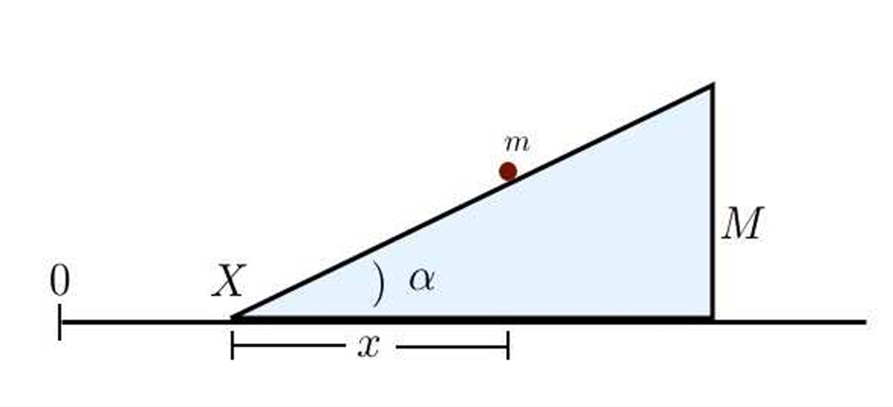

# 连续最优控制

介绍最优控制求解的三种主要方法

## 理论基础

### 控制简史

- 1696: 伯努利最速降线问题—牛顿使用**变分法**(优化函数本身), 为经典最优控制问题奠基
- 1769: 瓦特飞轮调速器—**反馈控制**思想开端
- 20世纪初-60年代: 经典控制理论(拉普拉斯变换, 奈奎斯特判据)
- 1960s至今: 现代控制理论(Pontryagin极小值原理, 李雅普诺夫稳定性, 状态空间概念)
- 1950至今: 自适应控制, 强化学习(在线梯度上升更新参数)
- 1980s: **鲁棒控制**—LQR参数微小噪声也可使系统发散
- 1970s: **模型预测控制**(MPC), 早期受算力限制用于化工等大时间常数系统

当前研究难点: 通用接触理论, model-based与model-free结合, RL先验知识, 不确定非线性系统安全裕度, 非协作环境

### 最优控制三种形式

性能指标 $J(x,u)$ 有三种表达形式, 可互相转换:

- **Lagrange**(关注过程): $J = \int_{t_0}^{t_f} L(t,x,u)dt$, 约束: $\dot x = f(t,x,u)$ + 初值
- **Mayer**(关注终端): $J = \Phi(x(t_f))$, 约束: 状态方程 + 初值
- **Bolza**(混合): $J = \Phi(x(t_f)) + \int L dt$

**Lagrange → Mayer**: 引入 $x_{n+1}$, $\dot x_{n+1}=L$, $x_{n+1}(t_0)=0$, 则 $J=x_{n+1}(t_f)$
$$
\begin{cases}
\dot x = f(t,x,u) \\
\dot x_{n+1} = L(t,x,u)
\end{cases}
$$

**Mayer → Lagrange**: $L=0$ 时Mayer是Lagrange特例

**Bolza → Mayer**: 同Lagrange转化, $J = \Phi(x_f) + x_{n+1}(t_f)$

**Bolza → Lagrange**: $J = \int [L + \delta(t-t_f)\Phi] dt$

## 连续最优问题(无控制)

### Review

泛函: 函数集 $\to$ 实数/复数的映射。

**Example** — 两点之间直线最短。从 $(0,0)$ 到 $(a,b)$:
$$
s = \int_0^a \sqrt{1+y'(x)^2} dx
$$

E-L方程: $\frac{d}{dx}(\frac{\partial F}{\partial y'}) - \frac{\partial F}{\partial y} = 0$, $F=\sqrt{1+y'^2}$

$\frac{\partial F}{\partial y}=0$, $\frac{\partial F}{\partial y'} = \frac{y'}{\sqrt{1+y'^2}}$, 代入得:
$$
\frac{d}{dx}\left(\frac{y'}{\sqrt{1+y'^2}}\right)=0 \Rightarrow \frac{y'}{\sqrt{1+y'^2}} = C \Rightarrow y'=m \Rightarrow y=\frac{b}{a}x
$$

### Geodesic (测地线)

**哈密顿原理**: $\delta S = \delta\int L(q,\dot q,t)dt = 0$

**平面测地线**:
- 几何: $F=\sqrt{1+\dot f^2}$, E-L得 $\dot f=c_1$, $f=c_1x+c_2$ (直线)
- 力学: $L=\frac12 g_{ij}\dot x^i\dot x^j = \frac12(\frac{ds}{dt})^2$, 代入拉格朗日方程得:
  $$
  \frac{d}{dt}(g_{ik}\dot x^k) - \frac12\partial_i g_{jk}\dot x^j\dot x^k = 0
  $$
  定义克氏符 $\Gamma^i_{jk} = \frac12 g^{il}(\partial_j g_{lk}+\partial_k g_{jl}-\partial_l g_{jk})$, 得:
  $$
  \ddot x^i + \Gamma^i_{jk}\dot x^j\dot x^k = 0
  $$

**球面测地线**($r=1$):
- 几何: $L=\int\sqrt{1+\sin^2\theta\,(\phi')^2}d\theta$, E-L得守恒量:
  $$
  \frac{\sin^2\theta\,\phi'}{\sqrt{1+\sin^2\theta\,(\phi')^2}}=c
  $$
  替换 $u=\cot\theta$: $\cot\theta = a\cos(\phi-\phi_0)$ (大圆路径)
- 力学: $\ddot\theta=\sin\theta\cos\theta\,\dot\phi^2$, $\ddot\phi+2\cot\theta\,\dot\theta\dot\phi=0$

**Example** — 三角块上滑块

$T = \frac12 M\dot X^2 + \frac12 m(\dot X+\dot x)^2 + \frac12 m\dot y^2$, $y=x\tan\alpha$
$$
T = \frac12(M+m)\dot X^2 + m\dot X\dot x + \frac12 m(1+\tan^2\alpha)\dot x^2
$$
$U = mgx\tan\alpha$, $L=T-U$。E-L方程:
- 对 $X$: $(M+m)\ddot X + m\ddot x = 0$
- 对 $x$: $m\ddot X + m(1+\tan^2\alpha)\ddot x = -mg\tan\alpha$

联立:
$$
\ddot x = -\frac{(M+m)g\sin\alpha\cos\alpha}{M+m\sin^2\alpha},\ \ddot X = \frac{mg\sin\alpha\cos\alpha}{M+m\sin^2\alpha}
$$

## 最优控制求解方法的发展

古典变分 → Lagrangian(等式约束) → Hamilton(对称化) → PMP(不等式约束)

| 方法 | 时期 | 适用场景 | 核心 |
|------|------|----------|------|
| Lagrangian | 17-18世纪 | 古典变分 | E-L方程 |
| Hamilton | 19世纪 | 理论分析 | 协态对称 |
| PMP | 20世纪60年代 | 工程 | 控制约束 |

### 确定性最优控制

系统确定, 给定 $u$ 即可知下一步(vs 随机最优控制)。

- $\dot x = f(x,u,t)$, $x(t_0)=x_0$
- $J = h(x_f,t_f) + \int g(x,u,t) dt$
- 目标: $u^*(t)$ 使 $J$ 最小

解为**开环轨迹**。多数无解析解(LQR特例)。同时优化 $x,u$ 避免Shooting法的梯度爆炸问题。

## Lagrangian Formulation

处理带等式约束的最优控制, $u(t)$ 无约束。

### 变分求解

增广性能指标(乘子法将状态方程并入目标):
$$
J = h(t_f,x_f) + \int_{t_0}^{t_f} [g + \lambda^T(f-\dot x)] dt
$$
$$
h(t_f,x_f) = \int \frac{d}{dt}h\,dt + h(t_0,x_0)
$$

重写: $J = \int L^a dt$, $L^a = \frac{\partial h}{\partial x}\dot x + \frac{\partial h}{\partial t} + g + \lambda^T(f-\dot x)$

$\delta J=0$ 得必要条件:
$$
\begin{aligned}
\left(\frac{\partial L^a}{\partial x}\right)_* - \frac{d}{dt}\left(\frac{\partial L^a}{\partial \dot x}\right)_* &= 0 \quad \text{协态}\\
\left(\frac{\partial L^a}{\partial \lambda}\right)_* - \frac{d}{dt}\left(\frac{\partial L^a}{\partial \dot\lambda}\right)_* &= 0 \Rightarrow \frac{\partial L^a}{\partial \lambda}=0 \quad \text{状态}\\
\left(\frac{\partial L^a}{\partial u}\right)_* &= 0 \quad \text{最优控制}\\
\left(\frac{\partial L^a}{\partial \dot x}\right)_*^T\delta x_f + L^a|_{t_f}\delta t_f &= 0 \quad \text{边界}
\end{aligned}
$$

边界条件($\delta x_f = \delta x(t_f)+\dot x(t_f)\delta t_f$):
$$
\left[L^a - \left(\frac{\partial L^a}{\partial\dot x}\right)^T\dot x\right]_{t_f}\delta t_f + \left(\frac{\partial L^a}{\partial\dot x}\right)_{*t_f}^T \delta x_f = 0
$$

### Example

自由最终时间, 两端固定:

$\dot x = \begin{bmatrix}0&1\\0&-2\end{bmatrix}x + \begin{bmatrix}0\\1\end{bmatrix}u$, $(0,1)^T\to(3,5)^T$

$J = [x_1(t_f)-3]^2 + \frac12[x_2(t_f)-5]^2 + \frac12\int_0^{t_f}(x_1^2+3x_2^2+2u^2)dt$

$L^a = \frac12(x_1^2+3x_2^2+2u^2) + 2(x_1-3)\dot x_1 + (x_2-5)\dot x_2 + \lambda_1(x_2-\dot x_1) + \lambda_2(-2x_2+u-\dot x_2)$

必要条件:
- $\dot\lambda_1^* = -x_1^*$
- $\dot\lambda_2^* = -3x_2^* - \lambda_1^* + 2\lambda_2^*$
- $u^* = -0.5\lambda_2^*$
- Final time: $\frac12(x_1^2+3x_2^2+2u^2)+\lambda_1 x_2+\lambda_2(-2x_2+u)=0$

## Hamilton Formulation

将变分问题改写成**哈密顿系统**, $x$ 和 $p$ 地位平等。

### 数学推导

$\dot x = f(x,u,t)$, $J = h(x_f,t_f)+\int g\,dt$

Hamilton函数: $\mathcal{H}(x,u,p,t) = g(x,u,t) + p^T f(x,u,t)$, $p$ 为协态变量

增广指标: $\bar J = h(x_f,t_f) + \int [\mathcal{H} - p^T\dot x] dt$

$\delta\bar J=0$:
- $\delta h = \frac{\partial h}{\partial x}\delta x_f + \frac{\partial h}{\partial t}\delta t_f$
- $\delta\mathcal{H} = \frac{\partial\mathcal{H}}{\partial x}\delta x + \frac{\partial\mathcal{H}}{\partial u}\delta u + \frac{\partial\mathcal{H}}{\partial p}\delta p$
- $\delta(-p^T\dot x) = -\delta p^T\dot x - p^T\delta\dot x$ (分部积分)

必要条件:
1. **极值**: $\partial\mathcal{H}/\partial u = 0$
2. **状态**: $\dot x = \partial\mathcal{H}/\partial p = f$
3. **协态**: $\dot p = -\partial\mathcal{H}/\partial x$
4. **边界**: $0 = [\frac{\partial h}{\partial x} - p(t_f)]\delta x_f$, $0 = [\frac{\partial h}{\partial t} + \mathcal{H}]\delta t_f$

**终端条件**:

| 终端情况 | 边界条件 |
|----------|----------|
| $t_f$固定, $x(t_f)$固定 | $x(t_0)=x_0$, $x(t_f)=x_f$ |
| $t_f$固定, $x(t_f)$自由 | $\frac{\partial h}{\partial x} - p(t_f)=0$ |
| $t_f$自由, $x(t_f)$固定 | $\frac{\partial h}{\partial t} + \mathcal{H}=0$ |
| 均自由 | 同时满足上述两个 |

## Pontryagin极小值原理(PMP)

在Hamilton框架上加入**控制有界** $u(t)\in U\subseteq\mathbb{R}^m$。

### 必要条件

$\mathcal{H}(x,u,p,t) = g(x,u,t) + p^T f(x,u,t)$

1. **极值**: $u^* \in \arg\min_{u\in U} \mathcal{H}(x,u,p,t)$
   - 无约束且可微 $\Rightarrow \partial\mathcal{H}/\partial u = 0$

2. **状态**: $\dot x = \partial\mathcal{H}/\partial p$

3. **协态**: $\dot p = -\partial\mathcal{H}/\partial x$

4. **边界**: $0 = [\frac{\partial h}{\partial x}+\mathcal{H}]\delta t_f + [\frac{\partial h}{\partial x} - p(t_f)]\delta x_f$

### 切换函数

$\phi(t)=\partial\mathcal{H}/\partial u$, $u\in[u_{\min},u_{\max}]$:
- $\phi>0 \Rightarrow u^*=u_{\min}$
- $\phi<0 \Rightarrow u^*=u_{\max}$
- $\phi=0 \Rightarrow$ 奇异弧(需高阶条件)

$t_f$自由且$h$不显含$t$: $\mathcal{H}(t_f)=0$

## LQR

> LQR → 线性状态反馈 $u=-Kx$, 由Riccati方程给出

### Takeaway

LQR = Linear Quadratic Regulator(线性二次型调节器)

解决以下问题
$$
\text{linear dynamics}
+
\text{quadratic cost}
\Rightarrow
\text{linear feedback optimal controller}
$$

### Core Mechanism

#### 数学建模

系统动力学是线性的：

$$
x_{t+1}=Ax_t+Bu_t
$$
代价函数是二次型：

$$
J=\sum_{t=0}^{T-1} \left( x_t^\top Qx_t+u_t^\top Ru_t \right) + x_T^\top Q_f x_T
$$
最终最优控制律具有线性 feedback form：

$$
u_t^*=-K_t x_t
$$
其中 $K_t$ 由 **Riccati recursion** 求出

还有连续的形式

$\dot x = A(t)x + B(t)u$, $x(t_0)=x_0$

$J = \frac12 x^T(t_f)Q_f x(t_f) + \frac12\int_{t_0}^{t_f}(x^TQx + u^TRu)dt$

$Q_f\geq0$, $Q(t)\geq0$, $R(t)>0$, $t_f$固定

#### Solution

求解有两种方法：

1. PMP求解
2. DP求解

能够得到最优性条件

最后求解就会将问题转化为求一个矩阵$P(t)$的问题，即求解Riccati方程（最终的数值答案）

##### Sol: PMP求解

$\mathcal{H} = \frac12 x^TQx + \frac12 u^TRu + \lambda^T(Ax+Bu)$

1. 状态: $\dot x = Ax+Bu$
2. 协态: $\dot\lambda = -Qx - A^T\lambda$
3. 极值: $Ru+B^T\lambda=0 \Rightarrow u=-R^{-1}B^T\lambda$
4. 终端: $\lambda(t_f)=Q_f x(t_f)$

##### Sol: 动态规划DP求解

无论是离散还是连续的函数都可以用DP求解，但是在求解之前我们需要先定义value function:
$$
V_t=\frac12 x^TP_tx
$$

> [!NOTE]
>
> Q: 为什么value funciton也是二次型：
>
> Bellman backup 会保持二次型函数族封闭，因为我们已经有了终端条件$V_T(x)=x^\top Q_f x.$
>
> 因此只要能证明$V_{t+1}(x)=x^\top P_{t+1}x
> \Rightarrow
> V_t(x)=x^\top P_t x,$即可说明所有的$V_t$都是二次型的。证明如下：
>
> 假设：
>
> $$V_{t+1}(x)=x^\top P_{t+1}x.$$
>
> 那么：
>
> $$V_{t+1}(Ax+Bu) = (Ax+Bu)^\top P_{t+1}(Ax+Bu).$$
>
> 因为 $Ax+Bu$ 是 $x,u$ 的线性函数，所以把一个线性函数代入二次型，仍然得到 $x,u$ 的二次型。
>
> 展开：
>
> $$(Ax+Bu)^\top P_{t+1}(Ax+Bu)$$
>
> $$= x^\top A^\top P_{t+1}Ax + 2u^\top B^\top P_{t+1}Ax + u^\top B^\top P_{t+1}Bu.$$
>
> 所以 Bellman 里面的目标变成：
>
> $$x^\top Qx + u^\top Ru + x^\top A^\top P_{t+1}Ax + 2u^\top B^\top P_{t+1}Ax + u^\top B^\top P_{t+1}Bu.$$
>
> 整理成关于 $x,u$ 的 joint quadratic：
>
> $$\begin{aligned} J_t(x,u) = &x^\top \left( Q+A^\top P_{t+1}A \right)x \\ &+ 2u^\top B^\top P_{t+1}Ax \\ &+ u^\top \left( R+B^\top P_{t+1}B \right)u. \end{aligned}$$
>
> 因此Bellman backup 内部是关于 }(x,u)\text{ 的二次函数
>
> 而
> $$
> V_t(x)=\min_u J_t(x,u).
> $$
> 如果 $J_t(x,u)$ 是关于 $x,u$ 的 joint quadratic，且关于 $u$ 是 strictly convex，那么对 $u$ minimize 后，得到的函数仍然是 $x$ 的 quadratic，证明如下
>
> 写成抽象形式：
>
> $$J(x,u) = x^\top Sx + 2u^\top Mx + u^\top Nu,$$
>
> 其中：
>
> $$N\succ 0.$$
>
> 对 $u$ 求最优：
>
> $$\nabla_u J(x,u)=2Mx+2Nu=0.$$
>
> 所以：
>
> $$u^*(x)=-N^{-1}Mx.$$
>
> 注意，最优 $u^*$ 是 $x$ 的线性函数。
>
> 代回去：
>
> $$J(x,u^*(x)) = x^\top Sx - x^\top M^\top N^{-1}Mx.$$
>
> 因此：
>
> $$\boxed{ \min_u J(x,u) = x^\top \left( S-M^\top N^{-1}M \right) x }$$
>
> 仍然是 quadratic

HJB方程:
$$
-\frac{\partial V}{\partial t} = \min_u\left\{\frac12 x^TQx + \frac12 u^TRu + \frac{\partial V}{\partial x}(Ax+Bu)\right\}
$$

$u^* = -R^{-1}B^T\frac{\partial V}{\partial x}$, 设 $V=\frac12 x^TPx$ 得相同Riccati方程

##### Riccati方程

- Takeaway: LQR问题最终求解的矩阵方程

- Core Mechanism

  本质就是求解$P(t)$，是 value function 的 curvature
  $$
  P(t)=\frac12\nabla_x^2V(t,x)
  $$
  假设 $\lambda=Px$ ($P$ 对称正定):
  $$
  \dot\lambda = P\dot x + \dot P x = -Qx - A^T P x
  $$
  $\dot x = (A-BR^{-1}B^T P)x$ 代入:
  $$
  \dot P x + P(A-BR^{-1}B^T P)x = -Qx - A^T P x
  $$

  **Riccati方程**: $\dot P + PA + A^T P - PBR^{-1}B^T P + Q = 0$, $P(t_f)=Q_f$

  > $\lambda=Px$的合理性: $\lambda(t_f)=Q_f x(t_f)$已线性; LQR下 $V=x^T P x$, $\lambda=\partial V/\partial x$; 线性可闭合成可解形式

  **最优控制**: $u^* = -R^{-1}B^T P x = -Kx$, $K=R^{-1}B^T P$

- Pipeline

  实际使用中我们先建模得到$A,B$，然后选择不同的$Q,R$矩阵（调参）得到控制率进行测试

### Pros

- LQR 是连续变量 DP 中少数可以解析求解的经典问题

## 特殊最优控制问题

### 最小能量控制

$J=\frac12\int\|u\|^2 dt$, $x(t_0)=x_0$, $x(t_f)=x_f$

$\tilde J = \int[\frac12\|u\|^2 + \lambda^T(Ax+Bu-\dot x)]dt$

E-L: $\dot\lambda = -A^T\lambda$, $u=-B^T\lambda$
$$
\lambda = e^{-A^T(t-t_0)}\lambda_0,\ u = -B^T e^{A^T(t_0-t)}\lambda_0
$$

#### 可控制性格拉姆矩阵

$W_c(t_0,t_1) = \int \Phi B B^T \Phi^T d\tau$, 可控 $\iff$ $W_c$ 非奇异

LTI: $W_c(t)=\int_0^t e^{A\tau}BB^T e^{A^T\tau}d\tau$, 满足 $A W_c+W_c A^T = -BB^T$

等效: $C=[B\ AB\ \cdots\ A^{n-1}B]$ 满秩, 或 $[A-\lambda I\ B]$ 满秩

#### 最小能量解

$W = \int_{t_0}^{t_f} e^{A(t_0-\tau)}BB^T e^{A^T(t_0-\tau)}d\tau$
$\lambda_0 = W^{-1}(x_0 - e^{A(t_0-t_f)}x_f)$
$u^* = -B^T e^{A^T(t_0-t)}W^{-1}(x_0 - e^{A(t_0-t_f)}x_f)$

反向Gramian:
$W_R = \int e^{A(t_f-\tau)}BB^T e^{A^T(t_f-\tau)}d\tau$
$u^* = B^T e^{A^T(t_f-t)}W_R^{-1}(x_f - e^{A(t_f-t_0)}x_0)$

最小能量:
$J^* = \frac12(x_0-e^{A(t_0-t_f)}x_f)^T W^{-1}(x_0-e^{A(t_0-t_f)}x_f)$

Gramian微分方程:
$\frac{d}{dt}W - A W - W A^T + BB^T = 0$, $W(t_f,t_f)=0$

### 参数最优化问题

$\dot x = f(t,x,\zeta)$, $x(0)=x^0(\zeta)$, $\zeta\in\mathbb{R}^r$

最小化 $g_0(\zeta) = \Phi_0(x(T|\zeta),\zeta) + \int_0^T \mathcal{L}_0(t,x,\zeta)dt$

满足界约束 $a_i\leq\zeta_i\leq b_i$ 和规范约束($\mathcal{E}$等式, $\mathcal{I}$不等式):
$$
\phi_j(x(\tau_j),\zeta) + \int_0^{\tau_j} L_j dt \ \{=0,\ j\in\mathcal{E};\ \geq0,\ j\in\mathcal{I}\}
$$

**应用**:
1. 参数辨识: 最小化 $\sum\|x(\tau_k)-\bar x^k\|^2$
2. 控制参数化: $u\approx\sum\sigma^k\phi_k(t)$ 转化为参数选择
3. 反馈控制设计: $u=\varphi(x,\zeta)$ 转化为参数优化

**求解**: 变分法(同时向前积分)或costate法(先向后再向前), 可用SQP

### BVP问题

$y''=f(x,y,y')$, $y(a)=\alpha$, $y(b)=\beta$

唯一解: $f,f_y,f_{y'}$连续, $f_{y'}>0$有界

**打靶法**: BVP$\to$IVP, 猜 $y'(a)=t$ 使 $y(b)=\beta$
- 线性: $y=y_1+ty_2$, $t=(\beta-y_1(b))/y_2(b)$
- 非线性: $y(b,t)=0$, 牛顿法/弦截法

## References

- [PMP module3.pdf](https://www3.nd.edu/~lemmon/courses/ee565/lectures/module3.pdf)
- [变分法对变动端点的推导](https://www.zhihu.com/column/c_1703789122005610496)
- [最优运输](https://www.cnblogs.com/liuzhen1995/p/14524932.html)
- [怎么理解SQP算法？](https://www.zhihu.com/question/279186014)
- [HJB方程推导](https://blog.csdn.net/w_w_y/article/details/123300931)
