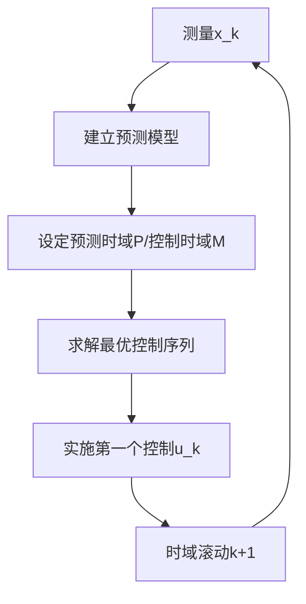
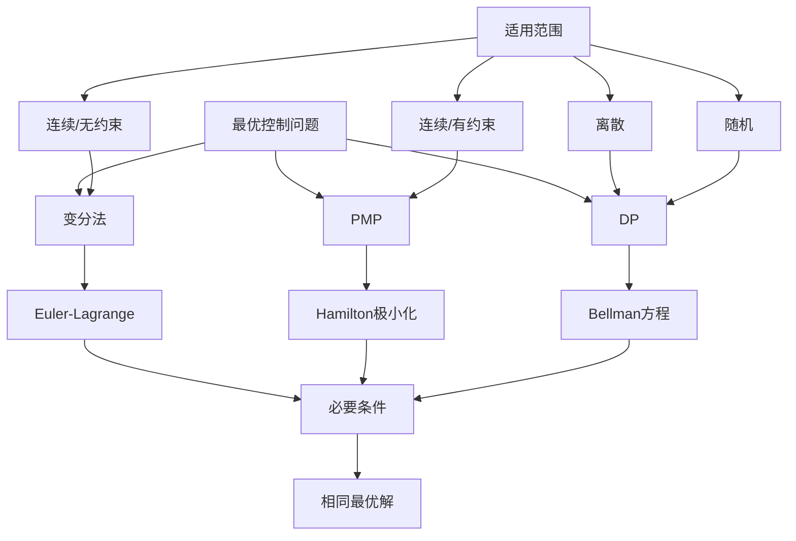

# 离散最优控制
[TOC]

- [ ] 掌握连续系统离散化方法，理解矩阵形式求解与MPC
- [ ] 熟练使用动态规划，理解变分法/PMP/DP的关联

<!--more-->

## 连续线性系统离散化

连续时间线性系统 $\dot{x}(t)=Ax(t)+Bu(t)$，目标得到离散时间系统:
$$
x_{k+1}=A_d x_k+B_d u_k
$$
其中 $A_d$ 和 $B_d$ 为离散化系统矩阵，依赖采样周期 $T$。

| 方法 | 精度 | 计算复杂度 | 稳定性保持 | 适用场景 |
|------|------|-----------|-----------|---------|
| 直接离散化(前向欧拉) | 低 | 低 | 差 | 快速原型 |
| 零阶保持(ZOH) | 高 | 中 | 好 | 一般应用 |
| 一阶保持(FOH) | 最高 | 高 | 最好 | 高精度要求 |

### 直接离散化法(前向欧拉)
将状态方程在采样点 $t_k$ 处泰勒展开:
$$
x(t_{k+1}) = x(t_k) + \dot{x}(t_k)T + \frac12\ddot{x}(t_k)T^2+\cdots
$$
忽略高阶项，仅保留一阶项:
$$
x(t_{k+1})\approx x(t_k)+\dot{x}(t_k)T
$$
代入连续状态方程 $\dot{x}(t_k)=Ax(t_k)+Bu(t_k)$:
$$
x_{k+1}=x_k+(Ax_k+Bu_k)T=(I+AT)x_k+BTu_k
$$
特点: 显式欧拉格式，计算简单; 精度 $O(T^2)$, 采样周期较大时可能破坏系统稳定性。

### 零阶保持法
ZOH假设控制输入在采样周期内保持常数:
$$
u(t)=u_k,\quad t\in[kT,(k+1)T)
$$
利用线性系统状态方程解:
$$
x(t)=e^{A(t-t_0)}x(t_0)+\int_{t_0}^t e^{A(t-\tau)}Bu(\tau)d\tau
$$
从 $t_0=kT$ 到 $t=(k+1)T$ 积分，利用ZOH假设将常数 $u_k$ 提出积分号:
$$
x_{k+1}=e^{AT}x_k+\left(\int_0^T e^{A\tau}d\tau\right)B u_k
$$
离散化结果:
$$
A_d=e^{AT},\quad B_d=\left(\int_0^T e^{A\tau}d\tau\right)B=A^{-1}(e^{AT}-I)B
$$

矩阵指数计算方法:
- 级数展开: $e^{AT}=I+AT+\frac{(AT)^2}{2!}+\frac{(AT)^3}{3!}+\cdots$
- MATLAB命令: `expm(A*T)`
- 对角化: 若 $A=PDP^{-1}$，则 $e^{AT}=Pe^{DT}P^{-1}$

### 一阶保持法
一阶保持假设输入在两个采样点间线性变化:
$$
u(t)=u(kT)+\frac{u((k+1)T)-u(kT)}{T}(t-kT),\quad kT\leq t<(k+1)T
$$
状态方程 $\dot{x}=Ax+Bu$ 积分后得离散化结果，与ZOH形式相比包含斜率项带来的额外贡献。适用于输入变化较快、ZOH近似误差较大的系统。

### 离散化方法选择指南
- 采样周期 $T$ 远小于系统时间常数时，直接离散化即可满足要求
- 一般工程应用优先选择零阶保持法(ZOH)，平衡精度与实现复杂度
- 高精度需求或输入变化剧烈时采用一阶保持法(FOH)

## 离散最优控制理论

标准问题:
$$
\begin{align}
\min_{u_0,\ldots,u_{N-1}} &\; J=\frac12 x_N^T Q_f x_N+\frac12\sum_{k=0}^{N-1}(x_k^T Q x_k+u_k^T R u_k)\\
\text{s.t.}&\; x_{k+1}=A x_k+B u_k,\quad x_0=x_{init},\quad u_k\in U\subseteq\mathbb{R}^m
\end{align}
$$

| 对比 | 连续系统 | 离散系统 |
|------|---------|---------|
| 状态方程 | $\dot{x}=f(x,u,t)$ | $x_{k+1}=f(x_k,u_k)$ |
| 性能指标 | $\int L dt$ | $\sum L_k$ |
| 求解方法 | 变分法/PMP | 矩阵运算/DP |
| 计算复杂度 | 边值问题 | 线性代数 |

### 开环最优控制(无约束)
考虑离散系统 $x(k+1)=Ax(k)+Bu(k)$，控制目标为在N步有限时域内使 $x(N)=0$，任何 $x(k)\neq0$ 均产生代价:
$$
J(k)=\frac12 x(k)^T Qx(k)+\frac12 u(k)^T R u(k)
$$
$$
\mathbf{J}=\frac12\sum_{k=1}^N x(k)^T\mathbf{Q}x(k)+\frac12\sum_{k=0}^{N-1}u(k)^T\mathbf{R}u(k)+\frac12 x(0)^T\mathbf{Q}x(0)
$$
$$
\mathbf{x}=[x(1)\;x(2)\;\ldots\;x(N)],\quad \mathbf{u}=[u(0)\;u(1)\;\ldots\;u(N-1)]
$$
将状态展开为初始状态和控制序列的函数:
$$
\begin{cases}
x(1)=Ax(0)+Bu(0)\\
x(2)=A^2x(0)+[AB\;B]\begin{bmatrix}u(0)\\u(1)\end{bmatrix}\\
x(3)=A^3x(0)+[A^2B\;AB\;B]\begin{bmatrix}u(0)\\u(1)\\u(2)\end{bmatrix}\\
\vdots\\
x(N)=A^Nx(0)+[A^{N-1}B\;A^{N-2}B\;\ldots\;AB\;B]\begin{bmatrix}u(0)\\\vdots\\u(N-1)\end{bmatrix}
\end{cases}
$$
$$
\begin{bmatrix}x(1)\\\vdots\\x(N)\end{bmatrix}=\begin{bmatrix}A\\A^2\\\vdots\\A^N\end{bmatrix}x(0)+\begin{bmatrix}B&0&\ldots&0\\AB&B&\ldots&0\\\vdots&\vdots&\ddots&\vdots\\A^{N-1}B&A^{N-2}B&\ldots&B\end{bmatrix}\begin{bmatrix}u(0)\\\vdots\\u(N-1)\end{bmatrix}
$$
简写: $\mathbf{x}=\bar{\mathbf{A}}x(0)+\bar{\mathbf{B}}u$

代入代价函数:
$$
\mathbf{J}=\frac12 x(0)^T(\bar{\mathbf{A}}^T\bar{\mathbf{Q}}\bar{\mathbf{A}}+\mathbf{Q})x(0)+\frac12 u^T(\bar{\mathbf{B}}^T\bar{\mathbf{Q}}\bar{\mathbf{B}}+\bar{\mathbf{R}})u+x(0)^T\bar{\mathbf{A}}^T\bar{\mathbf{Q}}\bar{\mathbf{B}}u
$$
$$
= \text{const}(x(0))+\frac12 u^T\bar{\mathbf{H}}u+x(0)^T\bar{\mathbf{F}}^T u
$$
其中 $\bar{\mathbf{H}}=\bar{\mathbf{B}}^T\bar{\mathbf{Q}}\bar{\mathbf{B}}+\bar{\mathbf{R}}$ (Hessian矩阵), $\bar{\mathbf{F}}^T=\bar{\mathbf{A}}^T\bar{\mathbf{Q}}\bar{\mathbf{B}}$.

$\mathbf{J}$ 对 $u$ 求梯度并令为零(无约束二次规划的最优条件):
$$
\nabla_u\mathbf{J}=\bar{\mathbf{H}}u+\bar{\mathbf{F}}x(0)=0
$$
求解得到最优控制序列(状态 $x(0)$ 的线性反馈形式):
$$
u^*=-\bar{\mathbf{H}}^{-1}\bar{\mathbf{F}}x(0)
$$

### 开环最优控制(有约束)
当存在控制约束 $u_{\min}\leq u_k\leq u_{\max}$ 时，无约束解析解不再适用。将此二次规划问题代入标准QP求解器(如MATLAB quadprog)，设定上下界 LB, UB 求解:
$$
\min_u \frac12 u^T\bar{\mathbf{H}}u + x(0)^T\bar{\mathbf{F}}^T u \quad \text{s.t.}\quad u_{\min}\leq u\leq u_{\max}
$$

### Model Predictive Control
开环控制因模型误差和噪声在实际中不可用→MPC通过滚动优化和反馈校正弥补。

#### 为什么需要Convex MPC
- **线性系统**: LQR功能强大，但需系统状态保持在近似线性化点附近
- **限制条件**:
  - LQR忽略约束(如力矩限制)，这些约束可编码为凸集Cx≤d
  - 约束会扰乱Riccati解，但可在QP中在线处理
  - 前向展开使对 $x$ 的约束难以满足
- **计算效率**: 转换为QP后，可利用Hessian稀疏性加速求解，随算力提升而普及

#### MPC基本原理
核心: 用系统动态模型预测未来输出，实时优化控制输入满足约束。

算法流程: 1. 预测模型 → 2. 滚动优化(在线有限时域) → 3. 反馈校正

时域: 预测时域P, 控制时域M(M≤P), 采样时间T.

#### 动态矩阵控制(DMC)

**预测模型**: DMC使用阶跃响应模型(非参数模型)，不需明确系统状态方程。$\hat{y}_0(k+i/k)$ 表示k时刻假定未来控制不变(Δu=0)时的预测初值。施加单个控制增量 Δu(k) 后的预测值:
$$
\hat{y}_1(k+i/k)=\hat{y}_0(k+i/k)+\hat{a}_i\Delta u(k),\quad i=1,\ldots,N
$$
向量: $\mathbf{Y}_{N1}(k)=\mathbf{Y}_{N0}(k)+\mathbf{a}\Delta u(k)$, $\mathbf{a}=[\hat{a}_1\;\ldots\;\hat{a}_N]^T$

M个连续控制增量 $\Delta u(k),\ldots,\Delta u(k+M-1)$ 作用下，系统在未来P个时刻的预测输出(M≤P≤N):
$$
\begin{align*}
\hat{y}_M(k+1/k)&=\hat{y}_0(k+1/k)+\hat{a}_1\Delta u(k)\\
\hat{y}_M(k+2/k)&=\hat{y}_0(k+2/k)+\hat{a}_2\Delta u(k)+\hat{a}_1\Delta u(k+1)\\
&\vdots\\
\hat{y}_M(k+P/k)&=\hat{y}_0(k+P/k)+\hat{a}_P\Delta u(k)+\cdots+\hat{a}_{P-M+1}\Delta u(k+M-1)
\end{align*}
$$
向量形式 $\mathbf{Y}_{PM}(k)=\mathbf{Y}_{P0}(k)+\mathbf{A}\Delta\mathbf{U}_M(k)$，动态矩阵:
$$
\mathbf{A}=\begin{bmatrix}
\hat{a}_1&&&&\\
\hat{a}_2&\hat{a}_1&&&\\
\vdots&\vdots&\ddots&&\\
\hat{a}_M&\hat{a}_{M-1}&\cdots&\hat{a}_1\\
\vdots&\vdots&\ddots&\vdots\\
\hat{a}_P&\hat{a}_{P-1}&\cdots&\hat{a}_{P-M+1}
\end{bmatrix}_{P\times M}
$$

k+1时刻的预测初值通过平移k时刻的校正后预测得到（因为时间窗口向前滚动，原k+2时刻的预测变为新的k+1时刻预测）:
$$
Y_{N0}(k+1)=S\cdot Y_{N1}(k)
$$
前向移位矩阵:
$$
S=\begin{bmatrix}0&I_{N-1}\\0&1\end{bmatrix}
$$
其结构含义: 将 $Y_{N1}(k)$ 的第2到N个元素移到 $Y_{N0}(k+1)$ 的第1到N-1个位置，最后一位用当前最新信息补充。

预测模型建立步骤:
1. 初始化: $\hat{y}_0(k+i/k)=y(k)\;(i=1,\ldots,N)$
2. 控制增量作用: $Y_{N1}(k)=Y_{N0}(k)+\hat{\mathbf{a}}\Delta u(k)$
3. 预测初值更新: $Y_{N0}(k+1)=S\cdot Y_{N1}(k)$

**反馈校正**: 由于模型失配和未知扰动，预测值与实际输出存在偏差。在 $t=(k+1)T$ 时刻测得实际输出 $y(k+1)$，计算预测误差:
$$
e(k+1)=y(k+1)-\hat{y}_1(k+1/k)
$$
利用误差校正预测向量，防止开环预测漂移:
$$
Y_{N1}^{\text{cor}}(k+1)=Y_{N1}(k)+\mathbf{h}\,e(k+1),\quad \mathbf{h}=[h_1\;h_2\;\ldots\;h_N]^T
$$
其中 $\mathbf{h}$ 为校正权重向量，$h_i$ 通常取1或按经验整定。校正后经平移更新下一时刻预测初值:
$$
Y_{N0}(k+1)=S\cdot Y_{N1}^{\text{cor}}(k+1)
$$

**滚动优化**: 在每个采样时刻求解有限时域最优控制问题，使P步预测输出尽可能接近期望值 $w_P$，同时惩罚控制增量防止剧烈变化。
$$
J_k=\sum_{i=1}^P q_i\|w(k+i)-\hat{y}_M(k+i/k)\|^2+\sum_{j=1}^M r_j\Delta u^2(k+j-1)
$$
- $P$: 优化时域长度(需 $M\leq P\leq N$)
- $M$: 控制时域长度(决策变量维度)
- $q_i$, $r_j$: 误差和控制权系数

向量形式:
$$
J_k=\|\mathbf{w}_P(k)-\mathbf{Y}_{PM}(k)\|^T\mathbf{Q}\|\mathbf{w}_P(k)-\mathbf{Y}_{PM}(k)\|+\Delta\mathbf{U}_M^T(k)\mathbf{R}\Delta\mathbf{U}_M(k)
$$
其中 $\mathbf{w}_P=[w(k+1)\;\ldots\;w(k+P)]^T$, $\mathbf{Q}=\text{diag}(q_1,\ldots,q_P)$, $\mathbf{R}=\text{diag}(r_1,\ldots,r_M)$.

令 $\partial J_k/\partial\Delta\mathbf{U}_M(k)=0$ 得:
$$
\Delta\mathbf{U}_M(k)=(\mathbf{A}^T\mathbf{Q}\mathbf{A}+\mathbf{R})^{-1}\mathbf{A}^T\mathbf{Q}[\mathbf{w}_P(k)-\mathbf{Y}_{P0}(k)]
$$
仅执行当前时刻控制增量，之后滚动重新计算:
$$
\Delta u(k)=\mathbf{c}^T\Delta\mathbf{U}_M(k),\quad \mathbf{c}^T=[1\;0\;\ldots\;0]_{1\times M}
$$
$$
\Delta u(k)=\mathbf{d}^T[\mathbf{w}_P(k)-\mathbf{Y}_{P0}(k)],\quad \mathbf{d}^T=\mathbf{c}^T(\mathbf{A}^T\mathbf{Q}\mathbf{A}+\mathbf{R})^{-1}\mathbf{A}^T\mathbf{Q}
$$
参考轨迹:
$$
w(k+i)=y(k)+[r-y(k)](1-e^{-iT/\tau}),\quad \text{简化}\; w(k+i)=\alpha^i y(k)+(1-\alpha^i)r,\ \alpha=e^{-T/\tau}
$$

#### MPC算法分类
- **线性MPC**: 系统模型为线性，优化问题通常为QP，求解算法成熟、效率高，适合实时性要求高的场景
- **非线性MPC**: 系统模型为非线性，优化问题为NLP，求解难度大、复杂度高
- **自适应MPC**: 线性模型随工作条件动态更新，问题结构在不同工作点保持不变
- **增益调度MPC**: 在感兴趣的工作点离线线性化，各工作点独立设计线性MPC控制器，可能具有不同数量的状态和约束

### Model Predictive Tracking Control
跟踪控制问题: 期望系统输出跟踪参考轨迹 $r(k)$，通过引入控制增量作为决策变量。

将控制律改写为增量形式:
$$
u(k)=u(k-1)+\Delta u(k),\quad k=0,1,\ldots,N_p-1,\;u(-1)=0
$$
构造增广状态 $\tilde{x}(k)=[x(k);\;u(k-1)]$ 包含当前状态和上一时刻控制:
$$
x(k+1)=Ax(k)+Bu(k)=[A\;B]\begin{bmatrix}x(k)\\u(k-1)\end{bmatrix}+B\Delta u(k)=\tilde{A}\tilde{x}(k)+B\Delta u(k)
$$
输出方程和跟踪误差:
$$
y(k)=[C\;0]\tilde{x}(k)=\tilde{C}\tilde{x}(k),\quad e(k)=r(k)-y(k)
$$
完整代价函数包含参考轨迹项、跟踪误差项和控制增量项。由于参考轨迹 $r(k)$ 为已知量，求解优化问题时仅保留与决策变量 $(\tilde{x},\Delta\mathbf{u})$ 相关的部分，去除仅含参考轨迹(与优化无关)的常数项:
$$
\mathbf{J}=\frac12\tilde{x}^T\bar{\bar{\mathbf{Q}}}\tilde{x}-r^T\bar{\bar{\mathbf{T}}}\tilde{x}+\frac12\Delta\mathbf{u}^T\bar{\bar{\mathbf{R}}}\Delta\mathbf{u}
$$

## 离散系统的动态规划

核心: 多级决策→子问题，最优性原理递推。

### 离散系统动态规划
离散控制系统的最优控制问题是一个典型的多级最优决策问题，逐级选择最优控制完成从初始到终端状态的转移。

系统 $x(k+1)=f[x(k),u(k),k]$, $k=0,\ldots,N-1$, $u(t)\in U$, $x(0)=x_0$, $x(N)=x_N$.

- $k$: 阶段变量，从0到N-1
- $x(k)$: 第k级开始时的状态向量
- $u(k)$: 第k级内的决策(控制)向量，受限于容许决策集合 $U$
- 始端和终端状态固定

目标: 求最优控制序列 $u^*(k)$ 使目标泛函 $J_N=\sum_{k=0}^{N-1}L[x(k),u(k),k]$ 极小。

记以 $x(j)$ 为初态的N-j级最优决策为 $J_{N-j}^*[x(j)]$:
$$
J_{N-j}[x(j)]=\min_{\{u(k)\}_{k=j}}\sum_{k=j}^{N-1}L[x(k),u(k),k]=\sum_{k=j}^{N-1}L[x^*(k),u^*(k),k]
$$
递推推导:
$$
\begin{aligned}
J_N^*[x(0)]&=\min_{\{u(k)\}}\sum_{k=0}^{N-1}L[x(k),u(k),k]\\
&=\min_{u(0)}\{L[x(0),u^*(0),0]+J_{N-1}^*[x(1)]\}
\end{aligned}
$$
贝尔曼泛函方程(递推核心):
$$
J_{N-j}^*[x(j)]=\min_{u(j)}\{L[x(j),u(j),j]+J_{N-j+1}^*[x(j+1)]\}
$$
$N$级决策最优→子决策也最优，通过后续子问题最优解构建原问题最优解。

### 离散系统线性调节器(DLQR)
系统 $x(k+1)=A(k)x(k)+B(k)u(k)$, $x(0)=x_0$, $x(N)$自由:
$$
J=\frac12 x^T(N)Fx(N)+\frac12\sum_{k=0}^{N-1}\{x^T(k)Q(k)x(k)+u^T(k)R(k)u(k)\}
$$

1. **终端条件**: $J_0^*[x(N)]=\frac12 x^T(N)Fx(N)$

2. **$N-1$时刻**:
$$
\begin{aligned}
J_1^*[x(N-1)]&=\min_{u(N-1)}\Big\{\frac12 x^T(N-1)Q(N-1)x(N-1)+\frac12 u^T(N-1)R(N-1)u(N-1)\\
&\quad+J_0^*[A(N-1)x(N-1)+B(N-1)u(N-1)]\Big\}
\end{aligned}
$$
展开代入(利用$F$对称性):
$$
\begin{aligned}
J_1^*[x(N-1)]&=\frac12 x^T(N-1)A^T(N-1)FA(N-1)x(N-1)\\
&\quad+\min_{u(N-1)}\Big\{u^T(N-1)B^T(N-1)FA(N-1)x(N-1)\\
&\quad+\frac12 u^T(N-1)[B^T(N-1)FB(N-1)+R(N-1)]u(N-1)\Big\}
\end{aligned}
$$
极值条件 $\partial/\partial u(N-1)=0$:
$$
B^T(N-1)FA(N-1)x(N-1)+[B^T(N-1)FB(N-1)+R(N-1)]u(N-1)=0
$$
$R$正定$F$半正定→$[B^T FB+R]$可逆，解得:
$$
u^*(N-1)=-[B^T(N-1)FB(N-1)+R(N-1)]^{-1}B^T(N-1)FA(N-1)x(N-1)
$$
定义 $P(N-1)$ 得线性反馈: $u^*(N-1)=-P(N-1)x^*(N-1)$

3. **递推**: 将 $u^*$ 代入 $J_1^*$ 表达式，经矩阵运算后配成二次型:
$$
J_1^*[x(N-1)]=\frac12 x^T(N-1)K(N-1)x^*(N-1)
$$
其中 $K$ 满足递推关系:
$$
K(N-1)=[A(N-1)-B(N-1)P(N-1)]^T K(N-1)[A(N-1)-B(N-1)P(N-1)]+Q(N-1)
$$
终端条件 $K(N)=F$. 用相同方法可推导 $N-2$ 时刻，最优控制仍为状态线性反馈 $u^*(N-2)=-P(N-2)x^*(N-2)$，最优性能指标也为二次型 $J_2^*[x(N-2)]=\frac12 x^T(N-2)K(N-2)x^*(N-2)$.

归纳出离散Riccati方程:
$$
\begin{aligned}
P(N-j)&=[B^T(N-j)K(N-j+1)B(N-j)+R(N-j)]^{-1}B^T(N-j)K(N-j+1)A(N-j)\\
K(N-j)&=[A^T(N-j)-B^T(N-j)P(N-j+1)]K(N-j+1)[A(N-j)-B(N-j)P(N-j+1)]+Q(N-j)\\
u^*(N-j)&=-P(N-j)x^*(N-j)\\
J_j^*[x(N-j)]&=\frac12 x^T(N-j)K(N-j)x^*(N-j)
\end{aligned}
$$
简化形式:
$$
K(k)=A^T(k)M(k)A(k)+Q(k),\quad M(k)=K(k+1)-K(k+1)B(k)[B^T(k)K(k+1)B(k)+R(k)]^{-1}B^T(k)K(k+1)
$$

### LQR as a QP
LQR问题可以等价转化为标准二次规划(QP)形式，这在处理约束时尤为重要。

标准QP形式: $\min_z\frac12 z^T H z$ s.t. $Cz=d$

将状态和控制交替排列为单个决策变量 $z$:

$$
z=\begin{bmatrix}u_1\\x_2\\u_2\\\vdots\\x_N\end{bmatrix},\;
H=\begin{bmatrix}R_1&0&\dots&0\\0&Q_2&\dots&0\\\vdots&\vdots&\ddots&\vdots\\0&0&\dots&Q_N\end{bmatrix},\;
J=\frac12 z^T H z
$$
等式约束编码动力学:
$$
C=\begin{bmatrix}B_1&(-I)&\dots&0\\0&A&B&(-I)&\dots&0\\\vdots&\vdots&\ddots&\vdots\\0&0&\dots&A_{N-1}&B_{N-1}&(-I)\end{bmatrix},\;
d=\begin{bmatrix}-A_1x_1\\0\\\vdots\\0\end{bmatrix}
$$
Lagrangian: $L(z,\lambda)=\frac12 z^T H z+\lambda^T[Cz-d]$. 由KKT条件:
$$
\nabla_z L=H z+C^T\lambda=0,\quad \nabla_\lambda L=C z-d=0
$$
写成线性方程组(KKT系统):
$$
\begin{bmatrix}H&C^T\\C&0\end{bmatrix}\begin{bmatrix}z\\\lambda\end{bmatrix}=\begin{bmatrix}0\\d\end{bmatrix}
$$
求解此系统即得最优决策变量 $z^*$ 和Lagrange乘子 $\lambda^*$。对于无约束LQR，该QP解与Riccati方程等价。

### 连续控制系统的动态规划
对于连续时间系统，动态规划从离散形式的贝尔曼原理出发，通过极限过程导出HJB偏微分方程。

系统 $\dot{x}=f(x,u,t)$, 性能指标 $J=\int_{t_0}^{t_f}L(x,u,t)dt+\Phi(x(t_f),t_f)$ 包含积分运行代价和终端代价。

#### 值函数与贝尔曼原理
定义值函数 $V(x(t),t)$: 从时刻 $t$、状态 $x(t)$ 出发的最优性能指标。贝尔曼原理将最优决策分解为当前步决策加后续最优:
$$
V(x(t),t)=\min_{u(t)}[L(x,u,t)\Delta t+V(x(t+\Delta t),t+\Delta t)]
$$
当 $\Delta t\to0$，对 $V(x(t+\Delta t),t+\Delta t)$ 泰勒展开:
$$
V(x+\Delta x,t+\Delta t)=V(x,t)+\frac{\partial V}{\partial t}\Delta t+\frac{\partial V}{\partial x}\dot{x}\Delta t+o(\Delta t)
$$
代入得HJB方程(连续DP的核心):
$$
-\frac{\partial V}{\partial t}=\min_{u(t)}\left[L(x,u,t)+\frac{\partial V}{\partial x}f(x,u,t)\right]
$$

#### 求解与最优控制
求解HJB偏微分方程得到 $V(x,t)$，再对 $u$ 求极小得最优控制 $u^*(x,t)$。具体地，将 $V$ 代入HJB后求解PDE，再通过 $\partial H/\partial u=0$ 确定 $u^*$ 与状态的关系。

对于LQR问题，$V(x,t)=x^T P(t)x$ 为二次型，HJB退化为Riccati微分方程可解析求解。这表明DP对简单问题非常有效，但一般非线性问题的HJB极难求解。

### 动态规划的意义
- **全局最优解**: DP给出最优控制的充分条件(而变分法和PMP仅给出必要条件)
- **维度诅咒**: 仅LQR等简单问题可解析求解——LQR的 $V(x)$ 为二次函数，可以用少量参数完全表示。但对于高维问题(如四足机器人状态维度80)，$V(x)$ 为80维非线性函数难以精确表示
- **函数逼近**: 强化学习中用神经网络作为函数逼近器，以有限参数近似高维值函数
- **控制率求解**: 即使能表示 $V$，通过最小化求取控制率也往往非线性且难解
- **与现代RL的关系**: DP是现代强化学习的理论基础
- **随机系统适用性**: DP对随机问题通用(只需将确定性量替换为期望形式)，而**极小值原理仅适用于确定性问题**

## 动态规划、经典变分法和最小值原理的关系

> 变分法、极小值原理、动态规划本质统一

### 关系推导

**1. DP → 经典变分法(Euler-Lagrange方程)**

对于无约束条件端点固定的最优化问题，目标泛函 $J=\int_{t_0}^{t_f}L(x(t),\dot{x}(t),t)dt$。将HJB方程应用于此场景，$\dot{x}$ 视为决策变量:
$$
-\frac{\partial J^*}{\partial t}=\min_{\dot{x}}\left\{L(x,\dot{x},t)+\left(\frac{\partial J^*}{\partial x}\right)^T\dot{x}\right\}
$$
最优性条件 $\partial/\partial\dot{x}=0$:
$$
\frac{\partial L}{\partial\dot{x}}+\frac{\partial J^*}{\partial x}=0
$$
对 $t$ 求全导数:
$$
\frac{d}{dt}\left(\frac{\partial L}{\partial\dot{x}}+\frac{\partial J^*}{\partial x}\right)=0
$$
最优解满足HJB: $L+({\partial J^*}/{\partial x})^T\dot{x}+{\partial J^*}/{\partial t}=0$. 将该式对 $t$ 求导并与上式联立得Euler-Lagrange方程:
$$
\frac{\partial L}{\partial x}-\frac{d}{dt}\frac{\partial L}{\partial\dot{x}}=0
$$
表明DP与变分法的内在统一性。

**2. DP → 最小值原理(PMP)**

DP的HJB方程与PMP的协态方程、横截条件等价。设受控系统:
$$
\dot{x}=f(x,u,t),\quad x(t_0)=x_0
$$
选择容许控制 $u(t)\in U$ 使 $J=\Phi(x(t_f),t_f)+\int_{t_0}^{t_f}L(x,u,t)dt$ 最小。此为末态 $x(t_f)$ 不受约束、$t_f$ 固定或自由的问题。

假设最优性能指标 $J^*[x(t),t]$ 存在且连续可微。

HJB方程及边界条件:
$$
-\frac{\partial J^*}{\partial t}=\min_{u\in U}\left\{L+\left(\frac{\partial J^*}{\partial x}\right)^T f\right\},\quad J^*[x(t_f),t_f]=\Phi[x(t_f),t_f]
$$
定义Hamilton函数 $H=L+\lambda^T f$, 令 $\lambda(t)=\partial J^*/\partial x$, 则:
$$
-\frac{\partial J^*}{\partial t}=\min_{u\in U}H(x,u,\lambda,t)
$$
$$
H(x^*,u^*,\lambda,t)=\min_{u\in U}H(x,u,\lambda,t)
$$
$u$无约束且$L,f$对$u$连续可微时: $\partial H/\partial u=0$ (极值条件).

将 $\lambda=\partial J^*/\partial x$ 对 $t$ 取全导数并利用HJB:
$$
\frac{d\lambda}{dt}=-\frac{\partial H}{\partial x}(x,u,\lambda,t),\quad \lambda(t_f)=\frac{\partial\Phi}{\partial x(t_f)}
$$
即协态方程和横截条件.

$t_f$自由时额外有:
$$
H[x^*(t_f),u^*(t_f),\lambda(t_f),t_f]=-\frac{\partial J^*}{\partial t_f}
$$
即PMP中另一横截条件。

### 三种方法对比
| 方法 | 适用问题 | 主要优势 | 主要限制 | 求解形式 |
|------|---------|---------|---------|---------|
| **变分法** | 连续/无控制约束 | 物理直观,理论完备 | 无法处理控制约束 | 微分方程组 |
| **极小值原理** | 连续/有控制约束 | 可处理约束,应用广泛 | 边值问题求解困难 | 边值问题 |
| **动态规划** | 离散/连续/随机 | 处理能力最强 | 维数灾难,PDE求解 | 偏微分方程 |

- **变分法与PMP**: 均解决ODE描述的变分问题，得出由常微分方程表示的必要条件; 变分法对有界闭集约束处理能力有限，由此引出能处理控制约束的最小值原理
- **DP**: 解决更一般问题，对于连续控制系统给出偏微分方程(HJB)。DP应用范围更广，某些问题(如随机系统)只能用DP求解而无法用PMP
- **统一性**: 三种方法在相同条件下计算结果相同，处理问题的角度和数学工具不同
- **局限性**: 若最优性能指标不满足可微性条件，则难以写出HJB方程; 对于同时适用多种方法的问题，选择取决于求解方便性或主观偏好

## 分布参数系统(PDE)

分布参数系统指状态变量不仅依赖于时间还依赖于空间位置的动态系统，与之前研究的集总参数系统(ODEs, 有限维)不同，其数学模型通常由偏微分方程(PDE)描述。

### 核心内容
1. **系统描述**: 用PDEs(波动方程、热方程、梁方程)建模，状态变量空间分布
   - 弹性梁振动(四阶PDE)、温度分布(抛物型方程)、弦振动(一维波动方程)
- 之前课程涉及的都是集总参数系统(状态仅依赖时间，ODEs)，但现在面对的是无穷维系统
2. **控制目标**: 调节空间分布的状态，如抑制振动、跟踪参考信号
   - 应用: 飞行器颤振控制、管道泄漏检测、建筑结构振动抑制
3. **挑战**: 无穷维状态空间→传统集中参数方法不适用; 需处理传感器/执行器的空间分布、数值计算复杂性及稳定性分析

### 著名PDEs
- **Navier-Stokes方程**: 描述流体运动
- **Fokker-Planck方程**: 描述随机过程概率密度演化
